# 耐故障制御の成否と推力重量比／シミュは飛べて実機が落ちる理由

- **作成日**: 2026-10-06
- **対象**: `program/NMPC_simulation/nmpc_simulation.py`（旧版、git `46a71bc`、S1〜S8 検証済み）と
  `program/NMPC_simulation/nmpc_simulation_stress.py`（実機パラメータ化した新版）
- **実機**: Benzen_NMPC（NX=5 / N=14 / 遅れ補償 DC6、コミット `9a9cdad`）
- **記法**: ✅ 確認済み／🔶 有力だが未確定

---

## 0. 要約

1. **1 発完全故障に耐えられるかは、推力重量比（T/W）で大きく変わる。** ✅
   旧シミュは T/W ≈ 7.5 の架空の機体だったので楽に耐えた。実機の T/W は 230 g で 1.88、285 g で 1.51 しかなく、
   **新シミュでは実機の重さ・推力のままだとほぼ墜落する。推力を 1.5 倍（T/W 2.8）にすると墜落しなくなる。**
2. **ただし T/W だけでは決まらない。** 同じ T/W 1.8〜1.9 でも、旧シミュは生き残り、新シミュは落ちる。
   差は慣性・腕の長さ・ヨー減衰と**重み（R_u=620 など）**。重みは「生き残っても 20〜40° 傾いたまま」という質の悪さに効いている。✅（切り分け実験）
3. **健全飛行では、シミュに実機の物理条件をすべて入れても落ちない。** ✅
   操縦入力・雑音・外乱トルク・貨物・効き 2 倍、さらに揺れを実機に合わせても墜落 0/24、上限張り付き 0〜1.7 %。
4. **シミュと実機で唯一合わないのは「指令のスパイク」。** 実機だけ、機体が静かなのに指令が 0.3 まで暴れ、フル再構築で消える。
   **近似行列（TR1/SR2）が古いまま走ることや単精度計算のずれ**が疑わしい。🔶
5. 次の一手は、**実機と同じ C++ ソースを PC で動かす SIL に、揺れを合わせたプラントをつなぐ**こと。

---

## 1. 2 つのシミュレータ

| | 旧 `nmpc_simulation.py` | 新 `nmpc_simulation_stress.py` |
|---|---|---|
| 最適化手法 | 凝縮 RTI + TR1 + SR2 + ADMM | **同じ** |
| 状態 / ホライズン | NX=5 / N=30 | NX=5 / **N=14**（実機と同じ） |
| 重み | Q=100/100/10/10/5, **R_u=14**, ADMM 1 反復 | Q=1000/1000/80/80/40, **R_u=620**, ADMM 4 反復（実機と同じ） |
| モータ 1 個の推力 | **2.725 N**（直線） | 実機の飛行較正曲線（duty 0.95 で 0.705 N） |
| 質量 | 0.200 kg | 0.230〜0.285 kg |
| **推力重量比 T/W** | **7.5** | **1.5〜1.9** |
| 慣性モーメント | Ix 6.1e-3（実機の約 3.4 倍） | Ix 1.8e-3 |
| モータ配置 | 腕 5 cm の正六角形 | 実機の実測配置 |
| ヨー減衰 Cr | 0.005 | 1.0e-4（実測） |
| 故障処理 | B に η を掛ける・故障発の重み大・即時再構築・5 発均等 | 左と同じ「元シミュ方式」＋実機と同じ「実機方式」（故障発と対角を 0、残り 4 発で支える） |
| 実機寄りの悪条件 | なし | 計算遅延・再構築中の指令保持・ジャイロバイアス・遅れ補償（切替式） |

---

## 2. 耐故障制御（1 発完全停止）

**共通の試験**: 高度 2 m でホバー → t=5 s に前右モータが完全停止 → 15 s まで。3 シード。
墜落 = 高度 0 m・姿勢 90°・角速度 360 deg/s のどれかに達したとき（旧版は事後判定）。

### 2.1 推力重量比と成否（両プログラム）

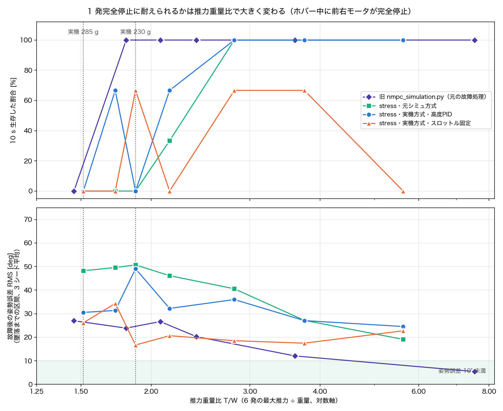

- 上段: 10 s 生き残った割合、下段: 故障後の姿勢誤差 RMS。点線は実機（285 g / 230 g）の T/W。
- **旧シミュ（紫）**: T/W 1.80 以上は全生存、1.46 で全滅。ただし姿勢誤差は T/W が下がるほど 5° → 20〜30° と悪化する。
- **新シミュ（青・緑・橙）**: 実機の T/W（1.5〜1.9）ではほぼ全滅。**T/W 2.8 以上（推力 1.5 倍）で高度 PID 方式は全生存**。
  ただし姿勢誤差は推力 3 倍でも 19〜26° 残る。
- 「スロットル固定」（橙）は推力を上げても落ちる。故障後のスロットルを「傾き 0 で釣り合う値」に固定しているので、
  傾いたままだと少しずつ沈むため。推力不足ではなく、この方式の限界。

### 2.2 旧シミュで推力・質量を変える

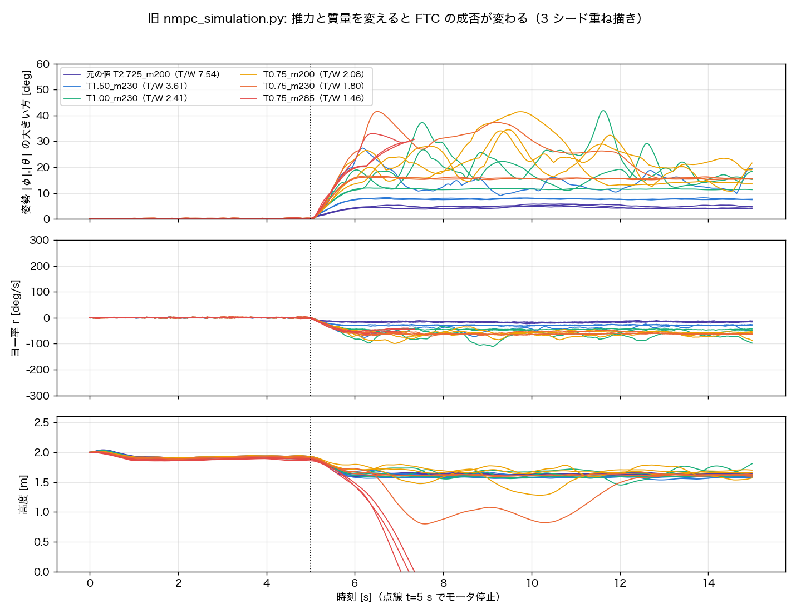

| T_max [N] | 質量 | T/W | 墜落 | 故障後の姿勢誤差 RMS | ヨー率の最大 | 最低高度 |
|---|---|---|---|---|---|---|
| 2.725（元の値） | 200 g | 7.54 | 0/3 | **5.1〜5.9°** | 19〜23 deg/s | 1.59 m |
| 1.50 | 230 g | 3.61 | 0/3 | 9.3〜17.7° | 33〜76 | 1.54 m |
| 1.00 | 230 g | 2.41 | 0/3 | 14.3〜24.9° | 50〜111 | 1.45 m |
| 0.75 | 200 g | 2.08 | 0/3 | 25.8〜27.4° | 76〜99 | 1.28 m |
| 0.75 | 230 g | 1.80 | 0/3 | 20.4〜30.9° | 67〜71 | 0.80 m |
| 0.75 | 285 g | 1.46 | **3/3** | — | — | 落下（故障から 2.0〜2.4 s） |

**旧シミュでも、推力と質量を実機に近づけると傾いたまま飛ぶようになり、285 g では落ちる。**

### 2.3 新シミュで推力・質量を変える

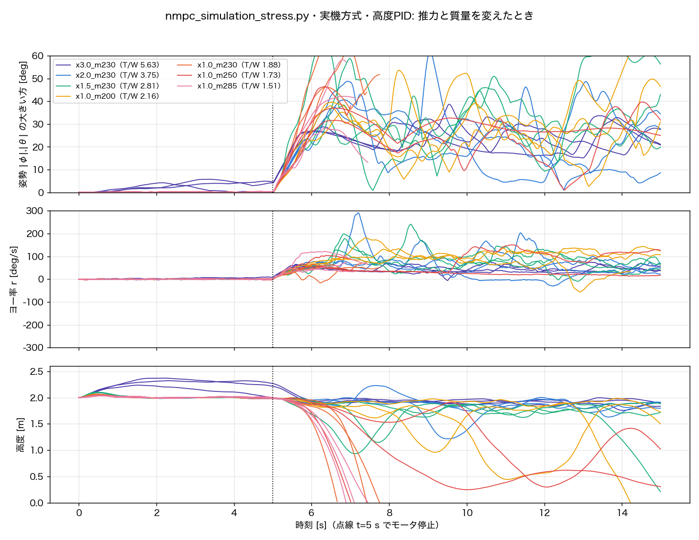

（実機方式・高度 PID、遅れ補償 DC6、悪条件なし）

| 推力倍率 | 質量 | T/W | 元シミュ方式 | 実機方式・高度PID | 実機方式・スロットル固定 |
|---|---|---|---|---|---|
| 3.0 | 230 g | 5.63 | 墜落 0/3（姿勢 19°） | 0/3（24〜26°） | 3/3（ゆっくり沈む） |
| 2.0 | 230 g | 3.75 | 0/3（27°） | 0/3（24〜31°） | 1/3 |
| 1.5 | 230 g | 2.81 | 0/3（40°） | 0/3（33〜41°） | 1/3 |
| 1.0 | 200 g | 2.16 | 2/3 | 1/3 | 3/3 |
| 1.0 | **230 g** | **1.88** | **3/3** | **3/3** | 1/3 |
| 1.0 | 250 g | 1.73 | 3/3 | 1/3 | 3/3 |
| 1.0 | **285 g** | **1.51** | **3/3** | **3/3** | **3/3** |

### 2.4 なぜ推力が効くのか

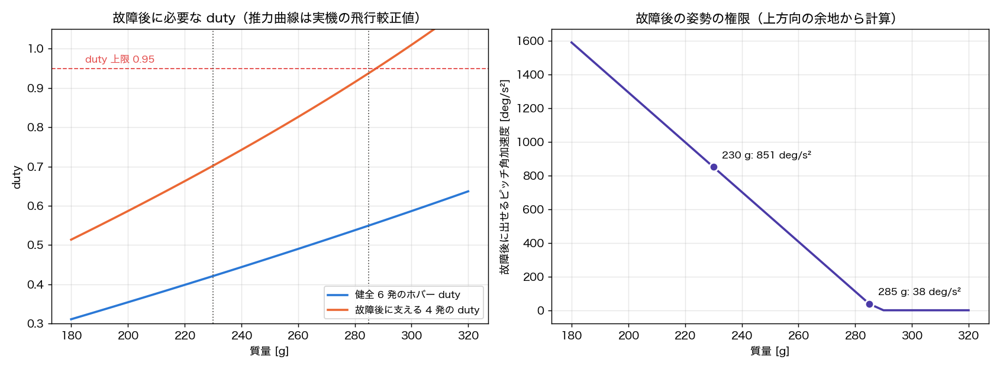

- 故障すると、支える 4 発が重量のぶんを全部持つ。**285 g では支える 4 発がホバーだけで duty 0.94**（上限 0.95）＝ 姿勢を直す余地がほぼ 0（ピッチ 38 deg/s²）。
- 230 g では duty 0.70 で余地 0.25、ピッチ 851 deg/s² まで出せる。それでも落ちる理由が次の図。

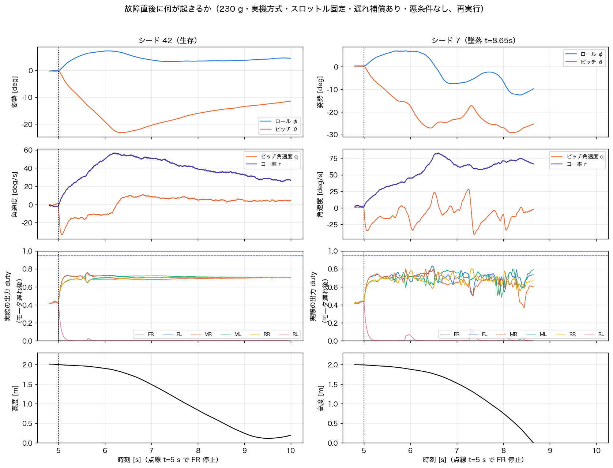

1. **故障の瞬間に機首が下がる**: FR の推力は瞬時に 0、残りはモータ遅れ 50 ms でしか追従しない → ピッチ角速度 −30 deg/s 前後。
2. **立て直しが弱い**: 4 発の duty の差を ±0.02〜0.04 しか使わない（余地 0.25 のうち 1 割程度。R_u=620 が大きい）。ピッチが 20〜30° まで倒れる。
3. **ヨーが回り出す**: 4 発でロール・ピッチを直すと必ずヨーモーメントが出る。Q_r=40 が弱いのでヨーが犠牲になり 50〜140 deg/s で回転。
   回りながら傾いているので、オイラー角ではロールの傾きがピッチへ移り続ける（θ̇ = q cosφ − r sinφ）。
4. **傾きで揚力が足りなくなる**: 20〜40° 傾くと落ちる。高度 PID は推力を上げて 4 発を 0.95 に張り付かせ、姿勢を直す余地が消える。

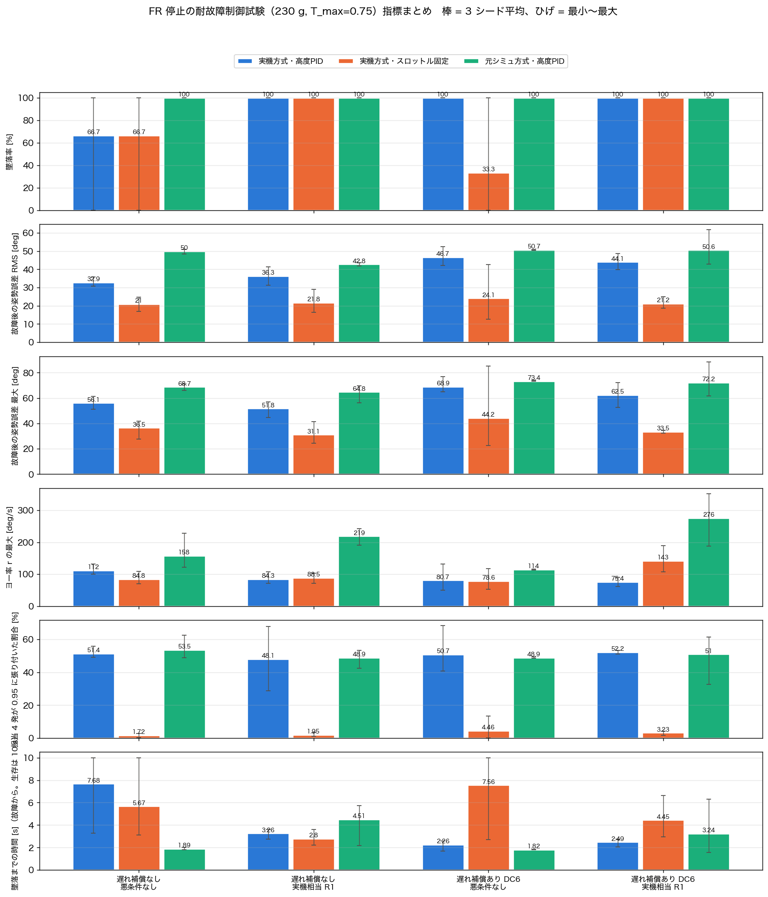

（230 g、遅れ補償なし／あり × 悪条件なし／実機相当 R1 × 3 方式 × 3 シード = 36 本。生存は 4/36 で、その 4 本も高度 1.1〜1.95 m 低下）

### 2.5 切り分け: 旧シミュの成功は何のおかげか

旧シミュの値から 1 項目ずつ新シミュの値へ入れ替えた（元シミュ方式・230 g 相当・遅れ補償なし・3 シード）。

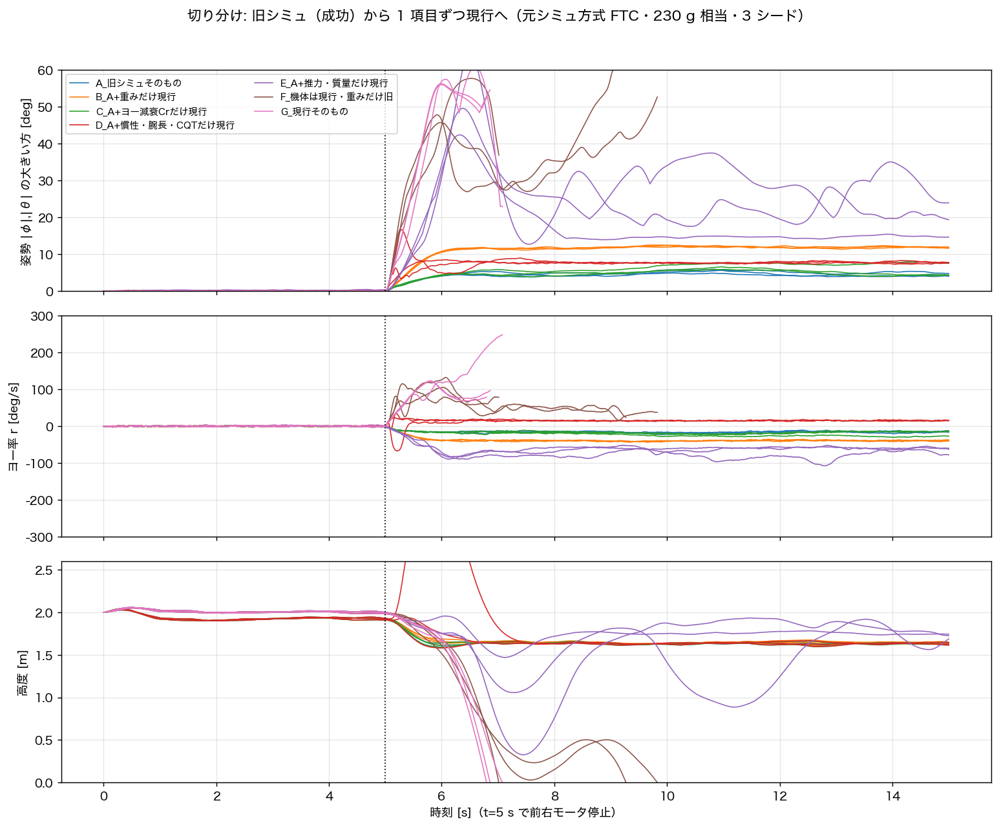

| 構成 | 墜落 | 姿勢誤差 RMS | 姿勢の最大 | 高度低下 |
|---|---|---|---|---|
| A 旧シミュの値そのもの | 0/3 | 5〜6° | 6〜7° | 0.3 m |
| B 重みだけ現行 | 0/3 | **16°（傾いたまま）** | 17° | 0.3 m |
| C ヨー減衰 Cr だけ現行 | 0/3 | 6〜8° | 7〜10° | 0.3 m |
| D 慣性・腕の配置だけ現行 | 0/3 | 8〜9° | 9〜22° | 0.3 m |
| **E 推力・質量だけ現行** | 0/3 | **23〜34°** | **46〜65°** | **0.5〜1.7 m** |
| **F 機体は全部現行・重みだけ旧** | **3/3** | 39〜46° | 56〜67° | 落下 |
| G 新シミュそのもの | **3/3** | 48〜51° | 69〜71° | 落下 |

- **推力・質量**を実機にすると際どくなり（E）、慣性・腕も実機にすると全滅（F）。→ 生き残れるかは**機体（推力の余裕）**で決まる。
- **重み**を実機にすると、旧機体でも 16° 傾いたまま（B）。→ 姿勢の質は**重み**で決まる。

### 2.6 耐故障制御のまとめ

- 手法（ソルバ・故障処理）の違いではなく、**機体の推力余裕**が成否を分けている。旧シミュの「1 発故障でも制御可能」は T/W 7.5 の機体での結果。
- 実機（T/W 1.5〜1.9）で静的 4 発の耐故障制御を成立させるには、少なくとも **T/W ≈ 2.8（推力 1.5 倍）**が要る（新シミュ・高度 PID 方式）。
  それでも健全用の重みのままでは 20〜40° 傾く。
- 既存の記録の結論「回転を許して対角のモータも使う relaxed hover が唯一の道」（`20260916_relaxed_hover_is_now_the_only_path_and_cr_is_step0.md`）と矛盾しない。

---

## 3. 健全飛行: シミュは飛べて実機は落ちる

### 3.1 前提

- 実機の NX=5 版も**健全なホバーは約 20 s できている**（0916_v1: 21 s フェイルセーフなし、0919_v5）。
- 落ちたのは、操縦入力・貨物・上限への張り付きが重なったとき（0919_v8）、ガードの不具合（0919_v6/v7、修正済み）、NX=8 版（0920）。
- 新シミュの健全飛行は、悪条件（計算遅延・再構築中の指令保持・ジャイロバイアス）を入れても安定している。

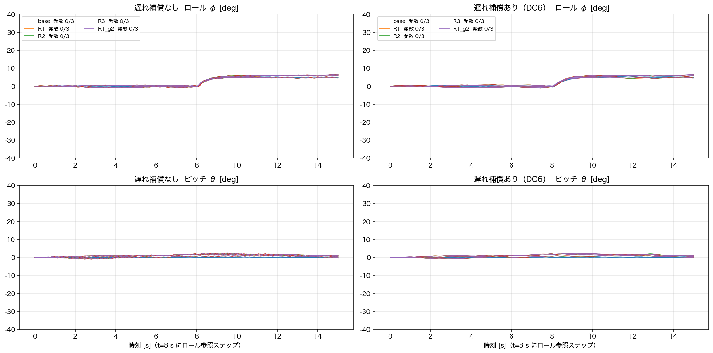

（NX=5/N=14、実機パラメータ、t=8 s にロール 5° ステップ、30 本すべて安定）

### 3.2 実機にある要素を 1 つずつ足しても落ちない

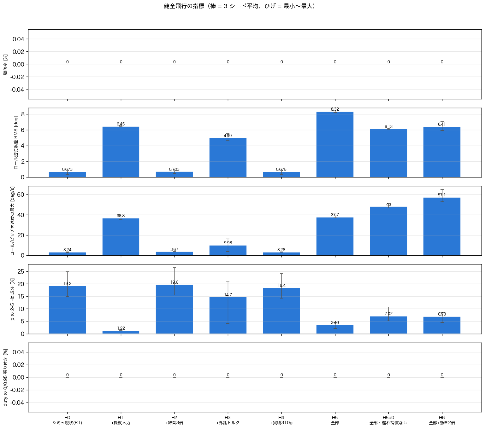

| 足した要素 | 墜落 | 上限張り付き |
|---|---|---|
| 操縦入力（ロール ±15〜20°、ピッチ ±10° のステップ。0919_v8 の操縦相当） | 0/3 | 0 % |
| ジャイロ雑音 3 倍 | 0/3 | 0 % |
| 一定の外乱トルク（左側推力 3 % 不足、ヨー残留トルク約 10 deg/s²） | 0/3 | 0 % |
| 貨物 310 g | 0/3 | 0 % |
| 全部／全部・遅れ補償なし／全部＋効き 2 倍 | 0/9 | 0 % |

### 3.3 揺れの大きさを実機に合わせても落ちない

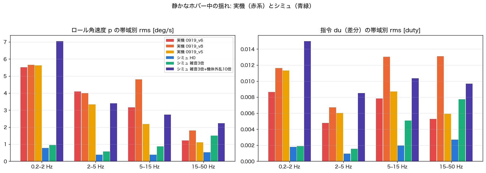

- 静かなホバーのロール角速度 rms は **実機 7.0〜8.6 deg/s に対してシミュ 1.2 deg/s**（6〜7 倍の差）。全帯域で実機が大きい。
- シミュの機体外乱を **10 倍**、ジャイロ雑音を 3 倍にすると、揺れの大きさ（8.6 deg/s）・帯域の内訳・指令の rms（0.025）まで実機と一致した（紫）。

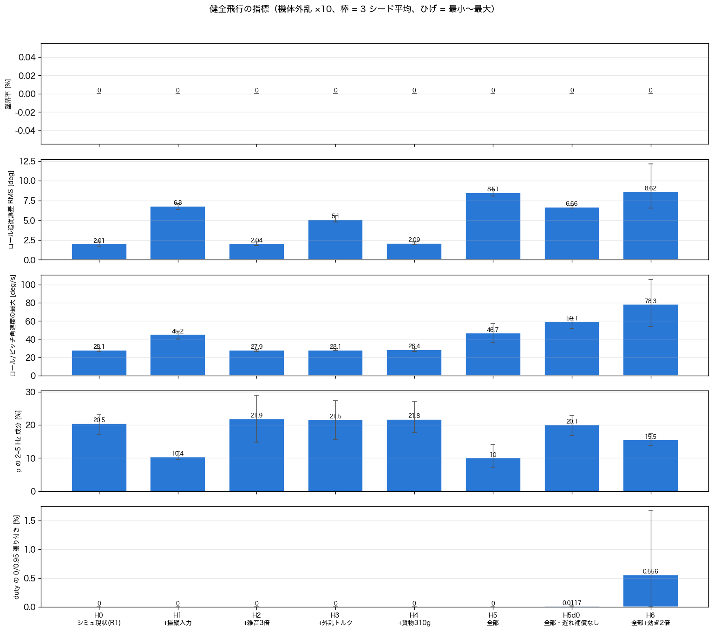

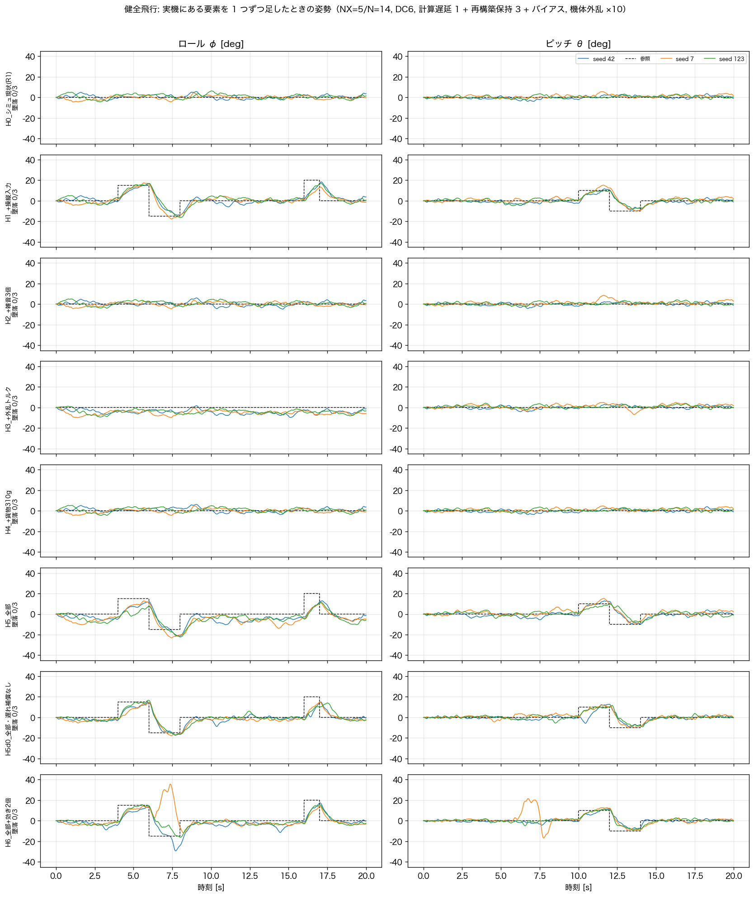

この「実機並みに揺れるシミュ」でも **墜落 0/24、上限張り付き 0〜1.7 %**。
実機 0919_v8 では、7.7° のロール指令だけで FR が 0.95 に張り付いている。

### 3.4 唯一残った違い: 実機だけに出る指令のスパイク

| | 指令の rms | 指令の最大 |
|---|---|---|
| 実機 0919_v5 / v6 / v8 | 0.015〜0.025 | 0.13 / 0.15 / **0.32** |
| 揺れを合わせたシミュ | 0.025 | 0.11 |

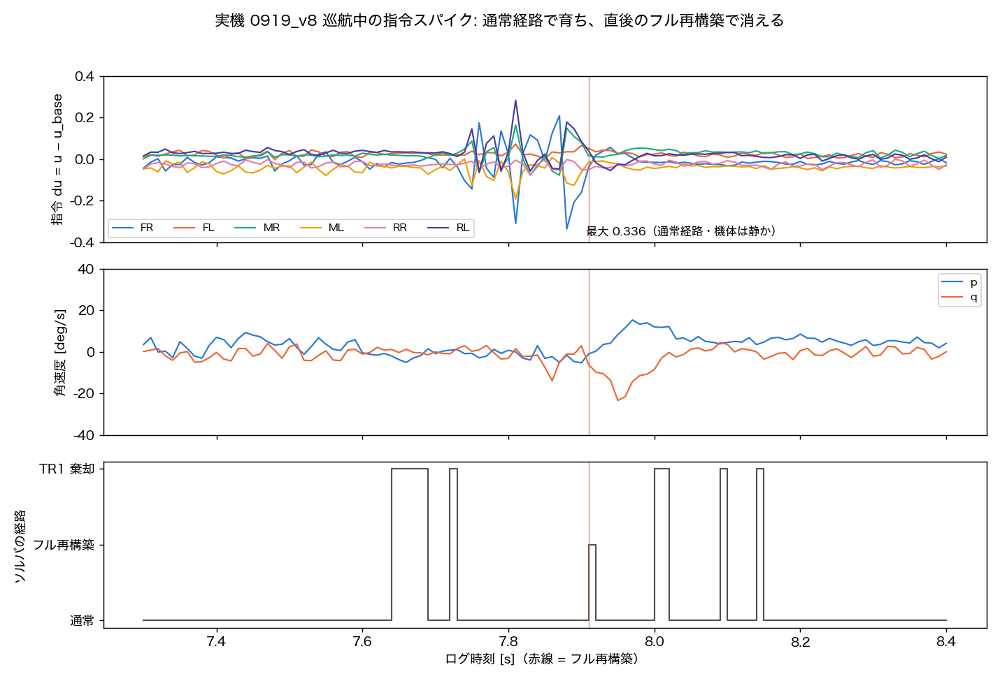

- 機体は静か（p, q とも数 deg/s）なのに、**TR1 更新が 5 周期続けて棄却された直後から**、通常経路で指令が暴れ始めた。
- 0.04 → 0.34 と育ち、**フル再構築で 0.05 に戻った**。再構築の直後には解が跳んで、実際にピッチ角速度が −23 deg/s まで振れている。
- → 「近似行列（Su・Hessian）が古いままずれていき、正確に作り直すと直る」形。🔶

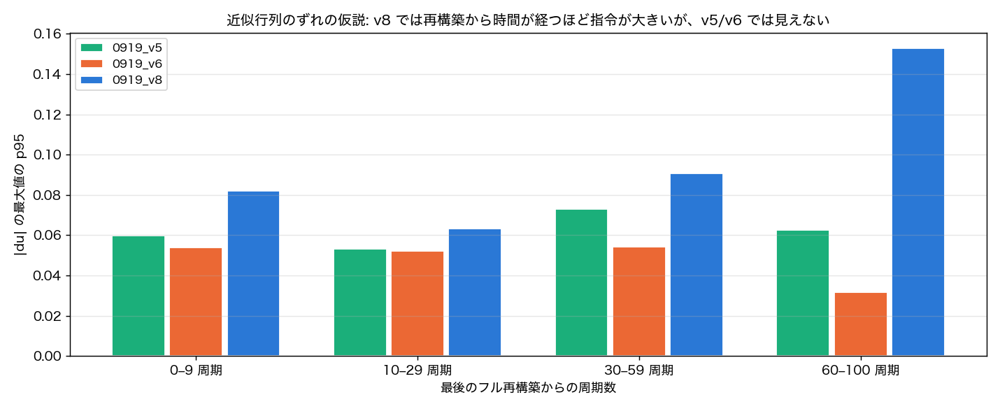

- 0919_v8 では、最後の再構築から時間が経つほど指令が大きい（p95 0.06 → 0.15）。**v5/v6 では見えない**ので仮説のまま。

### 3.5 シミュに無くて実機にあるもの（原因候補）

| 候補 | 根拠 | シミュの現状 |
|---|---|---|
| **ソルバの数値計算と運用** 🔶 | v8 のスパイクが TR1 棄却の直後に始まり再構築で消える。v8 巡航の 20.8 % が棄却周期 | 倍精度、棄却したら即再構築（古い行列で走らない） |
| **姿勢推定器（EKF）** | 過去に「偽の傾き」で何度も墜落 | 真の値＋白色雑音 |
| **人間の操縦ループ（PIO）** | v8 の発散中、操縦入力が ±13〜20° で振動に同期 | 決め打ちのステップ |
| **地上からの離陸** | 離陸ゲート・EKF 再初期化の不具合履歴 | 高度 2 m の空中から開始 |

### 3.6 次の一手

1. **SIL に揺れを合わせたプラントをつなぐ**: `program/sil/` は実機と同じ C/C++ ソース（control.cpp・ekf.cpp・nmpc.cpp）を PC で動かす環境。
   ここに 3.3 の「実機並みに揺れるプラント」をつなげば、ソルバの単精度・TR1 棄却の運用・EKF を実物のまま試せる。
   （SIL が現行の Benzen_NMPC を今もビルドできるかは未確認）
2. **実機ログに「再構築直前と直後の解の差」を出す**: 近似のずれを直接測れる。
3. 耐故障制御は、推力を増やす（T/W 2.8 以上）か、relaxed hover のように余裕が小さくても成り立つ方式へ。

---

## 4. 前提と限界

- 故障は**推力の瞬時消失**（最悪側）。故障の認識は瞬時（スイッチ相当）。
- Q・R は健全飛行用の値のまま（耐故障用に調整していない）。
- 新シミュで推力を上げた条件では、NMPC モデルの T_max も同じ倍率にした（強いモータを積んだら同定し直す想定）。
- 不安定な条件の数値は実行ごとにずれる（カオス的）。結論は「墜落したか・しないか」の水準で読むこと。
- シミュの機体外乱 10 倍は、揺れの統計を実機に合わせるための較正で、外乱の正体（気流・プロペラ・振動）は特定していない。

---

## 5. 再現方法とファイル

すべて `program/NMPC_simulation/` で実行する（Python は `.venv/bin/python`、`MPLBACKEND=Agg`）。

| 内容 | コマンド / 場所 |
|---|---|
| T/W を振った耐故障試験（2.1〜2.3） | `img/20261006_ftc_tw_sweep/run_head.py`、`run_stress.py` → `build_figs.py <出力先>` |
| 230 g の耐故障試験（2.4） | `nmpc_simulation_stress.py --suite ftc --mass 230 --seeds 42,7,123 --throttle both` → `img/20261006_134203/` |
| 切り分け（2.5） | `img/20261006_ftc_ablation/ablation.py` |
| 健全飛行・遅れ補償の比較（3.1） | `nmpc_simulation_stress.py --seeds 42,7,123` → `img/20261006_130333/` |
| 健全飛行の要素追加・揺れの較正（3.2〜3.3） | `img/20261006_healthy_realism/realism.py`、`calib.py`、`real_vs_sim.py`（機体外乱の倍率は環境変数 `PROC_K`） |
| 図（本資料） | `docs/figs/20261006_report/` |

関連する記録（`docs/ai/decisions/`）: `20261006_ftc_sim_230g_falls_due_to_yaw_spin_and_altitude_loop.md`、
`20261006_sim_flies_real_crashes_gap_is_in_controller_internals_not_physics.md`、
`20261006_revert_to_nx5_n14_and_sim_matched_dc0_vs_dc6.md`、`20261006_sim_vs_firmware_solver_and_ftc_formulation_diff.md`。
