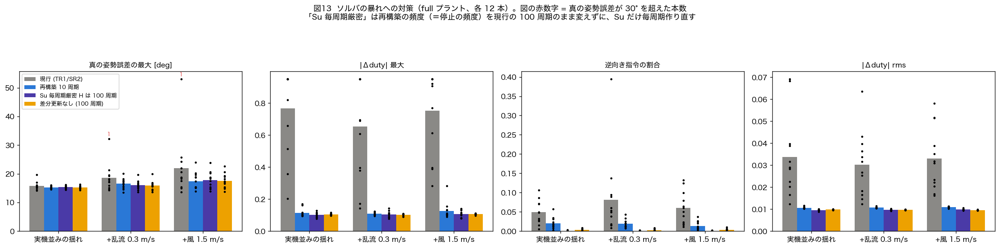
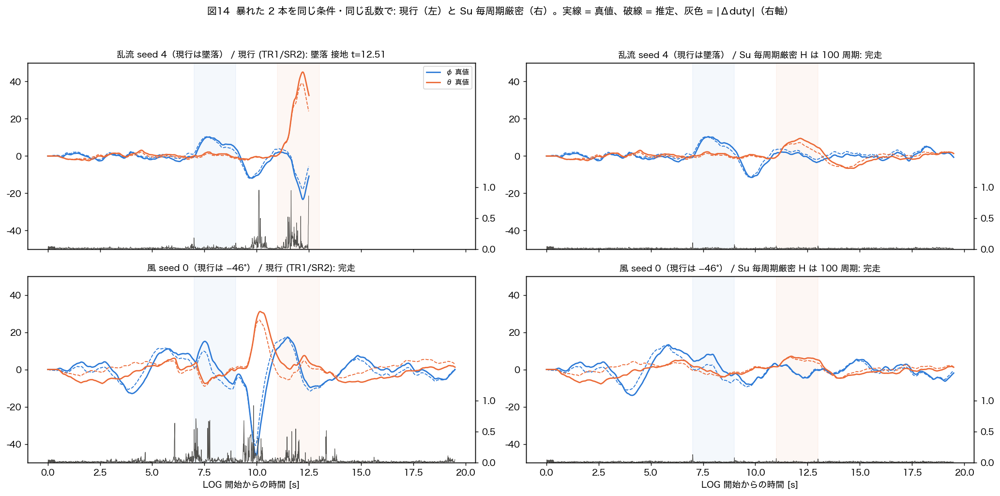
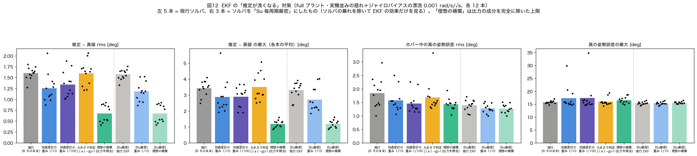

# EKF のずれとソルバの暴れの対策: SIL での比較

- **日付**: 2026-10-08
- **前提**: `docs/20261008_plant_shake_report.md`（実機並みに揺らした新プラントの SIL）
- **方法**: 実機ファーム `Benzen_NMPC` の**複製**に比較用スイッチ（`SIL_SOLVER_VARIANT`, `SIL_EKF_RSCALE`, `SIL_EKF_GATE`）を入れて SIL でビルド。
  スイッチ OFF の複製は実機ファームと**ビット単位で同じ結果**になることを確認した。**実機ファームは変更していない。**
- **条件**: full プラント（6 自由度・抗力・ブローバック）、実機並みの揺れ（shake）。EKF の比較だけジャイロバイアスの漂流 0.001 rad/s/√s を足した（shake_b）。各 12 本。
- **結果一式**: `program/sil_nmpc/results/20261008_fix/`、図 `docs/figs/20261008_fix/`

---

## 0. 要約

| 問題 | 原因（今回わかったこと） | 効いた対策（SIL） | 効かなかった・不要な対策 |
|---|---|---|---|
| **ソルバの暴れ**（逆向き全開指令、30° 超の崩れ） | **TR1/SR2 の差分更新そのものが Su/H を壊している**（更新をやめるだけで消える） | **Su を毎周期厳密に作り直す**（H は現行どおり 100 周期ごと）: 逆向き指令 5–8 % → **0.05 %**、跳び 0.65–0.77 → **0.10**、30° 超 2/36 → **0/36** | — |
| **EKF のずれ**（推定が浅い） | 加速中は重力と運動の加速度が同じ量ずつ各軸に分配されて打ち消し合い、加速度計が傾きを見られない | 加速度計の重みを 1/10: rms 1.57° → 1.18°（−25 %） | 加速度の大きさで判定（効果なし。大きさは 1.035–1.045 g しか変わらない）／重み 1/100（1/10 と同等で、ジャイロバイアスに弱くなる） |
| **垂れ**（傾きを保てない） | ブローバック（物理）。EKF のずれとは別物 | 今回は試験していない（§4 に候補） | 姿勢誤差の積分（0911 に実機で全指標悪化として却下済み） |

**優先順位の提案**: ① ソルバ（Su 毎周期厳密化）→ ② EKF の重み調整（小さな改善）→ ③ 垂れ（操縦性の問題として別途）。
墜落に直結しているのは①で、②③は飛びやすさの問題。

---

## 1. ご質問への答え: 加速度計は傾きに応じて各軸に分配されるのでは？

**分配されます。ただし横へ加速している間は、重力と「運動の加速度」の両方が同じように分配されて、横成分が打ち消し合います。**
加速度計が測るのは比力 = 運動の加速度 − 重力なので、差が残るのは抗力の分だけです。

ロール 15°・高度一定のときの機体 y 軸（右向き）成分（`plant6dof` で計算）:

| 状況 | 重力の y 成分 | 運動の加速度の y 成分 | 加速度計（比力）の y | 加速度計だけで見た傾き | 加速度の大きさ |
|---|---|---|---|---|---|
| 加速し始め（速度 0） | +2.54 | +2.54 | **0.00** | **0°**（真 15°） | 1.035 g |
| 速度 2 m/s | +2.54 | +1.87 | −0.67 | 3.8° | 1.035 g |
| 速度 4 m/s | +2.54 | +1.05 | −1.49 | 8.4° | 1.037 g |
| 終端速度 5.9 m/s（加速が終わる） | +2.54 | 0.00 | −2.54 | 14.3° | 1.045 g |

- 推力は機体の真下方向（機体 z）にしか働かないので、抗力が無ければ比力は**常に機体 z 方向だけ**＝加速度計は「水平」と答える。
- ジャイロは傾きに関係なく角速度を正しく測る。EKF はジャイロの積分（正しい）を、加速度計（加速中は水平寄り）で少しずつ引き戻すので、推定は真値と「水平」の間に来る。
- 加速度の**大きさ**は 1.035–1.045 g しか変わらず、実機の振動による揺れ（std 0.7 m/s² ≈ 0.07 g）に埋もれる → 大きさで判定する案が効かない理由。

## 2. ソルバの暴れ（図 13, 14）



各 12 本 × 3 条件（実機並みの揺れ / ＋乱流 0.3 m/s / ＋風 1.5 m/s）:

| ソルバ | 逆向き指令 | |Δduty| 最大 | |Δduty| rms | 真の姿勢誤差の最大（最悪） | 30° 超 | 再構築による停止 |
|---|---|---|---|---|---|---|
| 現行（TR1/SR2 で差分更新、100 周期で再構築） | 4.9–8.1 % | 0.65–0.77 | 0.030–0.034 | 15.8–21.9°（53°） | 2/36 | 1 % の周期 |
| 再構築 10 周期 | 1.4–2.1 % | 0.11–0.13 | 0.011 | 15.3–17.5°（24°） | 0/36 | **10 % の周期**（30 ms ずつ） |
| **Su 毎周期厳密・H は 100 周期** | **0.05 %** | **0.10–0.11** | **0.010** | 15.3–17.8°（24°） | **0/36** | 1 %（現行と同じ） |
| 差分更新なし（100 周期で再構築するだけ） | 0.3 % | 0.10–0.11 | 0.010 | 15.3–17.5°（23°） | 0/36 | 1 %（現行と同じ） |



**読み取り**
- **「差分更新なし」が現行より桁違いに良い。** 前回は「再構築の間隔が長いほど悪い」ことから「近似が古くなるのが原因」と考えたが、
  古いまま何もしない方が良いので、**原因は古さではなく TR1/SR2 の更新が Su/H を壊すこと**と絞り込めた（前回の解釈を訂正）。
  再構築間隔の用量反応は「壊れた Su/H を洗い流す頻度」を見ていた。
- コードから読める機構（**推測**）:
  - TR1 は「状態の変化 s_x と入力の変化 s_u をまとめた 1 本の割線」で Sx と Su を同時に直す。雑音で x0 が毎周期揺れると、s_x 由来の残差が Su にも書き込まれる。
  - Su は本来ブロック下三角（未来の入力は過去の状態に効かない）だが、ランク 1 更新は**上側ブロックを埋める**（nmpc.cpp のコメントにも明記）。ソルバは「後の入力で今の状態を動かせる」と誤認しうる。
  - SR2 はその Su の変化に合わせて Cholesky を 2 回 rank 更新するので、float32 の誤差も積もる。
- **Su 毎周期厳密化**は、勾配（コストの向き）を毎周期正しい Su で作るので、逆向きの解が出ない。H は最大 1 秒古いが、正定値なので解の向きは保たれる（準ニュートン法で「勾配は厳密・ヘシアンは近似」の形）。
- 再構築 10 周期は効くが、停止の頻度が 10 倍になる（実機で 10 % の周期が 30 ms 止まる）。Su 毎周期厳密化は停止頻度を変えない。

### 計算量の見積もり（N=14, NX=5, NU=6。積和の回数、概算）

| 処理（毎周期） | 現行 | Su 毎周期厳密 | 差分更新なし |
|---|---|---|---|
| 非線形ロールアウト | 約 0.7 k | （Su 作成に含む） | — |
| TR1（残差・Sx/Su のランク 1 更新） | 約 12.6 k | — | — |
| SR2（Suᵀ Q u・Cholesky の rank 更新 ×2） | 約 20 k | — | — |
| Sx/Su の作り直し（ヤコビアン 14 回＋ブロック積） | — | 約 18 k | — |
| 定数項・ADMM 4 反復・線形予測 | 約 40 k | 約 40 k | 約 40 k |
| **合計** | **約 74 k** | **約 58 k（−20 %）** | **約 41 k（−45 %）** |

（⚠ 見積もり。実機の `iter_us` は平均 7 ms で、比例すれば Su 毎周期厳密は約 5.5 ms。**ベンチモードで実測が必要**。SIL は仮想時間なので測れない。）

→ **計算が増えるどころか減る**見込み。周期 10 ms への収まり（`repository_rules.md` §5 の未解決 1）にも有利。

## 3. EKF のずれ（図 12）



ジャイロバイアスの漂流 0.001 rad/s/√s を足した条件（加速度計の重みを下げるとバイアスを直しにくくなるので、その代償も含めて比べる）。

| EKF | ソルバ | 推定 − 真値 rms | 推定 − 真値の最大 | ホバー中の真の誤差 rms |
|---|---|---|---|---|
| 現行 | 現行 | 1.60° | 3.4° | 1.84° |
| 加速度計の重み 1/10 | 現行 | 1.26° | 2.9° | 1.57° |
| 加速度計の重み 1/100 | 現行 | 1.34° | 2.9° | 1.46° |
| 大きさで判定（\|‖a‖−g\| > 1 m/s² で重み 1/100） | 現行 | 1.60° | 3.5° | 1.68° |
| 理想の補償（比力を完全に除去・上限） | 現行 | 0.68° | 1.2° | 1.43° |
| 現行 | **Su 毎周期厳密** | 1.57° | 3.3° | 1.39° |
| **加速度計の重み 1/10** | **Su 毎周期厳密** | **1.18°** | **2.7°** | **1.27°** |
| 理想の補償 | Su 毎周期厳密 | 0.68° | 1.2° | 1.27° |

- **重み 1/10 で −25 %**。1/100 にしても良くならない（ジャイロバイアスを直す力が落ちる分と相殺）。
- **大きさで判定する案は効果なし**（§1 のとおり、加速中も大きさがほとんど変わらない）。
- 理想の補償でも 0.7° までしか下がらず、ホバー中の真の誤差は 1.27° で変わらない（残りは揺れそのもの）。
- 現行ソルバで重みを下げた版に 30° 前後の崩れが 2 本あったが、崩れ始めの推定のずれは 3° 以下で、box 5–6 本張り付き・|Δduty| 0.8–0.95 の**ソルバの暴れ**だった（Su 毎周期厳密では 0）。
- ⚠ 漂流を 0.003 rad/s/√s にすると、離陸前に EKF の残差が 1 deg/s を超え、**ファームの離陸ゲートが 12 本中 3 本で離陸を拒否**した。実機ではゲートは毎回開いているので、実機の漂流はこれより小さいとみて 0.001 にした。

### 根本的な補償（理想の補償に近づける方法、未試験）

加速度計の横成分が測っているのは「重力」ではなく**抗力 ≈ −k·速度**である（小型マルチコプタの加速度計モデル。Leishman ら 2014 などで知られる）。
- **抗力モデル付き EKF**: EKF に機体の水平速度 (u, v) を状態として足し、加速度計 x/y の観測式を「−k u, −k v」にする。傾きは「推力方向と重力の差」から、速度は加速度計から推定できる。
  NMPC の状態（姿勢 5 次元）は変えずに済む（研究の主張と衝突しない）。係数 k（ロータ抗力）の同定が前提。
- **簡易版**: 推力方向（機体 z）成分を除いた残り（x/y）が小さいときだけ重力として使う、などの重み付け。今回の「大きさで判定」と同じく、加速度が 1 g 付近に留まる限り判別は難しい。

**ただし優先度は低い**: EKF のずれは rms 1.2–1.6°、最大 3° 程度で、単独では墜落しない（前回の資料）。墜落に直結するのはソルバの暴れ。

## 4. 垂れ（参考: EKF のずれとは別物）

「垂れ」は**真の姿勢**が戻される現象（ブローバック）で、推定のずれではない（Su 毎周期厳密・EKF 改善のどちらでも残る: ロール 15° の 2 s 後で参照の 5–13 %）。

| 候補 | 状態 |
|---|---|
| 姿勢誤差の積分（トリム） | **0911 に実機で却下済み**（速度比例の外乱は有限のトリムでは消えず、全指標悪化。`20260911_ulin_guard_and_revert_to_v10_for_ftc.md`）。再提案しない |
| 外乱トルクの推定と打ち消し（オフセットフリー MPC: 予測モデルに一定外乱 d を入れ、ジャイロの角加速度と指令トルクの差から d を推定） | **未試験の新案**。積分と違い「誤差を溜める」のではなく毎周期トルクそのものを推定するので、速度とともに育つ外乱にも追従しうる。条件数・雑音への感度は要検証 |
| 速度推定によるフィードフォワード（上の抗力モデル付き EKF で速度が得られれば、ブローバックのモーメントを予測して先に打ち消す） | 未試験。EKF 改善と同じ速度推定を使える |
| 運用（大きな傾きを長く保たない、操縦者の慣れ） | 0911 の当面の手 |
| 機体側（重心をロータ面に近づける。吊り下げ貨物はモーメント腕を伸ばすので悪化の向き） | 物理的にはブローバックのモーメント腕を短くする方向。未検証 |

## 5. 次の一手（提案）

1. **Su 毎周期厳密化を実機ファームに入れる前の確認**（実装は `nmpc_step` の差分更新部分を `full_rebuild_sx_su(ctx, x0, U_lin)` に置き換える数行。SIL の複製で動作確認済み）:
   - ベンチモードで `iter_us` を測る（見積もりは −20 %）。
   - 地上（離陸ゲート前）とホバーで、ログの逆向き指令・|Δduty| を現行と比べる。
   - 再構築周期（100）と `tr1_skip_max_run` 周りの分岐は不要になるが、まずは残したまま切り替えスイッチで比較できるようにする。
2. EKF の加速度計の重みを 1/10 にする案は小さな改善。上と同時に変えると効果が切り分けられないので、**1 の後に単独で**試す。
3. 垂れは、オフセットフリー MPC（外乱推定）を SIL で先に試す価値がある。

## 6. 限界

- SIL の再構築中の停止は近似（出力を凍らせるだけ）。
- ソルバ変種の計算時間は見積もり。実機で測っていない。
- 抗力・ブローバック係数は未同定。
- ジャイロバイアスの漂流の大きさは実機で測っていない（離陸ゲートの挙動から上限を推定しただけ）。
- 実機で記録された「バースト」（0910_v5/v6、ホストで再現できなかった）が今回の SIL の暴れと同じものかは未確認（型は同じ: 推定は正常で box 全開の逆向き指令）。

## 7. 再現手順

```bash
# ファーム複製に比較用スイッチを入れる（scratchpad で実施。手順は results/20261008_fix/README.md）
cmake -S program/sil_nmpc -B <dir> -DFW_DIR=<複製> -DCMAKE_BUILD_TYPE=Release -DCMAKE_CXX_FLAGS="-DSIL_SOLVER_VARIANT=1"
cd program/sil_nmpc/host
python3 run_jobs.py ../results/20261008_fix/jobs.txt -j 6         # ソルバ比較（ジョブ内の SIL_BUILD_DIR を自分の環境に）
python3 run_jobs.py ../results/20261008_fix/jobs_ekf.txt -j 6
python3 run_jobs.py ../results/20261008_fix/jobs_combo.txt -j 6
cd ../results/20261008_fix && <matplotlib のある python> analyze_fix.py ../../../../docs/figs/20261008_fix
```
