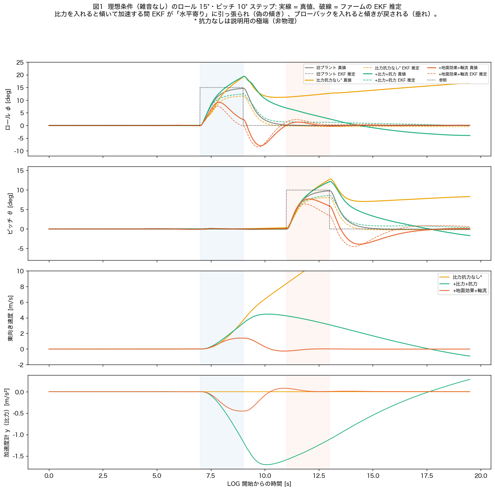
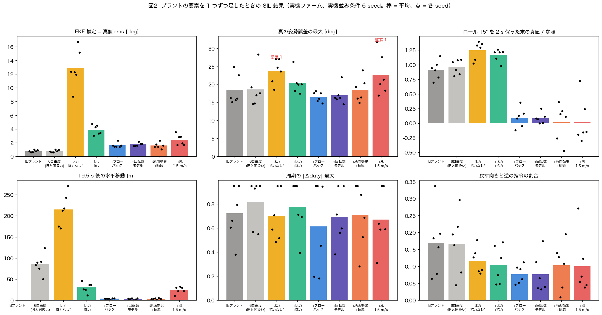
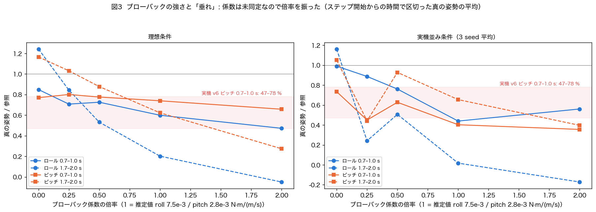
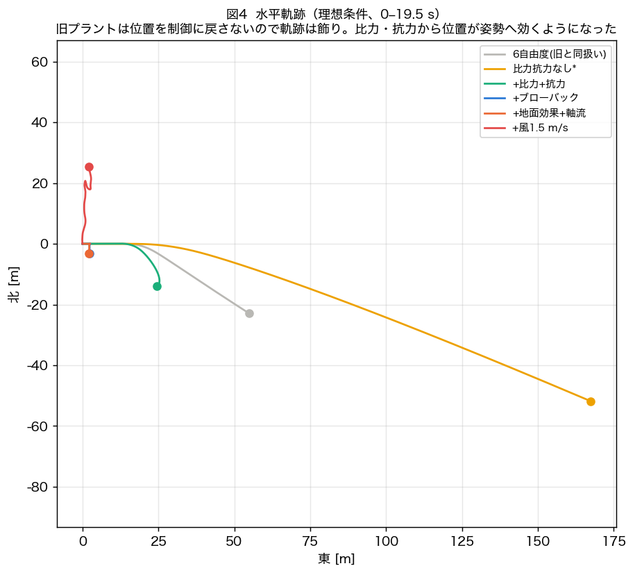
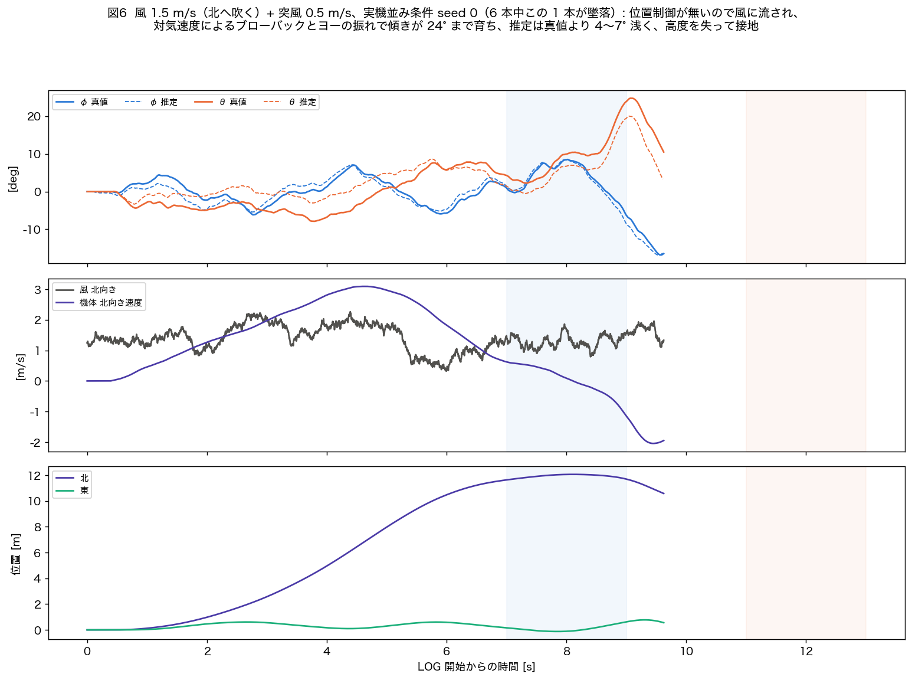
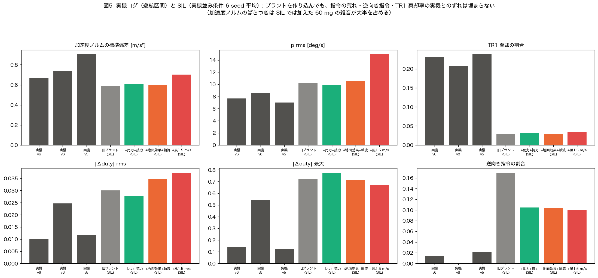
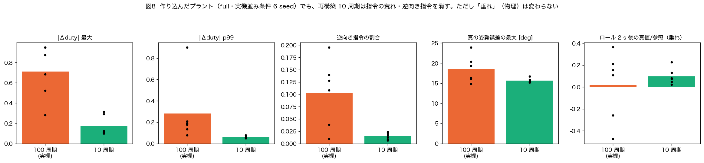
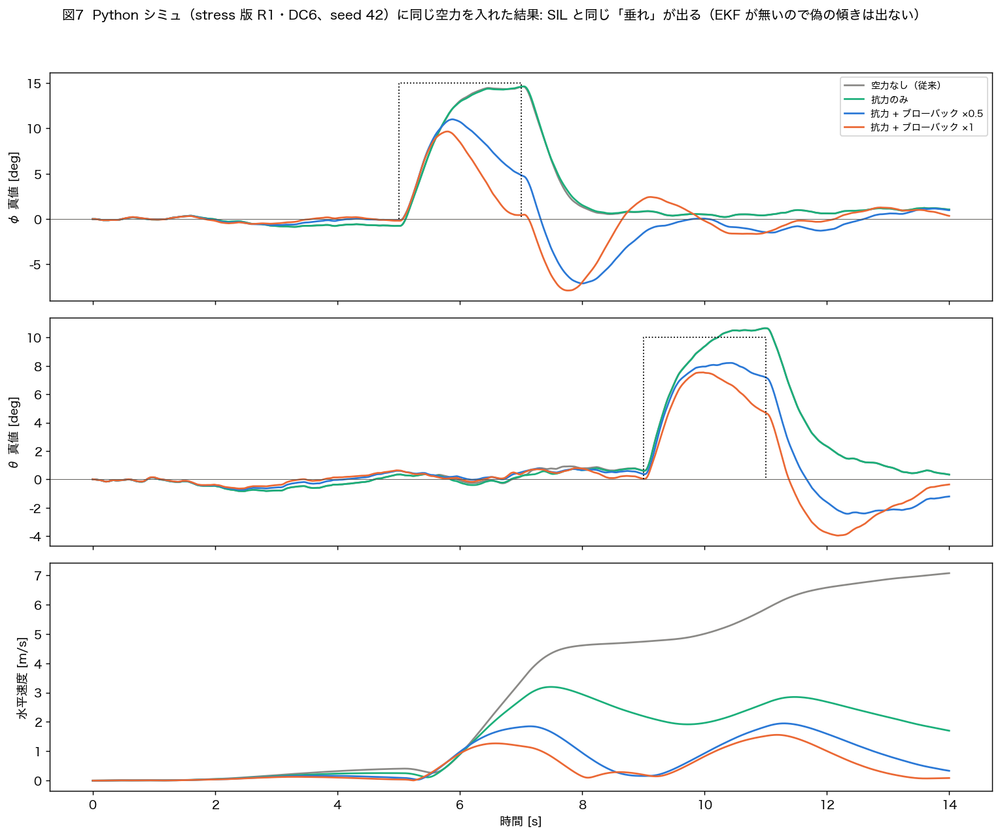

# プラント（世界モデル）の作り込み: 6 自由度・空力・比力加速度計を入れた SIL / シミュの結果

- **日付**: 2026-10-08
- **実装**: `program/sil_nmpc/host/plant6dof.py`（SIL）、`program/NMPC_simulation/nmpc_simulation_stress.py` の PKG-E10（Python シミュ）
- **試験**: `program/sil_nmpc/host/test_plant6dof.py`（16 項目すべて合格）
- **結果一式**: `program/sil_nmpc/results/20261008_plant/`、`program/NMPC_simulation/img/20261008_aero/`、図 `docs/figs/20261008_plant/`
- **ファーム**: `Benzen_NMPC`（NX=5, N=14, DC6）を**無改造**で SIL ビルド。プラントだけを変えた。

## 0. 要約

1. **プラントを 6 自由度化し、並進と姿勢・センサを連成させた。** 添付資料の機体座標の並進式・クォータニオンによる位置変換に加え、
   モータ回転数の一次遅れ・ロータ慣性、形状抗力・ロータ抗力、**ブローバック（速度安定）**、地面効果・軸流、風、
   **加速度計を比力にする**ことを入れた。全部 OFF で旧プラントに一致する（回帰確認済み）。
2. **SIL の飛行結果は大きく変わった。** 変わったのは主に次の 2 つで、どちらも実機で報告されていたのに旧プラントでは原理的に出なかった現象。
   - **EKF の偽の傾き**（比力）: 傾いて加速している間、加速度計は推力の向き＝機体の真下しか見ないので、EKF が「水平寄り」に引っ張られる。
     推定誤差 rms は旧 0.8° → 比力＋抗力で 3.9°（最大 7°）。ロール 15° を 2 s 保った末（1.7–2.0 s 平均、実機並み条件 6 本）で**真の傾きは 17.5° なのに推定は 12°**（図 1, 2）。
   - **ブローバックによる「垂れ」**: 速度が乗るとロール/ピッチが戻される。推定値（実機回帰の換算）ではロール 15° が 2 s で**ほぼ 0° まで戻され**、
     ピッチ 10° は 56–66 % に留まる（図 1, 2）。抗力・ブローバックがあると偽の傾きは 1.6° 程度に縮む（横向きの比力が出るため）。
3. **風（1.5 m/s＋突風）で 6 本中 1 本が墜落した**（旧プラントでは 0/6）。位置制御が無いので風に流され（20 s で 25 m）、ブローバックとヨーの振れで傾きが 24° まで育ち、高度を失った（図 6）。
4. **一方で、ファームのソルバに由来する問題（指令の跳び・逆向き指令）はプラントを作り込んでも変わらない**（図 2, 5）。
   前回の結論「フル再構築 10 周期ごとにすると指令の荒れが消える」は作り込んだプラントでも成り立った（|Δduty| 最大 0.71 → 0.18、逆向き指令 10 % → 1.5 %、図 8）。
   **実機との最大の不一致である TR1 棄却率（実機 21–24 % vs SIL 3 %）も、プラントを作り込んでも埋まらなかった。**
5. Python シミュ（stress 版）に同じ空力を入れると、SIL と同じ「垂れ」が出た（ロール 2 s 後 0.03、ピッチ 0.51、図 7）。EKF が無いので偽の傾きは出ない。
6. ⚠ **抗力・ブローバック・ロータ慣性の係数は未同定の推定値**。特にブローバックは結果を大きく左右する（図 3）。実機の傾け試験で同定するのが次の一手。


---

## 1. 何を足したか

### 1.1 旧プラントの限界

| | 旧 SIL プラント（`plant.AttitudePlant`） | Python シミュ（stress 版） |
|---|---|---|
| 姿勢 | オイラー角で積分 | オイラー角 |
| 並進 | **可視化のために開ループで積分するだけ**（姿勢・センサへ戻らない） | NED の z, w と x, y, 速度（抗力なし） |
| 加速度計 | **重力の向きだけ**（機体がどう加速していても 1 g が「下」を指す） | なし（状態にほぼ直接雑音を足して観測） |
| 速度 → 姿勢 | なし | なし |
| モータ | duty の一次遅れ 50 ms | duty の一次遅れ |

**旧 SIL は「傾いて横へ加速する」ことが姿勢推定にも姿勢にも一切効かない世界**だった。
実機では次の 2 つが観測されているが、旧プラントでは原理的に再現できない。

- **速度安定（ブローバック）による「垂れ」**: 傾けて速度が乗るほど傾きを戻すモーメントが増える（`20260911_v8v9_ru_up_loses_stiffness_droop_is_speed_stability.md`。θ_ref 10° に対し 0.7–1.0 s で 47–78 % まで垂れる）。
- **EKF の偽の傾き**: 機体が約 20° 傾いたまま横滑りし、推定は水平寄りを示した（`20260910_v10_delay_comp_removed_4hz_ekf_lean_remains.md`）。

### 1.2 新しいプラント（`Plant6DOF`）

状態 19 次元: 位置 NED(3) ・ 機体速度 u,v,w(3) ・ クォータニオン(4) ・ 角速度 p,q,r(3) ・ モータ回転数(6)。400 Hz の 1 tick を RK4 で 2 分割して積分。

**並進（添付資料の式そのもの。機体座標）**

$$m(\dot u + qw - rv) = -mg\sin\theta + F_x,\quad m(\dot v + ru - pw) = mg\cos\theta\sin\phi + F_y,\quad m(\dot w + pv - qu) = mg\cos\theta\cos\phi - T + F_z$$

ここで $F$ は空力（下表）。⚠ 資料の $-C_u u^2$ は符号が速度の向きに依らないので、実装は $-C_u u|u|$ とした。

**位置**: $\dot{\mathbf X}_e = R(q)\,[u, v, w]^T$（資料の「クォータニオン表現」。⚠ 資料の $\dot X_e$ 第 1 項の $q_4^2$ は $q_3^2$ の誤記）。
オイラー表現とクォータニオン表現の行列が 200 通りのランダム姿勢で一致することを試験で確認した（最大差 8.9e-16）。

**姿勢**: $\dot q = \tfrac12 q \otimes [0, p, q, r]$（オイラー角の特異点なし）。

**回転**: ファームの予測モデルと同じ形（対角慣性・ジャイロ連成・$C\,\omega|\omega|$ の減衰）に、下表のモーメントを足す。

| 要素 | 式 | 値（⚠ = 未同定の推定） | 主に効く先 |
|---|---|---|---|
| 推力 | $T_i = C_t\,\omega_i^2$、定常 $\omega_{ss}=\sqrt{T_f(d)/C_t}$ | $C_t$=5.21e-7（ベンチ）、$T_f$ は飛行較正曲線 | 推力 |
| モータ | $\dot\omega_i = (\omega_{ss}-\omega_i)/\tau$（上げ・下げ別 τ 可） | τ=50 ms（同定 40–50 ms） | 遅れ |
| ロータ加減速の反トルク | $\tau_z \mathrel{+}= \sum k_{S,i} J_r \dot\omega_i$ | ⚠ $J_r$=1.1e-6 kg m²（3.6 in 1.4 g プロペラ＋1404 ベル） | ヨー |
| ジャイロ効果 | $-\boldsymbol\omega\times(J_r\sum d_i\omega_i\,\mathbf e_z)$ | 同上 | ロール・ピッチ |
| 形状抗力 | $F = -C\,v_a|v_a|$（対気速度、機体各軸） | ⚠ $C$=(0.006, 0.006, 0.025) N/(m/s)²（½ρC_dA） | 速度 |
| ロータ抗力 | $F_{xy} = -k_{rd}\,T\,v_{a,xy}$ | ⚠ $k_{rd}$=0.03 s/m（小型機の文献値 d≈0.3 1/s 相当） | 速度・**比力** |
| ブローバック | $L=-k_{bf,r}\,v_a$、$M=+k_{bf,p}\,u_a$ | ⚠ 7.5e-3 / 2.8e-3 N m/(m/s)（0911 v6/v9 の実機回帰を換算。上限寄り） | **姿勢 ← 速度** |
| 地面効果 | $T \times 1/(1-(R_p/4z)^2)$ | $R_p$=0.0457 m、脚高 ⚠ 0.04 m | 離着陸 |
| 軸流による推力低下 | $T \times (1 - V_{in}/V_{ps})$ | ⚠ $V_{ps}$=11.5 m/s（ピッチ 3 in × 150 rev/s） | 上昇・下降 |
| 風 | 一定風 + 一次ガウス・マルコフ突風 | 既定 0（試験では 1.5 m/s + σ 0.5 m/s） | 対気速度 |
| **加速度計** | **比力 $f = (\text{推力}+\text{空力})/m$（機体座標）** | — | **EKF** |
| 測距 | 斜距離 $h/(\cos\phi\cos\theta)$ | — | （ファームの制御には不使用） |
| 接地 | 推力 < 重量の間は水平・静止で保持（旧と同じ） | — | 離陸 |

すべての要素は個別に ON/OFF でき、**全部 OFF（`preset('legacy')`）で旧プラントと一致**する（差動入力 0.5 s で姿勢差 2e-3 rad、離散化の差）。

### 1.3 SIL への入れ方

- `NmpcLoop` に `Plant6Params` を渡すと 6 自由度プラントになる。加速度計の生値は比力から作る（`sensors.raw_from_state` の `accel_body_extra` に「−比力 − 重力」を渡す）。
- `run_nmpc_eval.py --plant {old, legacy, sf_nodrag, sf, bf, motor, full, wind}` と `--set key=value` で段階・パラメータを選べる。

| 段階 | 中身 |
|---|---|
| old | 旧プラント |
| legacy | 6 自由度だが旧と同じ扱い（回帰確認） |
| sf_nodrag | 比力加速度計・抗力ゼロ（**説明用の極端。非物理**） |
| sf | 比力加速度計 + 形状抗力 + ロータ抗力 |
| bf | + ブローバック |
| motor | + 回転数モデル・ロータ慣性 |
| full | + 地面効果・軸流 |
| wind | + 風 1.5 m/s・突風 0.5 m/s |

### 1.4 Python シミュへの入れ方

`nmpc_simulation_stress.py` に PKG-E10（形状抗力・ロータ抗力・ブローバック・一定風）を追加。既定はすべて 0（従来と同じ結果）。
`--aero full` で SIL と同じ推定値、`--bf-scale` でブローバックの倍率。
⚠ Python シミュの NMPC は状態をほぼ直接観測する（EKF なし）ので、比力による「偽の傾き」は原理的に出ない。

---

## 2. 試験条件

- SIL: 前回（`docs/20261008_sil_nmpc_flight_eval.md`）と同じ。離陸 → 1 m ホバー → **7–9 s ロール +15°** → **11–13 s ピッチ +10°** → ホバー（19.5 s）。
  操縦者は高度だけを PD で保つモデル（位置は誰も保たない＝実機の手放しと同じ）。
- 条件: **ideal**（雑音なし）と **real**（ジャイロ雑音 0.03 rad/s・加速度雑音 60 mg・角速度外乱 0.5 rad/s/√s・出力遅延 10 ms・再構築中 30 ms 据え置き、6 seed）。
- 段階: §1.3 の表。各段階で 1 要素ずつ足した。ブローバックは倍率 0 / 0.25 / 0.5 / 1 / 2 で感度を見た。
- 指標は**プラントの真値**と**ファームの推定・ログ**の両方で取った（旧 SIL は推定 ≒ 真値だったので区別が要らなかった）。

## 3. 結果

### 3.1 何が変わったか（理想条件、図 1）



- **旧プラント**: 真値と推定が重なる。ロール 15° に 2 s で 97 % まで届く。
- **比力・抗力なし（説明用）**: 傾いて加速し続ける間、加速度計には横向きの成分が一切出ない（最下段が 0）。
  EKF は加速度計を「重力の向き」として使うので、推定が水平へ引っ張られる。制御器は推定を参照に合わせるので、**真の傾きは 19° まで増え、参照を 0° に戻しても 11〜17° 傾いたまま加速し続けた**（推定は 0°）。
  実機 `0910_v10` の「推定は水平寄りなのに約 20° 傾いたまま横滑り」と同じ形。
- **比力＋抗力**: 抗力で横向きの比力が出る（最大 −1.7 m/s²）ので、推定は追いつく。それでもロール保持中は真値 19° / 推定 12°、戻した後も真値 −4° / 推定 +1° の差が 10 s 残った。
- **＋ブローバック ほか全部入り**: 速度が乗ると傾きが戻され、ロールは 9° をピークに 2 s で 2° まで垂れる。参照を 0 に戻すと逆側へ −8° 振れる（溜まった速度が今度は逆向きのモーメントを生む）。

### 3.2 段階ごとの比較（実機並み条件、図 2）



| 段階 | 墜落 | 推定−真値 rms（各本の最大の平均） | ホバー中の真の姿勢誤差 rms | ロール 2 s 後 真値/参照（推定/参照） | ピッチ 2 s 後 真値/参照 | 水平移動 [m] | |Δduty| 最大 | 逆向き指令 |
|---|---|---|---|---|---|---|---|---|
| 旧プラント | 0/6 | 0.8°（1.3°） | 3.3° | 0.91（0.93） | 0.91 | — | 0.72 | 17 % |
| 6自由度・旧と同扱い | 0/6 | 0.8°（1.4°） | 2.8° | 0.96（0.97） | 0.91 | 86 | 0.82 | 17 % |
| 比力・抗力なし* | 1/6 | 12.9°（18.9°） | 12.6° | 1.25（0.72） | 1.17 | 215 | 0.70 | 12 % |
| **比力＋抗力** | 0/6 | **3.9°（7.3°）** | 4.0° | **1.17（0.80）** | 1.01 | 30 | 0.78 | 11 % |
| ＋ブローバック | 0/6 | 1.6°（3.2°） | 2.4° | **0.09（−0.04）** | 0.56 | 3.9 | 0.61 | 8 % |
| ＋回転数モデル | 0/6 | 1.7°（3.6°） | 2.9° | 0.09（−0.04） | 0.64 | 3.2 | 0.69 | 8 % |
| ＋地面効果・軸流（full） | 0/6 | 1.6°（3.0°） | 2.3° | 0.02（−0.08） | 0.66 | 3.5 | 0.71 | 10 % |
| **＋風 1.5 m/s** | **1/6** | 2.4°（4.5°） | **5.8°** | 0.03（−0.11） | 0.32 | 25 | 0.67 | 10 % |

（* 説明用の極端。2 s 後の値は 1.7–2.0 s の平均。）

読み方:
- **比力**は推定誤差を 5 倍にし、「推定より真値が深く傾く」向きに働く（ロール 1.17 vs 推定 0.80）。抗力が無いと破局的。
- **ブローバック**は傾きを戻す。偽の傾きは小さくなるが、**操縦者が入れた傾きが保てなくなる**（ロールが 2 s でほぼ 0）。
- **回転数モデル・地面効果・軸流**は 1 m 前後のホバー・小さな操作では差が小さい（seed 間のばらつきの範囲）。
- **風**は位置制御の無い機体を流し、ホバー中の真の姿勢誤差を 2.3° → 5.8° に増やし、1 本墜落させた。
- ⚠ 6 seed では seed 間のばらつきが大きい（同じはずの「旧プラント」と「6自由度・旧と同扱い」でもピッチ 0.7–1.0 s の値が 0.80 / 0.46 と違う。雑音の乱数の消費順が変わるため）。差が小さい項目は有意と言えない。

### 3.3 ブローバックの強さ（図 3）



- ロールの「2 s 後」は倍率に強く依存する（理想条件で ×0: 1.24 → ×0.5: 0.53 → ×1: 0.20 → ×2: −0.05）。
- 実機 v6 のピッチ（0.7–1.0 s で 47–78 %）はどの倍率とも矛盾しない。**この指標では係数を絞り込めない**。
  しかも実機は最初に 121–147 % 行き過ぎてから垂れるが、SIL は行き過ぎない（前回からの既知の差: 実機の応答が SIL より速い）。
- → 係数は**実機で一定角に傾けて保ったときの角速度・速度のログ**から同定する必要がある（§5）。

### 3.4 水平の動き（図 4）



旧プラントでは位置は制御に何も効かないので、軌跡は飾りだった。抗力が無いと 15° を 2 s 入れただけで 20 s 後に 170 m 先まで飛ぶ。
抗力＋ブローバックでは 4 m 程度。風があると 25 m 流される。

### 3.5 風（図 6）



### 3.6 実機ログとの比較（図 5）



| | 実機 v6 / v8 / v5 | 旧プラント | 比力＋抗力 | full | ＋風 |
|---|---|---|---|---|---|
| p rms [deg/s] | 7.7 / 8.6 / 7.0 | 10.2 | 9.9 | 10.6 | 15.0 |
| 加速度ノルム std [m/s²] | 0.67 / 0.74 / 0.90 | 0.59 | 0.60 | 0.60 | 0.70 |
| TR1 棄却 | 23 / 21 / 24 % | 2.9 % | 3.1 % | 2.8 % | 3.3 % |
| |Δduty| rms | 0.010 / 0.025 / 0.012 | 0.030 | 0.028 | 0.035 | 0.037 |
| 逆向き指令 | 1 / 0 / 2 % | 17 % | 11 % | 10 % | 10 % |

**プラントを作り込んでも、実機とのずれ（指令の荒れ・逆向き指令・TR1 棄却率）は埋まらない。**
これらはプラントではなく、SIL の雑音の与え方か、ファーム側（低ランク更新）の問題として残る（前回の結論と整合）。

### 3.7 再構築 10 周期は作り込んだプラントでも効くか（図 8）



| full プラント・実機並み条件 6 seed | 再構築 100 周期（実機ファーム） | 10 周期（複製ファーム） |
|---|---|---|
| 墜落 | 0/6 | 0/6 |
| |Δduty| 最大 / p99 | 0.71 / 0.28 | **0.18 / 0.06** |
| 逆向き指令 | 10 % | **1.5 %** |
| 真の姿勢誤差の最大（最悪） | 18.5°（23.9°） | 15.7°（16.7°） |
| ロール 2 s 後 真値/参照 | 0.02 | 0.10 |

ソルバの荒れは消えるが、**「垂れ」は物理なので再構築では直らない**。垂れに効くのは積分作用（0911 の decision の提案）か、参照側の工夫。

### 3.8 Python シミュ（図 7）



`nmpc_simulation_stress.py`（R1・DC6、3 seed 平均。`img/20261008_aero/aero_compare.py`）:

| | ロール 0.7–1.0 s | ロール 1.7–2.0 s | ピッチ 0.7–1.0 s | ピッチ 1.7–2.0 s | 水平速度最大 | 14 s 後の移動 |
|---|---|---|---|---|---|---|
| 空力なし（従来） | 0.82 | 0.98 | 0.95 | 1.11 | 8.0 m/s | 46 m |
| 抗力のみ | 0.82 | 0.98 | 0.94 | 1.10 | 3.4 m/s | 18 m |
| 抗力＋ブローバック ×0.5 | 0.71 | 0.36 | 0.81 | 0.74 | 2.1 m/s | 7.9 m |
| 抗力＋ブローバック ×1 | 0.61 | 0.03 | 0.74 | 0.51 | 1.7 m/s | 5.1 m |

SIL の full（ロール 0.02、ピッチ 0.66）とほぼ同じ「垂れ」。抗力だけでは姿勢は変わらない（観測が真値なので偽の傾きが出ないため）。

---

## 4. 考察

- **旧プラントの SIL が「実機より素直」だった理由の一部は、並進が姿勢・推定に戻らないことだった。**
  実機で見えていた「垂れ」「偽の傾き」「風で流される」は、いずれもプラントの作り込みで再現できた。
- ただし、**前回突き止めたソルバ由来の不安定（再構築間隔に比例する逆向き指令）は、プラントを変えても同じように出る**。
  プラント側の作り込みとソルバ側の対策は独立に効く。
- 実機の操縦で起きていそうな連鎖（仮説）: ロールを入れる → 速度が乗る → ブローバックで垂れる → 操縦者がさらにスティックを入れる →
  その間 EKF は比力で浅めに推定 → 真の傾きが推定より深い → 速度がさらに乗る。0911 の decision の「垂れ → 追い舵 → 行き過ぎ（PIO）」と同じ向き。
  SIL の操縦者モデルは姿勢を追い舵しないので、この PIO は再現していない（未検証）。
- **研究の主張（姿勢 5 次元への縮約）との関係**: 予測モデルに並進を足すのは 0911 で却下済み（主張を崩すため）。今回変えたのは**プラント（世界）だけ**で、ファームは無改造。
  プラントを作り込むことは、縮約したモデルが「何を見落としているか」を測る道具になる。

## 5. 限界と次の一手

| 項目 | 状態 | 同定のしかた（案） |
|---|---|---|
| ブローバック係数 | ⚠ 推定（0911 の回帰を換算、上限寄り） | 一定角で 1–2 s 保つ傾け飛行を数回。角加速度の残差を「対気速度（GPS が無いので加速度積分か外部カメラ）」で回帰 |
| ロータ抗力・形状抗力 | ⚠ 推定 | 同上の終端速度、または扇風機の前で吊り下げ |
| ロータ慣性 $J_r$ | ⚠ 推定 | プロペラ・ベルの質量と寸法から算出、またはヨーのステップ応答 |
| 減速側の時定数 | ⚠ 未同定（上げ下げ同じ 50 ms） | ベンチで duty を下げるステップ |
| 接地モデル | 旧と同じ簡易（推力 < 重量の間は水平保持） | 離着陸時の挙動を見たい場合は脚のばね・摩擦モデルが要る |
| 操縦者モデル | 高度だけ PD | 姿勢の追い舵（PIO）を入れると実機の行き過ぎを再現できる可能性 |
| 雑音 | 前回と同じ（角速度外乱＋白色雑音） | 外乱の一部は風・突風（物理）に置き換えられる。実機ログで較正し直す |

## 6. 再現手順

```bash
cd program/sil_nmpc/host
python3 test_plant6dof.py                                   # プラント単体試験（16 項目）
python3 run_nmpc_eval.py --plant full --cond real --seed 0 --out ../results/20261008_plant/full_real_s0.npz
python3 run_nmpc_eval.py --plant full --cond ideal --set k_bf_roll=0.0 k_bf_pitch=0.0 --out x.npz   # 係数の上書き
cd ../results/20261008_plant
./run_ladder.sh                                             # 段階 × 条件 × seed（72 本、4 並列）
RP10_BUILD=<reset_period=10 のビルド dir> ./run_rp10_full.sh
python3 metrics_plant.py                                    # plant_metrics.csv
<matplotlib のある python> build_figs_plant.py ../../../../docs/figs/20261008_plant
# Python シミュ
cd program/NMPC_simulation
<venv python> nmpc_simulation_stress.py --aero full --bf-scale 1.0 --phi-step-deg 15
<venv python> img/20261008_aero/aero_compare.py
```

