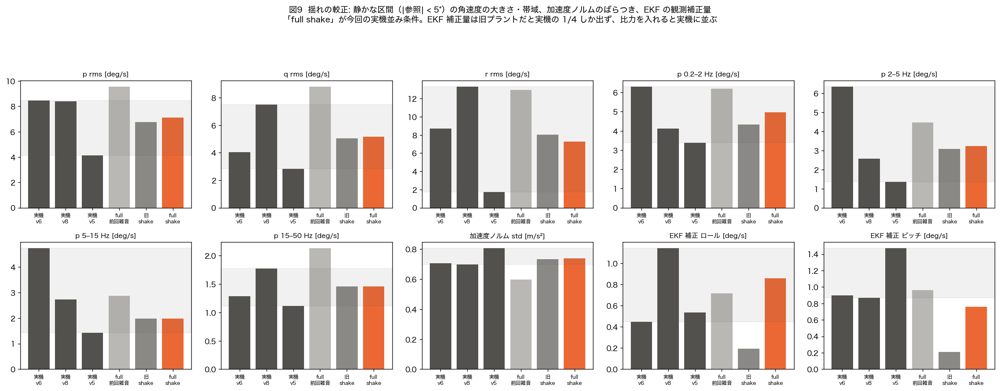
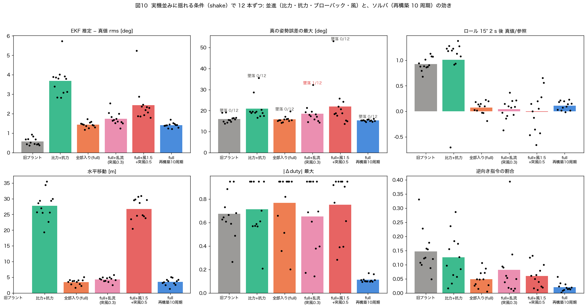
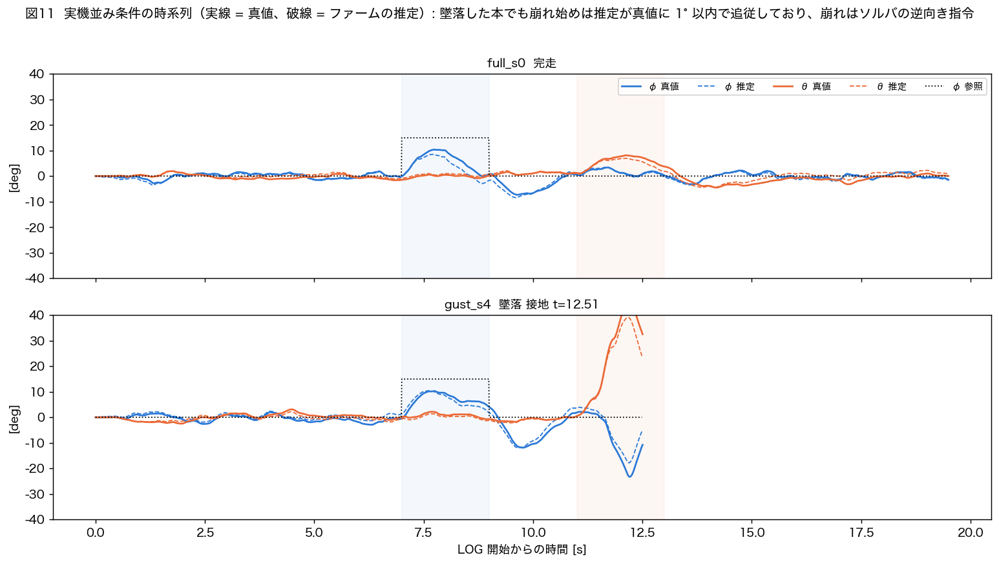

# 新プラントを実機並みに揺らした SIL: 並進は EKF を数度ずらすが、大きな崩れの引き金はソルバ

- **日付**: 2026-10-08
- **前提**: `docs/20261008_plant_6dof_report.md`（6 自由度プラントの実装）、`docs/20261008_sil_nmpc_flight_eval.md`（SIL 評価）
- **結果一式**: `program/sil_nmpc/results/20261008_shake/`、図 `docs/figs/20261008_shake/`
- **ファーム**: `Benzen_NMPC` 無改造（再構築 10 周期の比較だけ複製ファーム）

---

## 0. 要約

1. **揺れを実機ログに較正した**（静かな区間 |参照|<5° で p/q/r rms 7.2/4.9/7.1 deg/s、加速度ノルム std 0.73 m/s²。実機 3 便平均 7.0/4.8/7.9、0.74）。
   - ジャイロ雑音 0.02 rad/s。
   - 加速度雑音 75 mg。
   - 角速度外乱（ロール/ピッチ/ヨー）0.35/0.22/0.30 rad/s/√s。
   - 出力遅延 10 ms、再構築中 30 ms 据え置き。
   前回の「実機並み」（Python シミュで較正）は SIL では揺れすぎていた（p rms 9.5、低周波・ヨーが過大）。
2. **EKF の観測補正量（ファームが記録する ekf_dphi/dtheta）は、旧プラントでは実機の約 1/4 しか出ず、新プラントで実機の範囲に入った**（0.86/0.76 vs 実機 0.45–1.14 / 0.87–1.47 deg/s）。
   **実機の EKF は、新プラントが予測する程度の比力の影響を実際に受けている**と考えられる（旧 SIL はこの成分を欠いていた）。
3. 実機並みに揺らした 12 本ずつの結果（図 10）:
   - 並進（比力）による推定誤差は **rms 1.4°、最大 3–4°**（抗力が弱いと 3.7°、最大 10°）。
   - **ブローバックの「垂れ」**は揺れがあっても同じ（ロール 15° が 2 s で参照の 8 %、ピッチ 10° が 53 %）。
   - **墜落は 72 本中 1 本（乱流あり）**。他に風ありで 1 本が −46° まで崩れた。
4. **その 2 件はどちらも、推定が真値に 1–2° で追従したまま、ソルバが姿勢を崩す向きの指令を box 全開で出した**（前回突き止めた「バースト」）。
   並進や風は**きっかけ（揺さぶり）**を与えたが、崩れそのものを作ったのはソルバ。
   - 再構築 10 周期の複製ファームでは、同じ条件で崩れは消えた（最悪 16°、|Δduty| 最大 0.11、逆向き指令 2 %）。
5. **ご質問への答え: おおむねその理解で正しいが、2 点補足**。
   - (a) 並進が姿勢に効く経路は EKF だけでなく**ブローバックの「垂れ」**もあり、こちらは操縦性（追い舵 → 行き過ぎ）に効く。
   - (b) 実機で記録された「偽の傾き」による墜落（0910）の主因は比力ではなく**墜落直後の再アームで EKF が初期化されていなかったこと**で、0910_v12 の離陸ゲート・再初期化で既に消えている（§4）。

---

## 1. 揺れの較正（図 9）



| | p rms | q rms | r rms | p 0.2–2 / 2–5 / 5–15 / 15–50 Hz | 加速度ノルム std | EKF 補正 ロール / ピッチ |
|---|---|---|---|---|---|---|
| 実機 v6 / v8 / v5 | 8.5 / 8.4 / 4.1 | 4.1 / 7.5 / 2.8 | 8.7 / 13.3 / 1.7 | 6.3·6.3·4.7·1.3 / 4.1·2.6·2.7·1.8 / 3.4·1.4·1.4·1.1 | 0.70 / 0.70 / 0.81 | 0.45·0.90 / 1.14·0.87 / 0.53·1.47 |
| full・前回の雑音 | 9.5 | 8.8 | 12.9 | 6.2·4.5·2.9·2.1 | 0.60 | 0.71·0.96 |
| **旧プラント・今回の雑音** | 6.8 | 5.1 | 8.0 | 4.3·3.1·2.0·1.5 | 0.73 | **0.19·0.21** |
| **full・今回の雑音（shake）** | 7.1 | 5.2 | 7.3 | 5.0·3.2·2.0·1.5 | 0.74 | **0.86·0.76** |

（単位: 角速度 deg/s、加速度 m/s²。実機は静かな区間が 2–5 s と短いので便ごとの差が大きい。5–15 Hz 帯は SIL がやや小さい）

- 同じ雑音でも、旧プラントは EKF の補正量が実機の 1/4。**旧 SIL は「加速度計が重力以外も測る」ことによる推定の揺さぶりを欠いていた。**
- 較正の候補は 4 つ試した（`calib.sh`、乱流 gust を混ぜた案も含む）。突風（物理的な乱流）を足すと 0.2–2 Hz と EKF 補正が実機より大きくなるので、主成分は角速度外乱とした。

## 2. 実機並み条件での比較（図 10, 11）



各 12 本（seed 0–11）:

| | 墜落 | 推定−真値 rms（最悪の最大） | 真の姿勢誤差の最大 平均（最悪） | ロール 2 s 後 真値 / 推定 | ピッチ 2 s 後 | 水平移動 | |Δduty| 最大 | 逆向き指令 | TR1 棄却 |
|---|---|---|---|---|---|---|---|---|---|
| 旧プラント | 0 | 0.6°（1.4°） | 16.0°（19.1°） | 0.93 / 0.93 | 0.92 | — | 0.67 | 14.7 % | 7.1 % |
| 比力＋抗力 | 0 | **3.7°（10.5°）** | 21.0°（35.6°） | **1.01 / 0.66** | 1.10 | 28 m | 0.71 | 12.6 % | 7.0 % |
| **全部入り（full）** | 0 | 1.4°（4.1°） | 15.8°（19.7°） | **0.08** / −0.08 | **0.53** | 3.5 m | 0.77 | 4.9 % | 6.8 % |
| full＋乱流（突風 0.3 m/s） | **1** | 1.7°（5.5°） | 18.6°（**32.2°**） | 0.04 / −0.10 | 0.62 | 4.3 m | 0.65 | 8.1 % | 8.2 % |
| full＋風 1.5 m/s＋突風 0.5 | 0 | 2.4°（11.8°） | 21.9°（**53.1°**） | −0.01 / −0.20 | 0.55 | 27 m | 0.75 | 6.0 % | 10.5 % |
| full・**再構築 10 周期** | 0 | 1.4°（3.4°） | 15.3°（**16.1°**） | 0.11 / −0.04 | 0.62 | 3.5 m | **0.11** | **2.1 %** | 3.5 % |

読み方:
- **比力の効き（推定のずれ）は、抗力・ブローバックで横向きの比力が出るほど小さくなる**（3.7° → 1.4°）。推定は常に「浅め」にずれる（ロール 2 s 後: 真値 1.01 に対し推定 0.66）。
- **ブローバックの垂れは揺れの有無によらない**（full のロール 0.08、ピッチ 0.53）。
- **大きな崩れ（真の誤差 30° 超）は、乱流・風のある条件で 1 本ずつ**。どちらも次節のとおりソルバ由来。
- full は旧プラントより逆向き指令が少ない（4.9 % vs 14.7 %）。抗力・ブローバックという物理的な減衰が機体を落ち着かせ、ソルバが荒れる局面が減るためと見られる（推測）。
- TR1 棄却率は雑音を実機に合わせると 3 % → 7 % に上がったが、実機（21–24 %）にはまだ遠い。

### 大きく崩れた 2 本の中身



| | 何が起きたか | 推定のずれ（崩れ始め） | 指令 |
|---|---|---|---|
| full＋乱流 seed 4（墜落） | ピッチ 10° ステップ中、11.4 s から θ が 8° → 45° | **≤1°** | θ が参照を超えているのに**機首上げ全開**（FR/FL 0.95、RL 0、box 3–5 本張り付き）が 0.25 s |
| full＋風 seed 0（−46° まで） | 9.4 s からロールが −7° → −46° | **1–2°** | φ が左に傾いているのに**さらに左へ**（FR/MR 0.95、ML 0）が 0.4 s |

**どちらも「推定は正しいのに、ソルバが崩す向きの解を出し続けた」**。前回（`20261008_sil_nmpc_motor_order_bug_and_rank_update_drift.md`）の墜落と同じ型で、
再構築 10 周期の複製ファームでは同じ条件の 12 本で起きなかった。

## 3. 結論

| 並進がもたらすもの | 大きさ（実機並み条件） | 墜落への効き |
|---|---|---|
| EKF の偽の傾き（比力） | rms 1.4°、最大 3–4°（抗力が弱ければ最大 10°）。常に「推定が浅い」向き | **単独では墜落を起こさなかった**（72 本中 0）。真の傾きを数度深くし、速度・垂れを増やす下地にはなる |
| ブローバックの「垂れ」 | ロール 15° が 2 s で 8 %、ピッチ 10° が 53 %（係数は推定） | 墜落はしないが**操縦性を落とす**。実機の「垂れ → 追い舵 → 行き過ぎ（PIO）」の物理的な原因 |
| 風・乱流による揺さぶり | 風 1.5 m/s で 27 m 流される | **ソルバの暴れのきっかけ**にはなる（2/24 本）。崩れそのものはソルバ |

**→ 「並進は EKF の推定に悪さをしているが、墜落の直接原因ではない」は SIL ではそのとおり。**
ただし並進は (1) 垂れで操縦性を落とし、(2) 風・乱流でソルバの暴れを誘発するので、「無関係」ではなく**墜落の下地を作る側**。

## 4. 実機の墜落原因との照合（過去の decision から）

| 時期 | 墜落の直接原因（記録） | 並進との関係 | 状態 |
|---|---|---|---|
| 0831 | ゲイン過大の 4 Hz 発振、再構築ストール | なし | R_u 調整・N=14 で解消 |
| 0904–0909 | 受信 FRAME_LOST のフェイルセーフ、ADMM 勾配バグ・NaN 固着 | なし | 修正済み |
| 0910 v2/v5/v6/v10 | **EKF の偽の傾き**（毎秒 3–8° のドリフト、20° 級） | **比力ではない**: 墜落直後の再アームで EKF が初期化されず、地上で既に流れていた（`20260910_v11_post_crash_ekf_and_slow_mode.md`） | **v12 の離陸ゲート＋再初期化で消滅** |
| 0910 v5/v6 | **ソルバのバースト**（実機のみ、ホストで再現せず） | なし | 今回の SIL で同じ型を再現（再構築間隔に比例） |
| 0910 v7/v8 | 3–5 Hz の遅れ限界モード | なし | 遅れ補償で解消 |
| 0911 v6–v12 | 行き過ぎ・追い舵（PIO）、**速度比例の垂れ**、v12 は U_lin 暴走＋接触 | **ブローバック（並進）が垂れの原因** | 垂れは未対策（積分作用が候補） |
| 0915 / 0919 | U_lin ガードの誤発火（FTC・投下） | なし | 修正済み |
| 0920 | 貨物で推力余裕・ADMM が解に届かない | なし | 未解決 |

- 実機の偽の傾き（20° 級、毎秒 3–8° のドリフト）は、比力だけで出る大きさ（最大 3–4°、抗力が弱くても 10°）より**明らかに大きい**。記録どおり再アーム時の未初期化が主因で、比力は「残りの数度」を説明する程度。
- 一方、**今も残っていて墜落の直接原因になりうるのはソルバの暴れ**（今回 SIL で 2 件を再現、再構築 10 周期で消える）と、**並進由来の垂れによる操縦の難しさ**。

## 5. 限界

- 角速度外乱は「モデル化していない揺れ」の代理で、物理的な由来（振動・乱流・モータのばらつき）は分けていない。
- 実機の静かな区間は短く（2–5 s）、較正の目標値自体に幅がある。5–15 Hz 帯は SIL がやや小さい。
- 抗力・ブローバック係数は未同定（`docs/20261008_plant_6dof_report.md` §5）。
- 再構築 10 周期の SIL は据え置きを近似で扱っている（前回の限界と同じ）。
- 操縦者モデルは追い舵をしないので、垂れ → PIO の連鎖は再現していない。

## 6. 再現手順

```bash
cd program/sil_nmpc/results/20261008_shake
python3 shake_stats.py '../20261008_plant/full_real_s*.npz'   # 揺れの指標（実機 3 便も表示）
./calib.sh                                                    # 較正の候補 A–D（各 3 seed）
cd ../../host && python3 run_jobs.py ../results/20261008_shake/jobs_shake.txt -j 4   # 本番 72 本（rp10 は jobs 内の SIL_BUILD_DIR を自分の環境に）
cd ../results/20261008_shake && <matplotlib のある python> analyze_shake.py ../../../../docs/figs/20261008_shake
```
