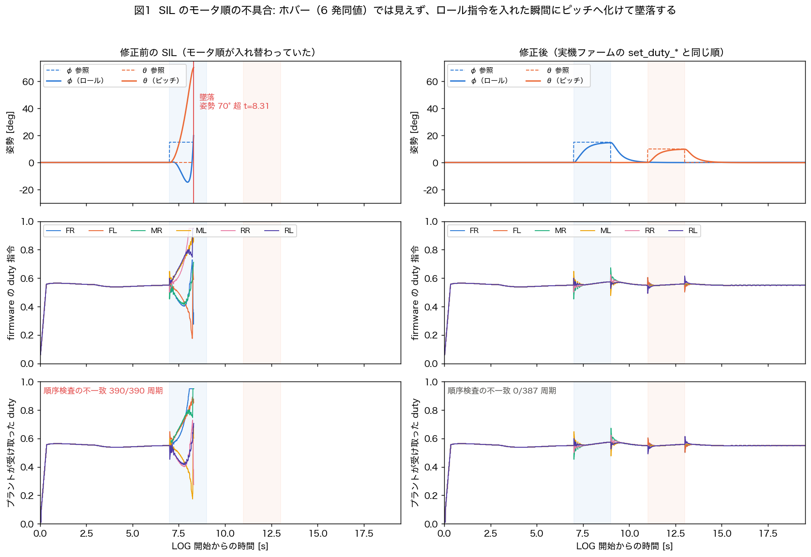
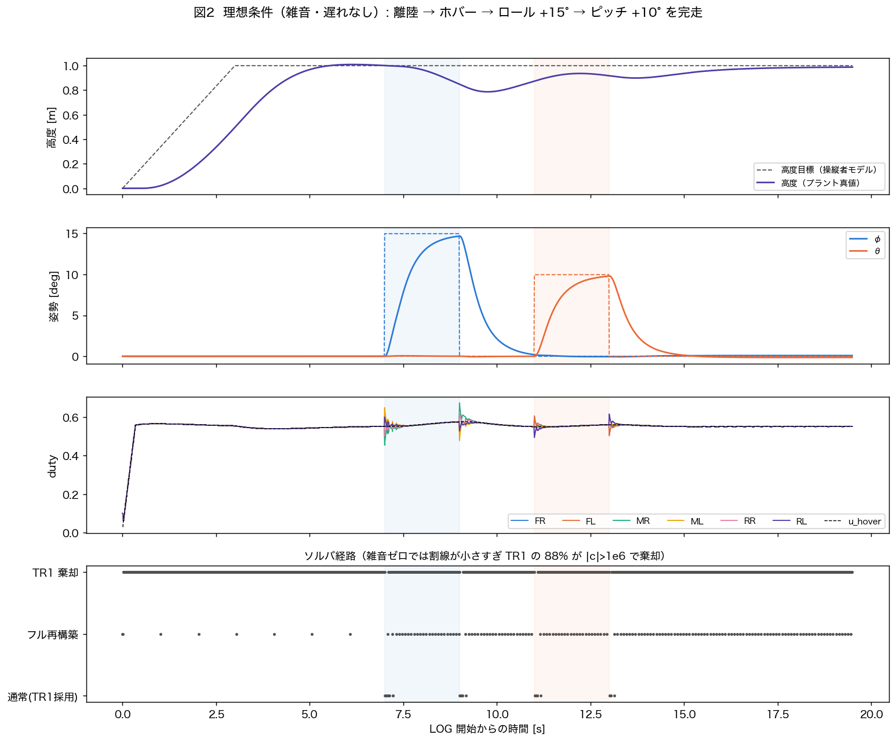
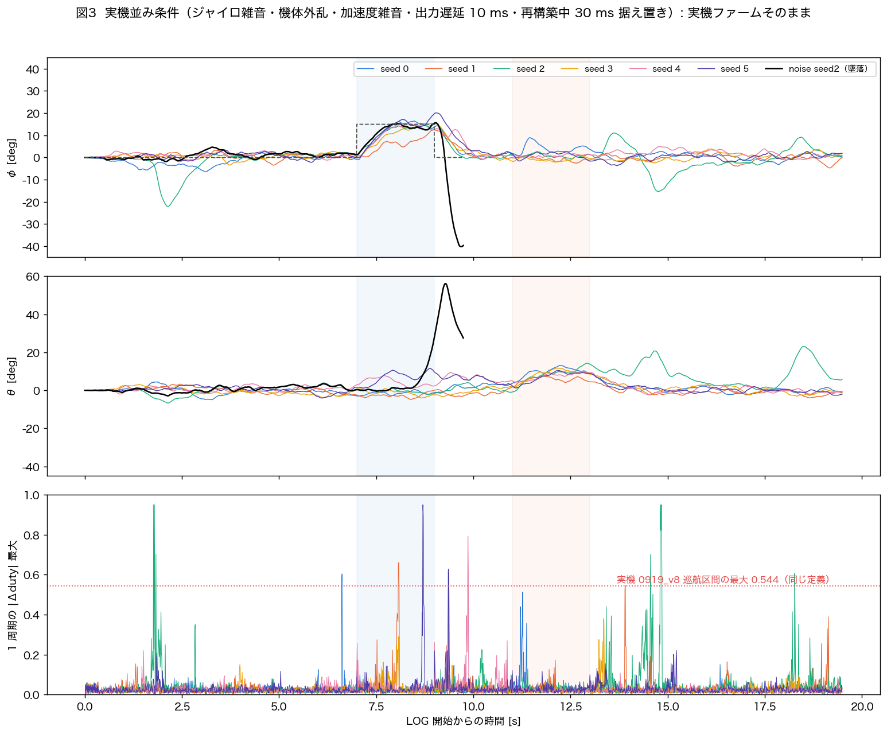
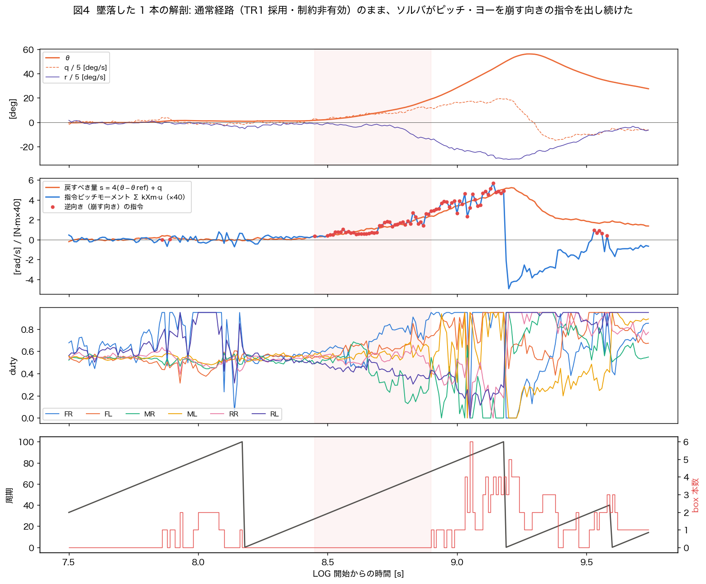
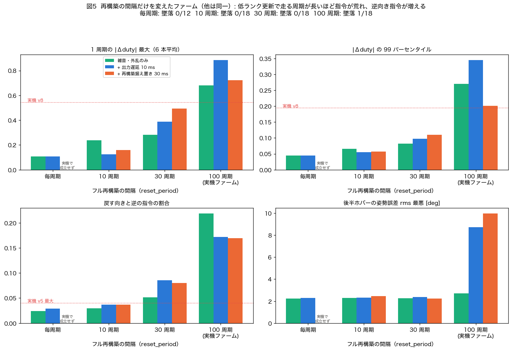
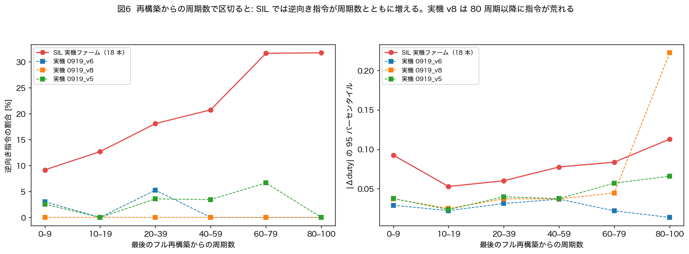
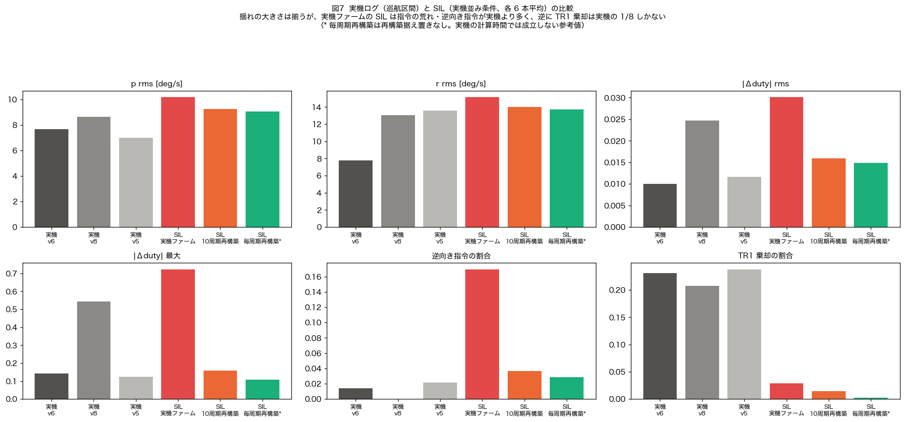

# 現行 Benzen_NMPC を SIL で飛ばした評価（通常飛行）

- **日付**: 2026-10-08
- **対象ファーム**: `Benzen_NMPC`（NX=5, N=14, DC6, R_u=620, ADMM ρ=1・4 反復, reset_period=100）— **無改造**でホストビルド
- **SIL**: `program/sil_nmpc/`（`program/sil/` を複製して Benzen_NMPC 向けに改造。作業コピーの `program/sil/` は無変更）
- **結果一式**: `program/sil_nmpc/results/20261008/`（npz・集計 CSV・スクリプト）、図 `docs/figs/20261008_sil/`

---

## 0. 要約

1. **SIL に実機を誤らせる不具合があった（修正済み）。** Benzen_NMPC の `pwm.cpp` は Benzen_new からモータ配線を付け替えてあるのに、
   SIL は Benzen_new 用の対応表のままで、**6 発の duty が入れ替わってプラントに届いていた**。
   6 発が同じ値になるホバーでは見えず、ロール指令を入れた瞬間にピッチへ化けて墜落する（図 1）。
2. 修正後、**理想条件（雑音・遅れなし）では通常飛行できる**。離陸 → 1 m ホバー → ロール +15° → ピッチ +10° を完走（図 2）。
   ステップの 90% 到達は約 1.2 s、行き過ぎなし。
3. **実機並みの揺れ（ジャイロ雑音・機体外乱・加速度雑音）を入れると、飛べはするが不安定になる。**
   実機ファームのままで 18 本中 1 本が墜落し、残りにも 10° 級のふらつきが出る。指令の跳び（1 周期の |Δduty| 最大）は 0.6〜0.9 で、実機 v8 の 0.54 と同程度かそれ以上（図 3）。
4. **墜落の中身は「物理」ではなく「ソルバ」。** 墜落した 1 本では、TR1 を採用した通常経路で、制約も効いていない状態のまま、
   ソルバが**姿勢を崩す向きのピッチ指令を約 0.7 s（79 周期連続）出し続けた**（図 4）。
5. **原因は低ランク更新（TR1/SR2）で走る周期の長さ。** ファームの `reset_period` だけを変えたビルドで比べると、
   毎周期・10・30・100 周期と再構築の間隔が延びるほど、指令の跳び（0.11 → 0.16 → 0.49 → 0.72）と逆向き指令（3 → 5 → 10 → 17 %）が単調に増えた（図 5）。
   実機ファームの中でも、**最後の再構築から周期が経つほど逆向き指令が増える**（9 → 32 %、図 6）。
   **再構築中の 30 ms の出力据え置きを入れても、10 周期ごとの再構築は 100 周期より明らかに良い**（late hover 最悪 2.5° vs 10.0°）。
6. 「シミュは飛ぶのに実機は落ちる」の差は、2026-10-06 の仮説どおり**制御器の中身**、具体的には
   **低ランク更新で近似した Su / Hessian が、雑音のある飛行で数十周期のうちに崩れること**で説明できる。
   ただし SIL の雑音は実機より強めで、**実機の巡航区間は SIL ほど荒れていない**（逆向き指令 0〜2 %、§5）。
   また TR1 棄却率は実機 21〜24 % に対し SIL 1〜3 % で、ここは一致していない（未解決）。

---

## 1. SIL の構成

| 項目 | 内容 |
|---|---|
| ファーム | `Benzen_NMPC` の `control.cpp` / `nmpc.cpp` / `nmpc_model.cpp` / `ekf.cpp` / `pwm.cpp` ほかを**そのまま**ホストでビルド（float32・`EIGEN_NO_MALLOC`・実機と同じ compile 定義） |
| 実行 | core0 の 400 Hz 割り込みを仮想時間で 1 tick ずつ回し、core1（100 Hz の `angle_control`）はスレッド＋セマフォで、毎 tick 完了まで待つ（決定的。同じ seed で同じ結果を再現確認済み） |
| プラント | 285 g、飛行較正の推力曲線 `Tf(u)=0.8389(−0.2265u²+1.0525u+0.0452)`（ホバー duty 0.55）、モータ一次遅れ 50 ms、慣性・形状・反トルクは `nmpc_model.cpp` と同じ、接地中は水平保持 |
| 操縦者 | スロットルを高度 PD で動かすモデル（実機に高度制御は無いので「上手な操縦者」の代わり）。スティックで姿勢参照のステップ |
| アーム | 実機と同じ手順（6000 tick のウォームアップ → ロック解除ジェスチャ → スティック中立 → 離陸ゲート開） |
| ログ | **ファーム自身の 100 Hz ログ（33 列、実機の SD ログと同じ形式）**を読み出して評価 |

### 飛行プロファイル（LOG 開始を 0 s とする、19.5 s）

0–4 s 1.0 m まで上昇 → 4–7 s ホバー → **7–9 s ロール +15°** → 9–11 s 中立 → **11–13 s ピッチ +10°** → 13–19.5 s ホバー

### 条件

| 条件 | ジャイロ雑音 | 加速度雑音 | 機体外乱 | 出力遅延 | 再構築中の据え置き |
|---|---|---|---|---|---|
| ideal | 0 | 0 | 0 | 0 | 0 |
| delay | 0 | 0 | 0 | 10 ms | 30 ms |
| noise | 0.03 rad/s | 60 mg | 0.5 rad/s/√s | 0 | 0 |
| real_nh | 同上 | 同上 | 同上 | 10 ms | 0 |
| **real**（実機並み） | 同上 | 同上 | 同上 | 10 ms | 30 ms |

- 雑音・外乱は 2026-10-06 に「静かなホバーの p rms を実機 7〜8.6 deg/s に合わせた」値（`20261006_sim_flies_real_crashes_gap_is_in_controller_internals_not_physics.md`）。加速度は実機 acc_norm の std 0.67〜0.90 m/s² 相当。
- 出力遅延 10 ms ＝ 実機 loop_us の平均 9.8〜10.3 ms。据え置き 30 ms ＝ フル再構築周期の loop_us 最大 31〜45 ms。
  SIL の core1 は仮想時間ゼロで終わるので、**プラント側で出力を遅らせ・凍らせて近似**している（§6 の限界を参照）。

---

## 2. SIL の不具合: モータ順の入れ替わり（図 1）



- Benzen_NMPC の `set_duty_fr` は slice7 **B**、`set_duty_rr` は slice7 **A** … と、Benzen_new から配線を付け替えてある。
  SIL の `sil_get_duty` は Benzen_new 用（FR=slice7 A …）のままだったため、プラントには
  `[RR, ML, RL, FL, FR, MR]` が `[FR, FL, MR, ML, RR, RL]` として届いていた。
- ホバー中は 6 発が同値なので**完全に正常に見える**（前回「1 m ホバーまで到達」と報告したのはこの状態）。
  ロール +15° の指令（左 3 発を上げる）を入れると、プラントでは前後差になって**ピッチが 70° まで振れて墜落**した。
- 修正: `sil_get_duty` の表を `pwm.cpp` の `set_duty_*` の写しにした。あわせてホスト側に
  **「core1 が書いたログの u_* と、PWM からプラントに届いた duty の一致検査」**を常設した（6 発がそろっていない周期だけ数える）。
  修正前の順を再現すると 390/390 周期で不一致、修正後は 0 で、検査が効くことを確認した。

> ⚠ 前回の中間報告「6 発の duty が完全に同一、100 Hz ログ 0 行 → core1 が回っていない疑い」は**誤り**。
> core1 は回っていた。同一 duty は「雑音ゼロでは姿勢が厳密に 0 のまま」なので正しい出力で、
> ログ 0 行は私の読み出し側が `loop_us≠0` で行を拾っていたため（SIL は仮想時間なので loop_us・iter_us は常に 0）。

---

## 3. 理想条件: 通常飛行できる（図 2）



| 指標 | ideal | delay（遅延 10 ms＋据え置き 30 ms） |
|---|---|---|
| 墜落 | なし | なし |
| ロール 15° の 90% 到達 / 行き過ぎ | 1.22 s / なし | 1.15 s / なし |
| ピッチ 10° の 90% 到達 / 行き過ぎ | 1.21 s / なし | 1.16 s / なし |
| 1 周期の |Δduty| 最大 | 0.098 | 0.098 |

- 追従は遅いが素直（R_u=620 の重さ）。遅延を足しても変わらない。
- **ソルバ経路が実機と全く違う**: 雑音ゼロでは 1 周期の状態変化が小さすぎて、TR1 の `|c|` が 1e6 を超え **88 % の周期で棄却**される。
  8 回連続棄却でフル再構築が入るので、結果として**約 9 周期ごとに再構築**している（path1 9.9 %）。
  後述のとおり、これは「再構築間隔が短いほど良い」の側に入っている。

---

## 4. 実機並み条件: 飛べるが不安定、1/18 墜落（図 3, 4）



実機ファームそのまま（rp100）、各 6 seed:

| 条件 | 墜落 | 前半ホバー姿勢 rms | 後半ホバー rms（平均 / 最悪） | ロール保持中 rms 最悪 | p rms | |Δduty| rms | |Δduty| 最大 | 逆向き指令 |
|---|---|---|---|---|---|---|---|---|
| noise | **1/6** | 2.2° | 2.1° / 2.7° | 6.1° | 11.2 | 0.037 | 0.68 | 19–25 % |
| real_nh | 0/6 | 2.2° | 3.3° / **8.7°** | 4.3° | 9.8 | 0.042 | 0.88 | 13–21 % |
| real | 0/6 | 2.1° | 3.5° / **10.0°** | 8.0° | 10.2 | 0.030 | 0.72 | 17 % |

- 「逆向き指令」= `s = 4(角度−参照) + 角速度` が 20 deg/s 相当を超えているのに、6 発の指令から計算したロール/ピッチモーメントが s と同符号（＝さらに崩す向き）だった周期の割合。
  モータ遅れ・遅れ補償で一時的に起こり得るので、雑音なしの ideal（3 %）を基準線とする。

### 墜落した 1 本（noise seed 2）の解剖



- t=8.45 s〜（ロール 15° 保持中）、ソルバ経路は**通常（TR1 採用）**、`|c|` は 1e3〜2e5 で閾値内、**box は 1 本も効いていない**、λ=0。
- それでも θ>0・q>0 の状態で**機首上げのモーメント**を出し続け、同時にヨーにも −0.5 相当の差動を入れて r が −150 deg/s まで走った。
- 8.4〜9.2 s の間、ピッチの指令モーメントは**79 周期連続で「戻すべき向き」と逆**だった（|s| が 20 deg/s 相当を超えた 70 周期はすべて逆向き）。崩れてから box が張り付き（8.9 s〜）、再構築（9.18 s）も間に合わず接地。
- 推定（EKF）は真値に 1° 以内で追従しており、推定の破綻ではない。

---

## 5. 原因の切り分け: 再構築の間隔（図 5, 6, 7）

### 5.1 `reset_period` だけを変えたファーム

ファームの複製で `nmpc_params.hpp` の `reset_period` 1 行だけを 1 / 10 / 30 に変えて同じ SIL・同じ seed で飛ばした（実機ファームは無変更）。



| 再構築の間隔 | 墜落 | |Δduty| 最大 | |Δduty| p99 | 逆向き指令（ロール / ピッチ） | 後半ホバー最悪 | box 張り付き |
|---|---|---|---|---|---|---|
| 毎周期（参考） | 0/12 | 0.11 | 0.045 | 3–4 % / 2 % | 2.3° | 0 |
| 10 周期 | 0/18 | 0.12–0.24 | 0.055–0.066 | 5 % / 1.5–2.5 % | 2.5° | ≈0 |
| 30 周期 | 0/18 | 0.28–0.49 | 0.08–0.11 | 8–12 % / 2–6 % | 2.4° | 0.02–0.2 % |
| **100 周期（実機）** | **1/18** | **0.68–0.88** | **0.20–0.35** | **13–19 % / 17–25 %** | **10.0°** | 0.4–3 % |

- **単調な用量反応**。低ランク更新（TR1 で Su、SR2 で Hessian）だけで走る周期が長いほど、指令が荒れ・逆向き指令が増え・box に張り付く。
- **30 ms の据え置きを入れた real 条件でも 10 周期 ≫ 100 周期**（据え置きは 10 周期ビルドで 178 回 ＝ 飛行時間の約 27 %）。
  「止まる害」より「近似が古くなる害」のほうが大きい。
- 毎周期再構築は実機の計算時間（再構築 1 回 31〜45 ms）では成立しないので、据え置きありの条件は走らせていない（参考値）。

### 5.2 最後の再構築からの周期数



- 実機ファームの SIL（18 本）では、逆向き指令が 0–9 周期 9 % → 60–100 周期 32 % と**周期数とともに増える**。
- 実機ログ v5/v6 には同じ傾向はほぼ無い（0〜7 %）。**v8 だけは 80 周期以降で |Δduty| p95 が 0.04 → 0.22 に跳ねる**（2026-10-06 に見つけた「v8 のスパイクはフル再構築で消える」と同じ現象）。

### 5.3 実機ログとの比較



| | 実機 v6 / v8 / v5（巡航区間） | SIL 実機ファーム（real） | SIL 10 周期再構築（real） |
|---|---|---|---|
| p rms [deg/s] | 7.7 / 8.6 / 7.0 | 10.2 | 9.2 |
| r rms [deg/s] | 7.8 / 13.1 / 13.6 | 15.1 | 14.0 |
| |Δduty| rms | 0.010 / 0.025 / 0.012 | 0.030 | 0.016 |
| |Δduty| 最大 | 0.14 / 0.54 / 0.13 | 0.72 | 0.16 |
| 逆向き指令 | 1 % / 0 % / 2 % | 17 % | 4 % |
| TR1 棄却（path2） | 23 % / 21 % / 24 % | 3 % | 1 % |

- 揺れの大きさ（p rms）はおおむねそろう。**指令の荒れは SIL の実機ファームが実機より大きく、v8 だけが SIL 側に近い。**
- 実機の巡航区間は SIL ほど逆向き指令を出していない。理由として考えられるのは
  (a) SIL の雑音モデル（特に加速度雑音→EKF、外乱をレートに直接足す形）が実機より厳しい、
  (b) **実機は TR1 を 21〜24 % 棄却していて、8 連続棄却で再構築が入る分、実質の再構築間隔が短い**（実機の path1 は 1.5〜3.3 %、SIL は 1.1 %）。
  (b) が正しければ「実機は TR1 棄却のおかげで、たまたま近似の劣化を洗い流せていた」ことになる。**未検証。**

---

## 6. 結論と限界

### 結論

- **現行 Benzen_NMPC は SIL で通常飛行できる**。理想条件では完走し、実機並みの揺れでも 18 本中 17 本は 19.5 s 飛び切る。
- ただし実機並みの揺れでは**ソルバが姿勢を崩す向きの指令を出す周期が 13〜25 %** あり、1 本はそれが約 0.7 s 続いて墜落した。
- この劣化は**低ランク更新で走る周期の長さに比例**し、フル再構築の間隔を縮めると消える。
  2026-08-31（0831_v3）に実機で観測された「`cycles_since_reset` と姿勢誤差の相関 +0.70」を、**同じファームのまま因果として再現した**ことになる。

### 再提案について（過去の却下案との関係）

`reset_period` の短縮は 2026-08-31 に「停止 1 回 58 ms のまま頻度だけ増えて悪化する」として却下されている
（`20260831_nmpc_rebuild_gate_degradation.md`）。**当時から変わった点**:
(1) N=17→14 で再構築は 58 ms → 実測 31〜45 ms、
(2) 今回の SIL は 30 ms の据え置きを入れたうえで 10 周期ごとが 100 周期より良いことを示した、
(3) 劣化の因果（近似の古さ → 逆向き指令）を用量反応で示した。
したがって**候補として再検討する価値はある**が、§限界のとおり SIL の据え置きモデルは近似なので、実機に入れる前に次の確認が要る。

### 限界（推測と事実の区別）

- **SIL の据え置きは近似**: 実機では再構築中の 100 Hz 周期そのものが消える（セマフォが `sem_reset` される）が、SIL では core1 が回り続け、出力だけを凍らせている。
  ウォームスタートや遅れ補償の duty 履歴の進み方が実機と違う。
- **雑音の形は Python シミュで合わせたもので、SIL では再較正していない**。SIL の実機ファームは実機より揺れ・指令の荒れが大きい。
- 実機の計算時間（iter_us・loop_us）は SIL では測れない（仮想時間）。
- TR1 棄却率の不一致（実機 21〜24 % vs SIL 1〜3 %）は**説明できていない**。
- どの近似（TR1 の Su か、SR2 の Hessian か、float32 の丸めか）が主因かは、今回の切り分けでは分けていない。

### 次にやるとよいこと（未実施）

1. 実機ログの TR1 棄却率に SIL を合わせる（雑音の周波数特性・EKF 入力を実機ログから作る）→ 劣化の程度を実機に較正。
2. TR1 だけ／SR2 だけを毎周期厳密計算に置き換えたビルドで、どちらが主因かを分ける。
3. `reset_period` 10〜30 を実機に入れる前に、実機の再構築コスト（N=14 で 31〜45 ms）の内訳と、据え置き中の挙動を SIL で正確に模擬する（core1 周期のスキップを再現）。

---

## 7. 再現手順

```bash
cd program/sil_nmpc && mkdir -p build && cd build && cmake .. -DCMAKE_BUILD_TYPE=Release && make
cd ../results/20261008
./run_all.sh                                   # ideal / delay / noise / real（各 seed）
# reset_period を変えたファーム複製をビルドして比較（実機ファームは触らない）
#   rsync で Benzen_NMPC を複製 → nmpc_params.hpp の reset_period を 1/10/30 に → cmake -DFW_DIR=<複製>
RP1_BUILD=<rp1 のビルドdir> ./run_ablation.sh
python3 metrics.py && python3 compare.py      # 集計（metrics.csv, ablation_summary.csv）
<matplotlib のある python> build_figs.py ../../../../docs/figs/20261008_sil
```

- 1 プロセス 1 インスタンス（ファームのグローバル変数を持つため）。条件ごとに別プロセスで実行する。
- 1 本あたり約 7 s（19.5 s の飛行＋アーム 15 s）。
