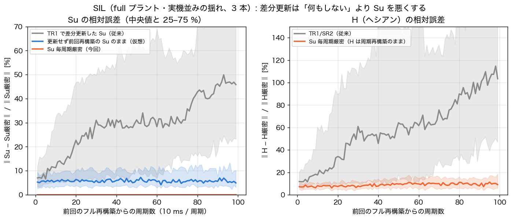
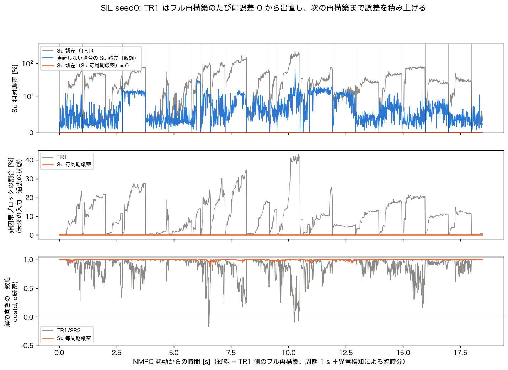
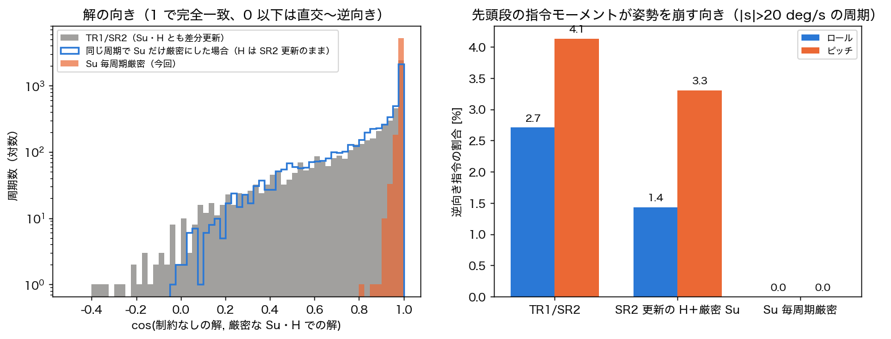
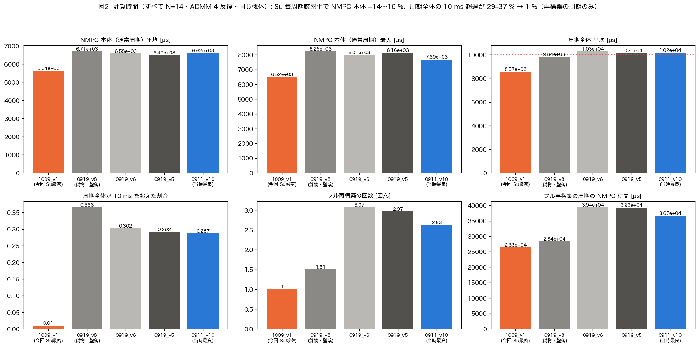
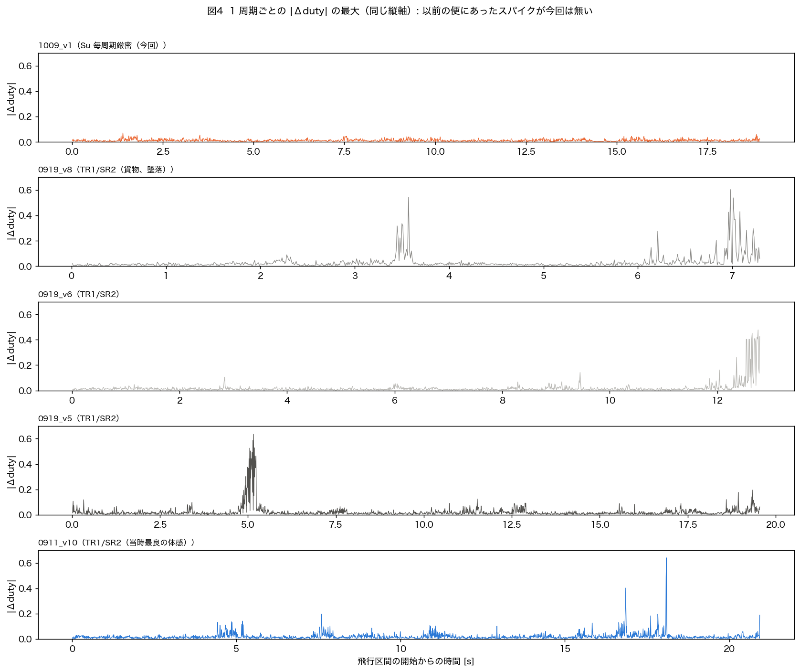

# 「Su を毎周期作り直す」修正の解説

- **日付**: 2026-10-09
- **対象**: `Benzen_NMPC/nmpc.cpp`（`nmpc_step` の通常経路）、`nmpc_params.hpp`（`NMPC_SU_EXACT`、既定 1）
- **関連資料**
  - SIL での対策比較: `docs/20261008_ekf_and_solver_fix_study.md`
  - 実機初飛行の評価: `docs/20261009_v1_flight_eval.md`
- **今回の追加診断**: TR1 が Su と H をどれだけ壊しているかを SIL で直接測った（§4）。
  - データ: `program/sil_nmpc/results/20261009_su_diag/`
  - 図: `docs/figs/20261009_su_exact/`
- **関連 decision**
  - `20261008_solver_bursts_come_from_tr1_sr2_updates_su_exact_fixes.md`
  - `20261008_su_exact_implemented_in_benzen_nmpc.md`
  - `20261009_v1_su_exact_flight_confirms_sil.md`

---

## 0. 要約

- **何を変えたか**
  - 従来は、予測行列 Su・Sx を毎周期 TR1（ランク 1 の差分更新）で直し、ヘシアン H を SR2（ランク 2 の差分更新）で直していた。
  - 今回から、通常の周期でも **Su・Sx をヤコビアンから厳密に作り直す**。
  - **H は差分更新をやめ**、従来どおり 100 周期（1 秒）ごとのフル再構築でだけ作る。
- **なぜか**
  - TR1/SR2 の差分更新は、Su・H を正しく保つどころか**壊していた**。
  - SIL で直接測ると、TR1 で更新した Su の誤差は次のとおり。
    - 再構築から 1 秒後に中央値 40%、最悪 256%。
    - 「何もせず古い Su を使い続けた場合」（約 6%）より、5〜7 倍悪い。
  - その結果、制約なしの解の向きがずれた周期は全体の 37% あった。
  - 指令が姿勢を崩す向きになった周期は 3〜4%。
- **何が良くなったか**
  - SIL: 逆向き指令が 5〜8% から 0.05% に下がり、30° 超の崩れは 2/36 本から 0/36 本になった。
  - 実機（1009_v1）
    - 逆向き指令は 4〜20% から 0.2% に下がった。
    - 1 周期の duty の跳びは 0.48〜0.64 から 0.07 に下がった。
    - **計算時間は NMPC 本体で 14〜16% 減った。周期全体は初めて 10 ms に収まった。**
- **残るもの**
  - H は最大 1 秒古い。測った誤差は中央値 9%、最大 44% で、解の向きは保たれる。
  - 1 秒に 1 回のフル再構築で、26〜30 ms 止まる。

```
            ┌───────── 従来（NMPC_SU_EXACT=0） ─────────┐   ┌──── 今回（NMPC_SU_EXACT=1、既定） ────┐
通常の周期   非線形ロールアウト → TR1 で Sx,Su を補正            ヤコビアンから Sx,Su を厳密に作り直す
             → SR2 で H の Cholesky を 2 回 rank 更新          （H には触らない）
1 秒に 1 回  Sx,Su,H をすべて厳密に作り直す（約 26〜30 ms）      同左（変更なし）
毎周期       定数項 c = Suᵀ Q (Sx x0 − X_ref) − R U_ref → ADMM 4 反復（H の Cholesky で解く）  同左
```

---

## 1. 前提: NMPC が毎周期解いている問題

### 1.1 予測を行列で書く（凝縮形）

- 状態は `x = [φ, θ, p, q, r]`（NX=5）、入力は 6 モータの duty（NU=6）、ホライズンは N=14 段。
- 未来の 14 段分の状態をまとめた `X`（70 要素）を、今の状態 `x0` と未来の入力 `U`（84 要素）で予測する。
  - 1 次の近似: **`X ≈ Sx · x0 + Su · U`**
  - 非線形モデルを、線形化点の入力列 `U_lin` に沿って線形化して作る。
- 各段の離散ヤコビアンを `A_k = ∂f/∂x`、`B_k = ∂f/∂u` とすると、次のブロック構造になる。

```
Sx = [ A_0            ]        Su = [ B_0                                  0  ]
     [ A_1 A_0        ]             [ A_1 B_0       B_1                       ]
     [ A_2 A_1 A_0    ]             [ A_2 A_1 B_0   A_2 B_1   B_2             ]
     [   ...          ]             [   ...                         ...       ]
     [ A_13 … A_0     ]             [ A_13…A_1 B_0  …              … B_13     ]
```

- **Su はブロック下三角**。右上が厳密に 0 になる。これは因果律そのもので、「k 段目の状態は、k 段目より後の入力では変わらない」ことを表す。
- `full_rebuild_sx_su()` は、この式どおりに 14 段のヤコビアンを順に掛けて作る。

### 1.2 二次計画（QP）

コストは次のとおり。

```
J(U) = ½ ‖Sx x0 + Su U − X_ref‖²_Q  +  ½ ‖U − U_ref‖²_R
```

これを U について整理すると次の形になる。

```
J(U) = ½ Uᵀ H U + cᵀ U + 定数
   H = Suᵀ Q Su + R                        （84×84。曲がり具合 = 「どれだけ」動かすか）
   c = Suᵀ Q (Sx x0 − X_ref) − R U_ref     （84 要素。傾き = 「どちらへ」動かすか）
```

- 制約なしの最適解は **`U* = −H⁻¹ c`**。
- 実機では duty の箱制約（box）を ADMM で扱い、`(H + ρI) U = −c + ρ(z − λ)` を 4 回解く。
- `H + ρI` の Cholesky 分解（LLT）は、作ってしまえば 1 回の求解が安い。分解そのものは高い。

**Su は H と c の両方に入っている。** ここが今回の話の要になる。

- c は解の**向き**を決める。どのモータを上げ、どれを下げれば姿勢誤差が減るか。
- H は解の**大きさと配分**を決める。どれくらい強く動かすか、どのモータで分担するか。

### 1.3 実時間にするための近似（RTI）

- 線形化は 1 周期に 1 回だけ行う（RTI = Real-Time Iteration）。線形化点は前周期の解を 1 段ずらしたもの。
- H を作り直すと、Cholesky 分解（84×84）を含めて実機で **26〜30 ms** かかる。100 Hz（10 ms）の周期には入らない。
- そこで H のフル再構築は `reset_period = 100` 周期（1 秒）に 1 回にしている。その間を何で埋めるかが問題になる。

---

## 2. 従来の方法: TR1 と SR2 で差分更新する

### 2.1 TR1: Sx・Su の割線ランク 1 更新（`tr1_update_sx_su`）

前周期からの変化を、まとめて 1 本の割線ベクトルで表す。

```
s_x = x0 − x0_prev                      （状態の変化、5 要素）
s_u = U_lin − U_lin_prev                （線形化点の変化、84 要素）
r   = X_nl − (X_lin_prev + Sx s_x + Su s_u)   （非線形ロールアウトと線形予測の差 = 残差）
[Sx Su] += r · [s_x; s_u]ᵀ / (‖s_x‖² + ‖s_u‖²)
```

- Broyden 法と同じ形で、「この 1 方向については、線形予測が非線形モデルと一致する」ように行列を直す。
- 計算は外積 1 回で済み、ヤコビアンを 14 回計算するより安い**はず**だった。

### 2.2 SR2: H の Cholesky のランク 2 更新（`sr2_update_h`）

- Su が `Su + u sᵀ` に変わると、H は `H + s aᵀ + a sᵀ + γ s sᵀ` に変わる。
  - `u = r/‖s‖²`、`s = s_u`、`a = Suᵀ Q u`、`γ = uᵀ Q u`（コード上の変数名は `c`。定数項 c とは別物）
- これは `p pᵀ − q qᵀ` の形に書ける。
  - `p = a + (γ+1)/2 · s`、`q = a + (γ−1)/2 · s`
- そこで、LLT に `rankUpdate(p, +1)` と `rankUpdate(q, −1)` を当てる。
- 分解し直さずに、H の Cholesky を Su の変化に追従させる仕組み。

### 2.3 安全弁（これまでに足してきたもの）

| 安全弁 | 理由 |
|---|---|
| 更新が大きすぎる（`γ > tr1_c_max = 1e6`）ときは捨てる | 0910 に 36 ms の再構築が 1 秒に 5 回起きていた |
| 8 回続けて捨てたら再構築する | 捨て続けると Su が古いまま残るため |
| LLT が不健全になったら再構築する | 負号付きの rank 更新は正定値を失いうるため |

**どれも「更新が壊れたあとに拾う」仕組みで、壊れること自体は止めていなかった。**

---

## 3. 何が起きていたか（症状）

- **実機**（N=14 の 4 便: 0911_v10、0919_v5・v6・v8）
  - 姿勢を崩す向きの指令（逆向き指令）が 4〜20% の周期で出ていた。
  - 1 周期で duty が 0.48〜0.64 跳ぶスパイクがあった。
  - 推定は正常なまま、box 全開で逆向きに振る「バースト」から墜落した便があった。
- **SIL**（実機ファームをそのままホストでビルド。実機並みの揺れ、36 本）
  - 逆向き指令 4.9〜8.1%、跳び最大 0.65〜0.77、30° 超の崩れ 2 本。
- **SIL の切り分け**（2026-10-08）
  - 「差分更新をやめて、1 秒ごとの再構築だけにする」と、逆向き指令は 0.3%、跳びは 0.10 に**下がった**。
  - 何もしない方が良いので、原因は「近似が古くなること」ではなく、**更新そのものが Su・H を壊していること**だと絞り込んだ。
  - 当時は仕組みが**推測**どまりだった。今回、それを直接測った。

---

## 4. なぜ壊れるのか（今回の診断で直接測定）

### 4.1 測り方

- ファームの**複製**（scratchpad）の `nmpc_step` に診断を足した。実機ファームは触っていない。
  - 毎周期、ソルバが実際に使う Su・H と、同じ `(x0, U_lin)` で厳密に作った Su・H を並べて比べる。
  - パッチ: `results/20261009_su_diag/su_diag_hook.patch`
- 診断はソルバの内部状態を書き換えない。飛行結果はこれまでの SIL と同じで、3 本とも墜落なし。
- 条件
  - full プラント（6 自由度・抗力・ブローバック）、実機並みの揺れ（shake）、seed 0〜2 の 3 本。
  - 通常周期は約 5,500 周期。
  - 比べたのは、従来（`NMPC_SU_EXACT=0`）と今回（`=1`）の 2 通り。

### 4.2 Su の誤差は、再構築のあと単調に積み上がる（図 1・図 2）



| 前回の再構築からの周期数 | TR1 で更新した Su の誤差 | 更新しなかった場合の誤差（仮想） | 比 |
|---|---|---|---|
| 1〜9 | 8% | 6% | 1.2 倍 |
| 10〜29 | 19% | 6% | 2.5 倍 |
| 30〜59 | 29% | 6% | 3.4 倍 |
| 60〜100 | **40%** | 6% | **5.5 倍** |
| 全体（中央値 / p95 / 最大） | 25% / 119% / **256%** | 5.7% / 23% / 71% | |

（誤差 = ‖Su − Su厳密‖ / ‖Su厳密‖。「更新しなかった場合」は、直前のフル再構築で作った Su と今の厳密な Su の差。）

- **「何もしない」の誤差は時間がたっても 6% 前後で増えない。**
  - 飛行中の Su は、平均の周りを行ったり来たりしているだけで、1 秒で遠くへ行くわけではない。
- **TR1 は、その行ったり来たりを毎周期追いかけて、誤差を積み上げていく。**
  - 再構築で 0 に戻り、次の再構築までにまた積み上がる（図 2 上段の、のこぎり波）。
  - 最悪のときは誤差が Su 自身の 2.5 倍になる。もはや予測モデルとして意味がない。



### 4.3 なぜ積み上がるのか

ここでは、測った数値で裏付けられることと、推測を分けて書く。

1. **本当の Su の変化は、1 本の割線では表せない**（測定）
   - 1 周期での Su の真の変化は、中央値 4%、p95 10% だった。
   - その変化を特異値分解すると、最良のランク 1 で表せる割合は中央値 81% だった。悪いときは 52%。
   - 残りの 2〜5 割は、ランク 1 の更新では原理的に直せない。
   - さらに TR1 が足すのは「最良のランク 1」ではなく `r · sᵀ`、つまり割線方向で決まる 1 本である。
2. **割線の大半は状態の変化 s_x で、その分の残差が Su に書き込まれる**（測定＋推測）
   - 割線の長さ ‖s‖² のうち、s_x が占める割合は中央値 75%（p95 97%）だった。
   - 状態の変化には、ジャイロの雑音や振動による角速度の揺れが入る。
   - 残差 r の大半は、その状態の変化によるヤコビアンの変化から来ている（推測）。
   - それでも TR1 は、`r · s_uᵀ/‖s‖²` を Su に足す。**状態が原因の誤差を「入力の効き方が変わった」と解釈して書き込む。**
   - 単位の違う rad・rad/s と duty を重みなしで同じノルムに入れていることも、この配分を恣意的にしている。
3. **非因果ブロックが埋まる**（測定）
   - 残差 r は全段に値を持ち、s_u も全段に値を持つ。だから外積 `r s_uᵀ` は、Su の**右上（因果律で 0 のはず）**も埋める。
   - 測ると、Su のエネルギーのうち右上ブロックの割合は次のとおりだった。
     - 中央値 9%、p95 30%、最大 43%。
     - 厳密な Su では常に 0。
   - ソルバにとっては「後の入力で今の状態を動かせる」という、ありえない効き方がモデルに入る。
4. **H も一緒に壊れる**（測定）
   - SR2 は、壊れた Su に合わせて H を更新する。H の誤差は中央値 49%、p95 336%、最大 673% だった。
   - 図 1 右のとおり、再構築からの周期数に比例して増える。
   - float32 の Cholesky に負号付き rank 更新を何十回も重ねることも、誤差を足しうる（未分離）。

### 4.4 結果: 解の向きが狂い、逆向き指令になる（図 3）



比較の基準は「厳密な Su・H で解いた制約なしの解」。

| | 従来（TR1/SR2） | SR2 で更新した H＋厳密 Su | **今回（Su 厳密・H は周期再構築）** |
|---|---|---|---|
| 解の向きの一致度 cos（中央値 / 5 パーセンタイル / 最小） | 0.959 / 0.36 / **−0.40** | 0.942 / 0.43 / −0.04 | **0.998 / 0.978 / 0.81** |
| cos < 0.9 の周期 | **37%** | 41% | **0.05%** |
| 先頭段の指令の誤差（p99 / 最大）［厳密解の大きさは p99 0.13］ | 0.20 / **4.9** | — | **0.022 / 0.059** |
| 逆向き指令（ロール / ピッチ、\|s\|>20 deg/s の周期） | 2.7% / 4.1% | 1.4% / 3.3% | **0% / 0%** |

- 従来の方法では、**1/3 以上の周期で解の向きが 25° 以上ずれていた**（cos 0.9 は約 25°）。
  - 先頭段の指令の誤差は、最悪で厳密な指令そのものの 25 倍以上あった。
- **Su だけ厳密にしても、H が SR2 で壊れたままだと逆向き指令は残る**（中央の列）。
  - だから今回の修正では、Su を作り直すだけでなく、**H の差分更新もやめる**必要があった。
- 一方、**H が 1 秒古いだけ（壊れていない）なら、解の向きはほぼ完全に保たれる**（右の列）。次節で理由を説明する。

---

## 5. 修正の中身

### 5.1 コード

`nmpc.cpp` の `nmpc_step`、フル再構築しない周期の分岐。

```cpp
if (rti::su_exact_each_cycle) {           // nmpc_params.hpp: NMPC_SU_EXACT（既定 1）
    full_rebuild_sx_su(ctx, x0, U_lin);   // Sx・Su をヤコビアンから厳密に作り直す。H（LLT）は触らない
    ctx.diag.last_tr1_applied = 1u;       // ログ上は通常経路（path=0）。割線の診断値は 0
    ...
} else {                                  // 従来（NMPC_SU_EXACT=0 でビット単位に同一）
    nonlinear_rollout(...);
    tr1_update_sx_su(...);
    sr2_update_h(...);
}
```

- そのあとの処理は変えていない。
  - 定数項 `c` は、作り直した Su から定義どおり作る（`compute_neg_const_term`）。
  - ADMM は、1 秒ごとに作った H の LLT で解く。
- 1 秒ごとのフル再構築（`do_full_rebuild`）と、離陸前の再構築の許可条件も変えていない。
- TR1/SR2 のコードは `NMPC_SU_EXACT=0` で戻せるように残してある。
- 変更前のファイルは `program/sil_nmpc/results/20261008_fix/firmware_backup_before_su_exact/` に退避した。Benzen_NMPC はどの git にも追跡されていないため。

### 5.2 なぜ H は古いままでよいのか: 「勾配は厳密、ヘシアンは近似」

- 制約なしの解は `U* = −H⁻¹ c`。
  - **向きを主に決めるのは c**、つまり Su と今の状態・参照。
  - H は、その向きを正定値行列で伸び縮み・回転させるだけ。
- 準ニュートン法と同じ考え方になる。勾配が正しく、ヘシアンの近似が正定値で真値に近ければ、解は正しい向きに進む。
- 今回の H がその条件を満たす理由は 2 つある。
  - **正定値が保証される**。H は 1 秒ごとに `Suᵀ Q Su + R + ρI` を作り直すだけで、負号付きの更新を一切しない。
  - **真値に近い**。§4.2 のとおり、飛行中の Su は平均の周りを行ったり来たりしているだけで、1 秒前の Su との差は約 6%。H の誤差は中央値 9%、p95 23%、最大 44% だった（図 1 右）。
- 測定でも、解の向きは中央値 0.998、最悪 0.81（約 36°）で、逆向き指令は 0 だった。
- 従来の H（SR2 更新）は、差が中央値 49%・最大 673% で、そもそも「近い」とは言えなかった。

**H と c の整合について**（2026-09-09 の発散事故との違い）

- 当時は、c を「勾配 g と H から逆算」していた。そのため、H の近似誤差がそのまま c に入り、U_lin に比例して増幅して発散した。
  - 参照: `20260909_admm_const_term_backsolve_divergence.md`
- 今は c を Su から定義どおり作る。H の古さは曲がり具合にしか効かず、c を汚さない。

### 5.3 なぜ計算が減るのか

| 処理（通常の周期） | 従来 | 今回 |
|---|---|---|
| 非線形ロールアウト（14 段） | あり | なし（Su 作成の中でついでに進める） |
| TR1: 残差（Sx s_x, Su s_u の積）＋Sx・Su へのランク 1 外積 | 約 13k 積和 | なし |
| SR2: `Suᵀ Q u`（70×84）＋ LLT の rank 更新 2 回（84² 程度ずつ） | 約 20k 積和 | なし |
| Sx・Su の作り直し（ヤコビアン 14 回＋下三角ブロックの積） | なし | 約 18k 積和 |
| 定数項・ADMM 4 反復・線形予測 | 約 40k | 約 40k（同じ） |
| **合計（見積もり）** | **約 74k** | **約 58k（−20%）** |
| **実測（実機、通常の周期の NMPC 本体の平均）** | **6.49〜6.71 ms** | **5.64 ms（−14〜16%）** |

- ヤコビアンは解析式で、14 段 × 5×5・5×6 と小さい。
- Su の作り直しは「下三角ブロックの積」だけで済む。そのため、ランク更新 2 種類よりも安かった。
- **「正しくて、しかも安い」という珍しい修正**になった。

### 5.4 結果として不要になったもの

- 割線の大きさの検査（`tr1_c_max`）、連続スキップでの再構築（`tr1_skip_max_run`）、SR2 後の LLT 健全性検査は、通常の周期では通らなくなった。
  - LLT の検査はフル再構築のときだけ働く。
- ログの TR1 の診断列（`tr1_c`, `secant_nsq`, `tr1_skip_run`）は常に 0 になる。
  - `solver_code` の path は、0（通常）と 1（再構築）だけになる。
  - この 2 点で、どちらの版で飛んだかをログから判別できる。

---

## 6. 検証

### 6.1 SIL（2026-10-08）

- 実装した実機ファームを SIL でそのままビルドして確認した。
  - **既定（ON）は比較用に作った「Su 毎周期厳密」版とビット単位で一致**した（5 本、プラントの真値の差 0.0）。
  - **`NMPC_SU_EXACT=0` は従来版とビット単位で一致**した。
- 実機並みの揺れ・乱流・風の 3 条件、各 12 本の結果（`docs/20261008_ekf_and_solver_fix_study.md` §2）:

| ソルバ | 逆向き指令 | \|Δduty\| 最大 | 30° 超 | 再構築の停止 |
|---|---|---|---|---|
| 従来（TR1/SR2） | 4.9〜8.1% | 0.65〜0.77 | 2/36 | 1% の周期 |
| 再構築 10 周期 | 1.4〜2.1% | 0.11〜0.13 | 0/36 | **10% の周期** |
| 差分更新なし | 0.3% | 0.10〜0.11 | 0/36 | 1% |
| **Su 毎周期厳密（採用）** | **0.05%** | **0.10〜0.11** | **0/36** | 1% |


### 6.2 実機（2026-10-09、1009_v1）

- 19 秒以上を積極的に操縦して飛び、着地した。フェイルセーフは 0 回。
- 比較は、N=14・同じ機体の 4 便（0911_v10、0919_v5・v6・v8）。詳細は `docs/20261009_v1_flight_eval.md`。

| | 1009_v1（Su 厳密） | 以前の 4 便（TR1/SR2） |
|---|---|---|
| NMPC 本体（通常の周期、平均 / 最大） | **5.64 / 6.52 ms** | 6.49〜6.71 / 7.69〜8.25 ms |
| 1 周期全体の平均 | **8.57 ms** | 9.84〜10.31 ms |
| 10 ms を超えた周期 | **1%**（再構築の周期だけ） | 29〜37% |
| 1 周期の duty の跳び（最大 / p99） | **0.071 / 0.041** | 0.48〜0.64 / 0.12〜0.33 |
| 逆向き指令（ロール / ピッチ） | **0.24% / 0.16%** | 3.7〜19.8% / 7.5〜16.2% |
| box が効いた周期・λ が正の周期 | **0% / 0%** | 0.05〜4.9% / 0.15〜5.6% |
| 5〜15 Hz の揺れ（p / q） | **1.6 / 1.1 deg/s** | 2.4〜4.6 / 2.0〜3.5 deg/s |
| 参照への遅れ・相関（ロール） | **110 ms・0.73** | 140〜310 ms・−0.46〜0.46 |





**改善の向きも大きさも、SIL の予測どおりだった。** 体感の「格段に安定」は次の 2 つで説明できる。
- 逆向き指令とスパイクが消えたこと。
- その結果、揺れが減り、応答が速く素直になったこと。

---

## 7. 採らなかった案

| 案 | 採らなかった理由 |
|---|---|
| H を毎周期フル再構築 | 26〜30 ms かかり、10 ms 周期に入らない |
| `reset_period` を短くする（例: 10 周期） | SIL では効くが、30 ms の停止が 10 倍の頻度になる。2026-08-31 にも「停止のまま頻度だけ増える」として却下済み（`20260831_nmpc_rebuild_gate_degradation.md`） |
| 差分更新をやめるだけ（Su も 1 秒古いまま） | Su 厳密とほぼ同等に良く、計算はさらに軽い（約 41k、−45% 見積もり）。ただし線形化点が最大 1 秒古く、大きな姿勢変化で弱くなりうる。Su 厳密の方が計算は増えずに正しいので、こちらを採った。今回試験した ±45° の範囲では差は出なかった |
| TR1 を残して割線に重みを付ける・s_x を外す | 試験していない。§4.3 のとおり、本当の変化はランク 1 で表せず、雑音を追いかける性質は残る。直す動機が薄い |
| 安全弁をさらに足す | これまでの安全弁は、どれも壊れたあとに拾う仕組みだった。原因（更新）を除く方が筋が良い |

---

## 8. 限界と残っている課題

- **H は最大 1 秒古い。**
  - 今回の試験範囲（±45°、shake・乱流・風）では問題なかった。
  - 姿勢や角速度が大きく速く変わる場面（故障直後の急な回転など）では、H の誤差が大きくなりうる。FTC の試験で確認が必要。
  - 故障で η（box と U_ref）が変わったときは、`nmpc_mark_external_rebuild` で再構築を要求する経路がある。これは従来どおり。
- **1 秒に 1 回、26〜30 ms 止まる。**
  - 今回の修正では変えていない。周期全体が 10 ms に入らないのは、この周期だけになった。
- **診断は SIL での測定。**
  - 実機の Su・H の誤差は直接は測っていない。実機の改善の向きが SIL の予測と一致したことによる、間接的な裏付けにとどまる。
- **予稿の手法の記述は要更新。**
  - `paper.typ` は「RTI + TR1 + SR2」と書いている。実機の既定は「RTI + Su・Sx 毎周期厳密 + H 周期再構築 + ADMM」になった。
  - 計算時間の表も、1009_v1 の値で更新できる。
- この修正とは別の残課題（`docs/20261009_v1_flight_eval.md`）
  - 傾けて保つと浅くなる「垂れ」（ブローバック）
  - ヨーの当て舵

---

## 付録: 再現手順

```bash
# 1. ファームを複製して診断を入れる（実機ファームは触らない）
rsync -a --exclude 'build*' --exclude tools --exclude docs --exclude log <Benzen_NMPC>/ <複製>/
patch <複製>/nmpc.cpp < program/sil_nmpc/results/20261009_su_diag/su_diag_hook.patch
#    （2026-10-09 時点の nmpc.cpp に対する差分。SIL_DIAG_FILE 未設定なら何もしない）

# 2. 従来（0）と今回（1）を SIL でビルド
cmake -S program/sil_nmpc -B <b0> -DFW_DIR=<複製> -DCMAKE_BUILD_TYPE=Release -DCMAKE_CXX_FLAGS="-DNMPC_SU_EXACT=0"
cmake -S program/sil_nmpc -B <b1> -DFW_DIR=<複製> -DCMAKE_BUILD_TYPE=Release -DCMAKE_CXX_FLAGS="-DNMPC_SU_EXACT=1"

# 3. 飛ばす（SIL_DIAG_FILE に診断の CSV が出る）
cd program/sil_nmpc/host
SIL_BUILD_DIR=<b0> SIL_DIAG_FILE=d0_s0.csv python3 run_nmpc_eval.py --plant full --cond shake --seed 0 --out r0_s0.npz

# 4. 図と数値
<matplotlib のある python> docs/analysis/20261009_su_exact/figs_su_exact.py docs/figs/20261009_su_exact
```

診断 CSV の主な列は次のとおり。

| 列 | 意味 |
|---|---|
| `e_su` / `e_sx` / `e_h` | ソルバが使う Su・Sx・H の、厳密値に対する相対誤差 |
| `e_stale` | 直前のフル再構築の Su のままだった場合の誤差 |
| `up_frac` | Su の右上（非因果）ブロックのエネルギー割合 |
| `cos_d_cur` / `cos_d_hold` | 制約なしの解と、厳密解との向きの一致度（`_hold` は、Su だけ厳密にしたもの） |
| `mr_*` / `mp_*` | 先頭段の指令が作るロール・ピッチのモーメント |
| `s_roll` / `s_pitch` | 4(角度 − 参照) + 角速度（逆向き判定の基準） |
| `dsu_rel` / `rank1_frac` / `sx_share` | 厳密 Su の 1 周期の変化の大きさ、その変化を最良のランク 1 で表せる割合、割線に占める s_x の割合 |
