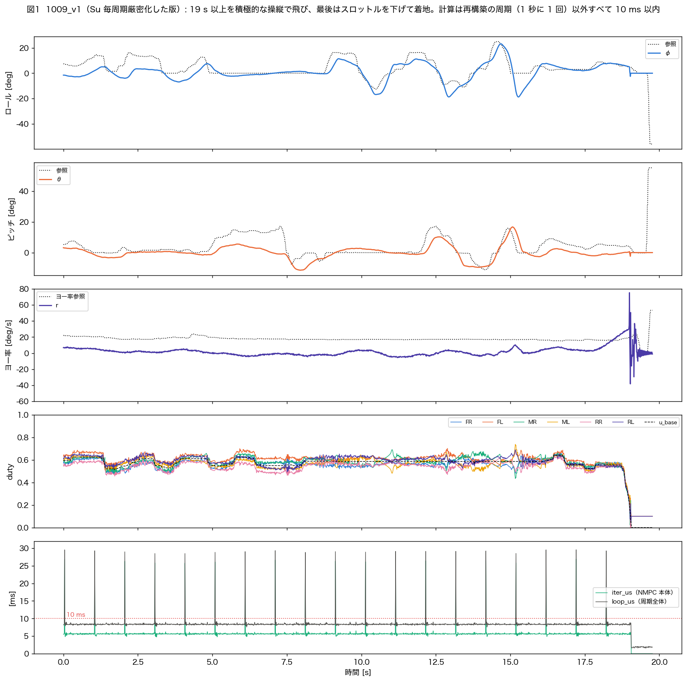
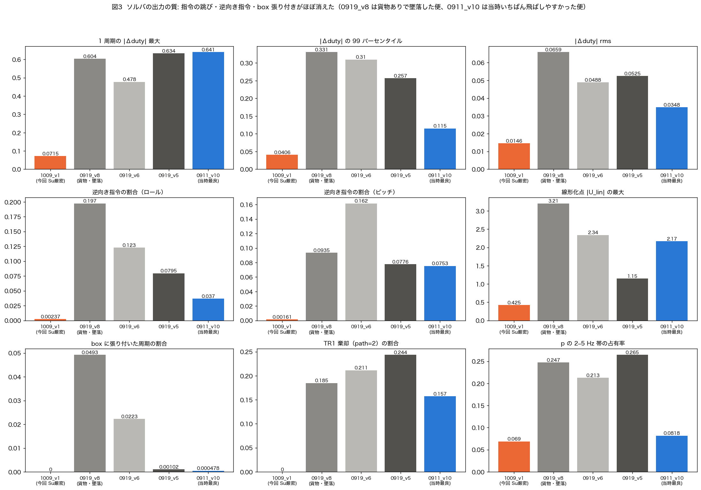
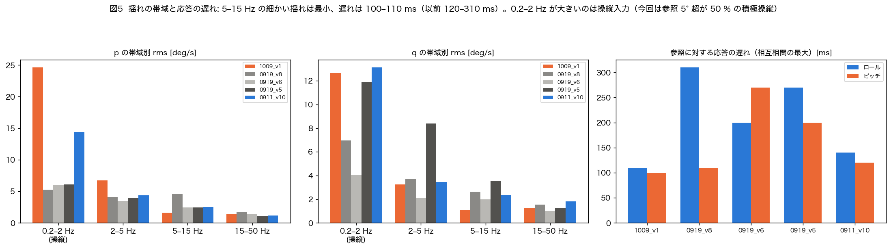

# 1009_v1 飛行評価: Su 毎周期厳密化（`NMPC_SU_EXACT=1`）の初飛行

- **日付**: 2026-10-09
- **ログ**: `Benzen_NMPC/log/1009_v1.csv`（100 Hz リング 19.8 s。飛行はそれより長く、ログは飛行途中から始まる）
- **ファーム**: NX=5, N=14, DC6, R_u=620, ADMM 4 反復, reset_period=100, **Su/Sx 毎周期厳密・TR1/SR2 不使用**（`docs/ai/decisions/20261008_su_exact_implemented_in_benzen_nmpc.md`）
- **比較**: 同じ N=14・同じ機体の以前の実機ログ — 0919_v5 / v6 / v8（TR1/SR2、v8 は貨物ありで墜落）、0911_v10（TR1/SR2、当時もっとも飛ばしやすかった便）
- **解析**: `docs/analysis/20261009_v1/analyze_1009_v1.py`（指標 `metrics.csv`）、図 `docs/figs/20261009_v1/`

---

## 0. 要約

ユーザ所見「格段に安定するようになった」は**数値でも裏付けられた**。

| | 1009_v1（今回） | 以前（0919 v5/v6/v8, 0911 v10） |
|---|---|---|
| 飛行 | **19 s 以上を積極操縦で飛び、スロットルを下げて着地**。フェイルセーフ 0 | v6/v8/v10 は角速度超過（fs=4）で終了 |
| NMPC 本体（通常周期）平均 / 最大 | **5.64 / 6.52 ms** | 6.49–6.71 / 7.69–8.25 ms |
| 周期全体 平均 | **8.57 ms** | 9.84–10.31 ms |
| **周期全体が 10 ms を超えた割合** | **1.0 %**（= 1 秒に 1 回の周期再構築だけ） | 29–37 % |
| フル再構築 | 1.0 回/s（周期分のみ）、26.4 ms | 1.5–3.1 回/s、28–39 ms |
| 1 周期の |Δduty| 最大 / p99 | **0.071 / 0.041** | 0.48–0.64 / 0.12–0.33 |
| 逆向き指令（ロール / ピッチ） | **0.2 % / 0.2 %** | 3.7–19.8 % / 7.5–16.2 % |
| box 張り付き・λ>0 | **0 / 0** | 最大 4.9 % / 5.6 % |
| 線形化点 |U_lin| の最大 | **0.43** | 1.15–3.21 |
| 5–15 Hz の細かい揺れ（p / q） | **1.6 / 1.1 deg/s**（最小） | 2.4–4.6 / 2.0–3.5 |
| 参照に対する応答の遅れ（ロール / ピッチ） | **110 / 100 ms** | 140–310 / 110–270 ms |
| 参照との相関（ロール / ピッチ） | **0.73 / 0.68** | −0.46–0.46 / 0.21–0.47 |

- **SIL の予測どおり**: 指令の跳び 0.65–0.77 → 0.10（SIL）に対し実機 0.48–0.64 → 0.071、逆向き指令 5–8 % → 0.05 %（SIL）に対し実機 4–20 % → 0.2 %。
- **計算時間は見積もり（−20 %）に近い −14〜16 %**（NMPC 本体の通常周期）。周期全体は初めて 10 ms に収まった（再構築の周期を除く）。
- **残る課題（今回の変更とは無関係）**:
  - ① 傾けて保つと姿勢が参照の 40–50 % に「垂れる」（ブローバック、SIL の予測と同じ向き）。
  - ② ヨーの定常外乱を操縦者がラダーで当て舵している（参照 +18 deg/s で実 r ≈ 0、0919_v8 と同じ傾向）。
  - ③ 1 秒に 1 回の再構築で 26–30 ms 止まる。

---

## 1. 飛行の概要（図 1）

- ログの 0–19.0 s はずっと飛行中（u_base 0.52–0.64）。ロール −12〜+25°、ピッチ −11〜+17° の参照を積極的に入れている（参照が 5° を超えている時間がロール 50 %、ピッチ 35 %。以前の便は 9–23 %）。
- 19.0 s にスロットルを 0.56 → 0.15 へ下げて着地。加速度 147 m/s² は接地の瞬間の 1 サンプルのみで、フェイルセーフは発火していない（0）。
- 最下段: NMPC 本体は通常周期で 5.4–6.5 ms、周期全体は 8.1–8.6 ms。**10 ms を超えるのは 1 秒ごとの再構築の周期（約 29 ms）だけ**。
- ログの solver_code: 通常（path 0）と再構築（path 1、1.0 %）のみ。TR1 の診断列（tr1_c 等）は全周期 0 で、**Su 毎周期厳密の版で飛んだことがログからも確認できる**。

## 2. 計算時間（図 2）

| | 1009_v1 | 0919_v8 | 0919_v6 | 0919_v5 | 0911_v10 |
|---|---|---|---|---|---|
| NMPC 本体 通常周期 平均 [ms] | **5.64** | 6.71 | 6.58 | 6.49 | 6.62 |
| 〃 p95 / 最大 [ms] | **5.89 / 6.52** | 7.85 / 8.25 | 7.63 / 8.01 | 7.62 / 8.16 | 7.35 / 7.69 |
| 周期全体 平均 [ms] | **8.57** | 9.84 | 10.31 | 10.18 | 10.19 |
| 周期全体 通常周期 p95 [ms] | **8.64** | 10.49 | 10.36 | 10.38 | 10.24 |
| 10 ms 超過の割合 | **1.0 %** | 36.6 % | 30.2 % | 29.2 % | 28.7 % |
| フル再構築 [回/s] | **1.00** | 1.51 | 3.08 | 2.97 | 2.63 |
| 再構築周期の NMPC 本体 [ms] | **26.4** | 28.4 | 39.4 | 39.3 | 36.7 |

- 通常周期の NMPC 本体は −0.85〜−1.07 ms（−14〜16 %）。事前の積和の見積もり（−20 %）より少し小さいが向きと大きさは一致。
- 再構築は「周期 100 回ごと」の分だけになった（以前は TR1 棄却 8 連続や SR2 不健全による追加の再構築が 0.5–2 回/s あった）。
- 再構築 1 回の時間（26.4 ms）は 0919_v8 の 28.4 ms とほぼ同じ（ブロック下三角化以降の値。今回の変更では変わらない部分）。

## 3. ソルバの出力の質（図 3, 4）

- 以前の便には 0.3–0.6 の指令スパイクが必ずあった（v5 は 5 s 付近、v8 は 3.5 s と墜落前、v10 は 17–18 s）。**今回は全区間で 0.07 以下**。
- 逆向き指令（姿勢誤差が 20 deg/s 相当を超えているのに、指令モーメントが崩す向き）はロール 0.24 %・ピッチ 0.16 %（判定対象 1464 周期）。以前は 3.7–19.8 %。
- box 張り付き・ADMM の双対 λ・線形化点 |U_lin| がすべて健全側。duty は 0.29–0.74（下側は着地のためにスロットルを下げた部分）で、上下限（0 / 0.95）に一度も触れていない。

## 4. 揺れと追従（図 5）

| | p 帯域 rms 0.2–2 / 2–5 / 5–15 / 15–50 Hz [deg/s] | q 同 | 応答の遅れ φ/θ [ms] |
|---|---|---|---|
| **1009_v1** | 24.6 / 6.7 / **1.6** / 1.4 | 12.6 / 3.2 / **1.1** / 1.2 | **110 / 100** |
| 0919_v6 | 6.0 / 3.4 / 2.5 / 1.4 | 4.0 / 2.1 / 2.0 / 1.0 | 200 / 270 |
| 0919_v5 | 6.1 / 4.0 / 2.4 / 1.1 | 11.9 / 8.4 / 3.5 / 1.2 | 270 / 200 |
| 0911_v10 | 14.4 / 4.4 / 2.5 / 1.2 | 13.1 / 3.4 / 2.4 / 1.8 | 140 / 120 |

- **5–15 Hz の細かい揺れが最小**（指令のスパイク・ディザが消えたため）。
- 0.2–2 Hz（と 2–5 Hz の一部）が大きいのは**操縦入力そのもの**（参照の変化が大きい積極操縦）。全帯域の p rms（25.6 deg/s）だけを見ると揺れが増えたように見えるので注意。
- **応答の遅れは 100–110 ms で、比べた中で最短**。参照との相関もロール 0.73 / ピッチ 0.68 で最大。
- ⚠ 「参照がほぼ 0 の区間の姿勢 rms」（以前の評価で使った水平保持の指標）は、今回は 0.5 s 以上続く区間が合計 1.0 s しかなく、すべて操作の合間の戻り途中なので**比較に使えない**（この指標では 9.6°/6.9° と大きく出る）。静かなホバーの評価は別の便で取ること。

## 5. 残っている課題

### 5.1 傾けて保つと「垂れる」（ブローバック）

参照 |ref| > 8° が 0.7 s 以上続いた区間（6 個、平均 1.2 s、参照 13.4°）の 姿勢/参照:

| 経過時間 | 0.2–0.5 s | 0.5–0.8 s | 0.8–1.2 s | 1.2–2.0 s |
|---|---|---|---|---|
| 1009_v1 | 0.42 | 0.51 | 0.40 | 0.14（1 区間） |
| 0911_v10（3 区間） | 0.51 | 0.63 | 0.36 | — |

- 図 1 でも 2.5–3.2 s（ロール参照 14° に対し 3°）、5.5–7 s（ピッチ参照 11–14° に対し 3–5°）で目立つ。
- SIL で推定したブローバック（`docs/20261008_plant_6dof_report.md`、ロールが 2 s で参照の数 % まで垂れる）と同じ向き。**ソルバではなく物理**なので今回の変更では変わらない（変わらないことも SIL の予測どおり）。
- 対策の候補は `docs/20261008_ekf_and_solver_fix_study.md` §4（積分は 0911 に却下済み。外乱推定＝オフセットフリー MPC は未試験）。

### 5.2 ヨーの当て舵

- 飛行中のヨー率参照は平均 **+17.7 deg/s**（15–24）で、実際のヨー率は平均 +1.9 deg/s。
- 飛行後のラダーは中立（1024）なので、飛行中は**ラダーを約 215 カウント倒し続けていた**計算になる。機体に一定のヨー外乱があり、操縦者が当て舵で向きを保っていたと見られる（推測。0919_v8 も参照平均 +14.7 / 実 +1.4 で同じ傾向）。
- NMPC から見ると「ヨー率 18 deg/s を指令されているのに 0 のまま」＝定常誤差 16 deg/s。ヨーの積分（トリム）は 0911 に実装し、v10 に戻した経緯がある（`20260911_ulin_guard_and_revert_to_v10_for_ftc.md`）。扱いはユーザ判断。

### 5.3 1 秒に 1 回の再構築による停止

- 26–30 ms の停止が 1 Hz で残る（以前の 1.5–3 Hz からは減った）。
- 「差分更新なし」と同様に、H が 1 s 古くても解の向きは保たれている（逆向き指令 0.2 %）。SIL では再構築間隔を延ばしても悪化しない可能性があるが、未検証。

## 6. 結論

- **Su 毎周期厳密化は実機でも SIL の予測どおりに効いた**: 指令スパイク・逆向き指令・box 張り付きがほぼ消え、計算時間も減って周期全体が 10 ms に収まった（再構築の周期を除く）。
- 体感の「格段に安定」は、①指令の荒れが消えたこと（5–15 Hz の揺れ最小）、②応答が速く素直になったこと（遅れ 100–110 ms、相関 0.7）で説明できる。
- 次に効くのは「垂れ」（物理）とヨーの当て舵（定常外乱）で、どちらもソルバとは別の問題。

## 7. 限界

- 1 便のみ。操縦の仕方が以前の便と違う（積極操縦）ので、揺れの全帯域 rms や水平保持の指標は比較できない。
- 墜落・貨物・耐故障の条件はまだ試していない。
- 静かなホバーの区間がほぼ無いので、ホバー中の揺れは評価できていない。
