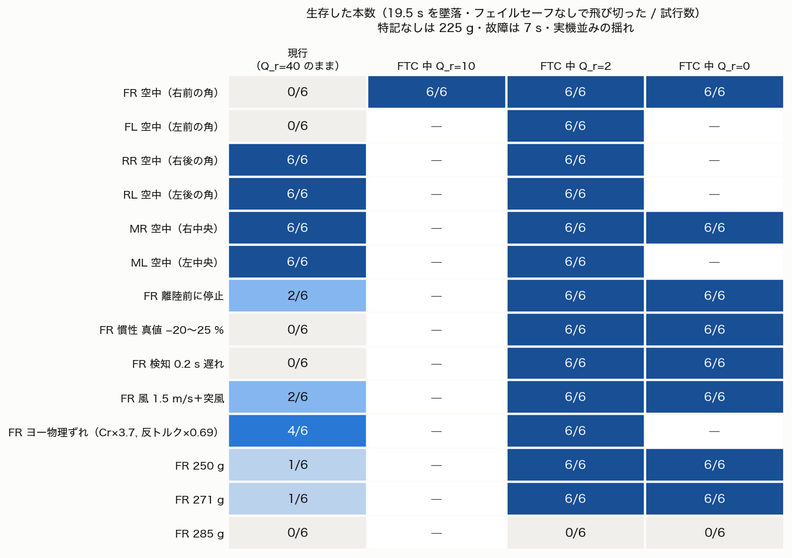
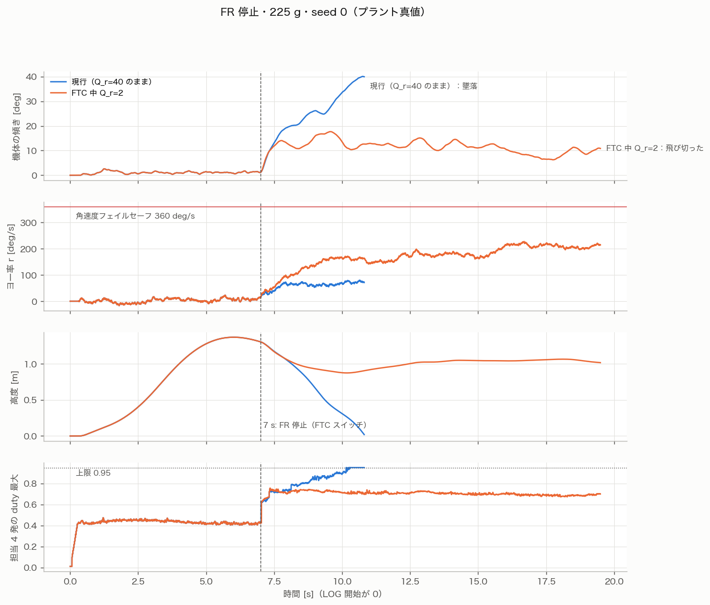
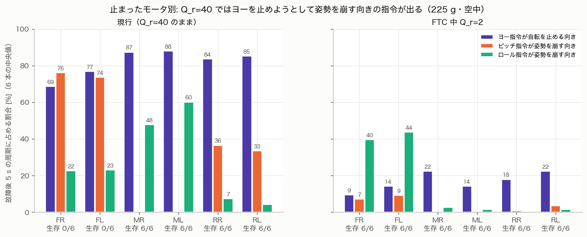
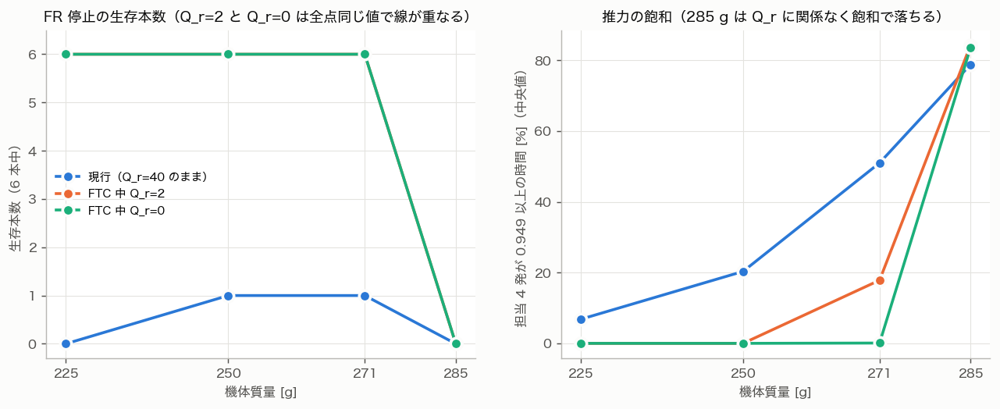

# 225 g・同じモーターで耐故障制御（1 発停止）はできるか: SIL 評価

- **日付**: 2026-10-13
- **質問**
  - プロペラガードを外して 225 g になった。慣性モーメントは測り直さずに今の値のまま使う。
  - 同じモーターのままで、耐故障制御（FTC）はできるか。
- **方法**
  - 実機ファーム `Benzen_NMPC`（現行。Su 毎周期厳密の版）をそのままホストでビルドした SIL で実験した。
  - プラントは 6 自由度の full モデル。揺れは実機並みに較正した条件（shake）。
  - 故障は、ch5 の FTC スイッチで 1 発を止める（実機の FTC 実験と同じ手順）。
- **実験の規模**: 合計 254 本。
- **結果の置き場**
  - 実験データ: `program/sil_nmpc/results/20261013_ftc225/`
  - 図: `docs/figs/20261013_ftc225/`
  - 図のスクリプト: `docs/analysis/20261013_ftc225/`
- **参照した過去記録**
  - `20260914_ftc_is_thrust_limited_not_cr_limited`
  - `20260914_param_changes_before_ftc_and_why_diagonal_cannot_share_load`
  - `20260915_uref_must_point_at_the_balanced_allocation`
  - `20260915_v2_ftc_flew_yaw_fixed_but_roll_damping_halved`
  - `20260916_ftc_thrust_feasible_at_285g_and_stale_inertia_is_safe`
  - `20260916_bench_thrust_curve_overstates_flight_thrust_ftc_has_no_authority`
  - `20260916_static_4motor_ftc_viable_at_271g_and_failsafe_scope_narrowed`
  - `20260916_relaxed_hover_*`
  - `20261006_ftc_sim_230g_falls_due_to_yaw_spin_and_altitude_loop`
  - `20261006_sim_vs_firmware_solver_and_ftc_formulation_diff`

---

## 0. 結論

1. **推力は足りるようになった。** 225 g なら 1 発止まっても、担当の 4 発は duty 0.68 で機体を支えられる。上方向の余地は 0.27 ある。
   - 271 g では 0.076、285 g では 0.012 だった。
   - 285 g は、どんな重みでも飽和して落ちる（0916 の実機便の墜落と整合する）。
   - 225 g では推力が律速ではなくなった。
2. **ただし現行ファームのままでは、前側の角（FR・FL）が止まると落ちる。**
   - 空中で止めると 0/6 本が生存した。離陸前に止めた場合は 2/6 本。
   - 後側の角（RR・RL）と中央（MR・ML）が止まった場合は 6/6 本が生存した。
3. **原因はヨー。**
   - 1 発とその対角を止めた残りの 4 発では、ヨーのモーメントを独立に作れない（混合行列の階数が 3）。
   - ヨーはロール・ピッチと必ず一緒にしか出ない。
   - 現行の重み Q_r=40 では、ソルバが自転を止めようとして姿勢を崩す向きの指令を出す（FR 停止で、ピッチ指令の 76% が逆向き）。
4. **FTC に入ったときだけ Q_r を小さくする（2 または 0）と、試したすべての条件で生存した。**
   - 6 発すべて、離陸前の停止、慣性の誤差、検知の遅れ、風、ヨーの物理のずれ、250・271 g を試した（Q_r=10・2・0 を合わせて 23 条件 × 6 本）。
   - 代わりに、機体は 110〜250 deg/s（最大 300）で**自転しながら**、傾いたまま浮く（傾きの rms 10〜17°）。
5. **「同じモーターで FTC できるか」への答え**
   - SIL の上では、ファームを 1 か所変えれば（FTC 中の Q_r を下げる）、**どのモータが止まっても浮いていられる**。
   - 現行のままでは、FR・FL の停止は無理。
   - 慣性モーメントを測り直さないことは、結果を左右しなかった（真値が 20〜25% 小さい場合も同じ結果）。
6. **実機での試験に向けて残るもの**
   - 自転中は操縦が効きにくい。スティックの指令が機体と一緒に回るため。
   - 自転の速さは、ヨーの減衰 Cr に依存する。実機の Cr は未確定。
   - 角速度のフェイルセーフ 360 deg/s までの余裕は 60〜140 deg/s しかない。



---

## 1. 条件

| 項目 | 設定 |
|---|---|
| ファーム | `Benzen_NMPC` 現行（N=14、Q=1000/1000/80/80/40、R_u=620、Su 毎周期厳密）。無改造 |
| 故障の入れ方 | ch5 の FTC スイッチ。`Ftc_target_motor` で止める発を選ぶ。止まった発は即 duty 0。NMPC にも同時に伝わる（η=0、対角の参照 0、担当 4 発の参照 1.5·u_base） |
| 故障の時刻 | 空中: 1 m でホバー中の 7 s。離陸前: スロットルを上げる前（0 s） |
| プラント（真値） | 6 自由度 full（抗力、ブローバック、ロータ回転数の遅れ 50 ms、地面効果）。推力は飛行で較正した曲線（ホバー duty は 285 g で 0.55） |
| 質量 | 225 g（比較用に 250・271・285 g） |
| 慣性モーメント | ファームは今の値のまま（Ix=1.8e-3、Iy=1.9e-3、Iz=3.0e-3）。プラントの真値は同じ値と、Ix/Iy −20%・Iz −25% の 2 通り |
| 揺れ | 実機ログに較正した shake 条件（ジャイロ雑音、加速度計雑音、機体外乱、出力の 1 周期遅れ、再構築中の出力据え置き 30 ms） |
| 操縦者（スロットル） | 高度 PD＋積分＋フィードフォワード。故障に気付いてから 0.3 s 後に、FTC の釣り合い点（担当 4 発が mg/4 を出す u_base）までスロットルを足す。水平位置は操縦しない |
| 飛行 | 0〜4 s で 1 m へ上昇 → 7 s で故障 → 12〜14 s ロール +5° → 16〜18 s ピッチ +5° → 19.5 s まで |
| 判定 | 「生存」= 19.5 s まで、姿勢 70° 超・接地・フェイルセーフのいずれも無い。各条件 6 本（乱数の種 0〜5） |

SIL 側に `sil_set_ftc_target()` を 1 つ足した（ファームの `Ftc_target_motor` を書き換えるだけ）。

---

## 2. 推力の見積もり（飛行較正の推力曲線から）

| 質量 | 健全ホバー duty | 1 発停止時の担当 4 発の duty | 1 発の上限に対する必要量 | 0.95 までの上方向余地 |
|---|---|---|---|---|
| **225 g** | 0.410 | **0.682** | **78%** | **0.268** |
| 250 g | 0.467 | 0.784 | 87% | 0.166 |
| 271 g | 0.516 | 0.874 | 94% | 0.076 |
| 285 g | 0.550 | 0.938 | 99% | 0.012 |

- 271・285 g の値は、過去の記録（0916）の値と一致する。
- 225 g では、姿勢を動かすための上方向の余地が、285 g の約 22 倍ある。
- SIL でも、225 g で生存した便は担当発が飽和しなかった（最大 0.75〜0.83、飽和時間 0%）。

---

## 3. 現行ファームの結果

| 止まった発 / 条件（225 g） | 生存 | 最大傾き | 高度の低下 | ヨー率（平均 / 最大） |
|---|---|---|---|---|
| **FR（右前の角）空中** | **0/6** | 41° | 1.3 m（接地） | +52 / 84 deg/s |
| **FL（左前の角）空中** | **0/6** | 39° | 1.3 m（接地） | −56 / 95 |
| RR（右後の角）空中 | 6/6 | 17° | 0.50 m | +25 / 64 |
| RL（左後の角）空中 | 6/6 | 16° | 0.48 m | −25 / 60 |
| MR（右中央）空中 | 6/6 | 13° | 0.36 m | −23 / 60 |
| ML（左中央）空中 | 6/6 | 12° | 0.36 m | +27 / 57 |
| FR 離陸前に停止 | 2/6 | 40° | — | +68 / 98 |
| FR 慣性の真値 −20〜25% | 0/6 | 41° | 1.3 m | +58 / 93 |
| FR 検知 0.2 s 遅れ | 0/6 | 41° | 1.3 m | +63 / 91 |
| FR 風 1.5 m/s＋突風 | 2/6 | 37° | 1.1 m | +48 / 90 |
| FR ヨー物理のずれ（Cr×3.7、反トルク×0.69） | 4/6 | 32° | 1.0 m | +37 / 77 |
| FR 雑音・遅れなし（ideal） | 0/2 | 38° | 1.3 m | +54 / 83 |
| （参考）故障なし | 6/6 | 5° | — | 0 / 26 |

- 生存の値は「生存本数 / 試行本数」。数値は 6 本の中央値。
- 前側の角が止まると、故障から 3〜4 秒で接地する。
  - 機首下げが 25〜40° まで育ち、揚力の鉛直成分が足りなくなる。
  - 担当発が 0.95 に張り付くのは最後の 1 秒だけで、**推力切れが先ではない**（図 2）。
- 雑音も遅れも無い条件（ideal）でも落ちる。したがって原因は揺れではなく、制御の構造にある。



---

## 4. なぜ落ちるのか: 4 発ではヨーを独立に作れない

### 4.1 混合行列から（確定）

FR と対角の RL が 0 のとき、残る FL・MR・ML・RR の 4 発が作るモーメントを考える。
- 4 発には推力・ロール・ピッチ・ヨーの 4 つの役割がある。
- しかし、ヨーの行は他の行の組み合わせで書けてしまう。

```
ヨー = 10 ×（ロールの行 Σk_Ym·u） + 17.65 ×（ピッチの行 Σk_Xm·u）      ← 階数 3
```

- つまり、**ロールやピッチを動かせば必ずヨーが出る。ヨーを出そうとすれば必ずロールやピッチが動く。**
- 他の発が止まった場合も同じで、どれも階数は 3 になる。
  - RR 停止: ヨー = 10·ロール − 17.65·ピッチ
  - MR 停止: ヨー = −20·ロール
- 唯一ヨーを独立に作れる対角発（FR 停止なら RL）は、参照が 0 で、下には動けない（duty は 0 未満にできない）。

### 4.2 何が起きているか（ログで確認）

1. 前の角が止まると、機首下げ・横倒し・自転が同時に始まる（止まった発のモーメントが消えるため）。
2. 機首を上げるピッチ指令を出すと、4.1 の関係で**自転を速める向きのヨー**が出る。
3. Q_r=40 は、自転を止めることにも重みを置いている。ソルバは自転を止めるために、**機首を下げる向き**のピッチを選ぶ。
4. 機首下げがさらに育ち、それを戻す指令がまた自転を速める。これを繰り返して、傾きが 40° に達する。

故障後 5 秒の周期を数えた結果（6 本の中央値、図 3）:

| 止まった発 | ヨー指令が自転を止める向き | ピッチ指令が姿勢を崩す向き | ロール指令が姿勢を崩す向き | 生存 |
|---|---|---|---|---|
| FR | 69% | **76%** | 22% | 0/6 |
| FL | 77% | **74%** | 23% | 0/6 |
| RR | 84% | 36% | 7% | 6/6 |
| RL | 85% | 33% | 4% | 6/6 |
| MR | 87% | 0% | 48% | 6/6 |
| ML | 88% | 0% | 60% | 6/6 |
| （FTC 中 Q_r=2 の FR） | **9%** | **7%** | 40% | 6/6 |



- **6 発どれが止まっても、ヨーとの綱引きは起きている。** ヨー指令の 69〜88% が自転を止める向きだった。
- 前側の角だけが落ちたのは、ピッチ側の逆向き指令が 3/4 に達して、持ちこたえる幅を超えたため。
  - なぜ前と後で差が出るのか（36% と 76%）は**未解明**。
  - 幾何は前後対称なので、プラントの前後非対称（ブローバック、抗力の向き）か、故障直後の過渡の違いが候補。
- Q_r を下げると、ヨー指令が自転を止める向きになる割合は 9% に落ち、ピッチの逆向き指令も 7% に減る。
  - ロールの逆向きは 40% 残るが、6/6 本が生存した。

> 0916 の実機 FTC 便（285 g）も、FR 停止で「機首下げ θ −25〜−28° で墜落」だった。
> 当時は推力の飽和（担当 4 発すべて 0.95）で説明した。今回の SIL でも 285 g は飽和で落ちるので、その説明は変わらない。
> ただし、同じ向きのヨーとの綱引きが重なっていた可能性はある（未確認）。

---

## 5. FTC 中だけ Q_r を下げた場合

### 5.1 どう変えたか（比較用のファーム複製でのみ。実機ファームは未変更）

- FTC スイッチが入った周期に、ヨー率の重み Q_r を 40 から 10・2・0 に差し替えた。
  - Q は H に入るので、フル再構築を 1 回要求する（26〜30 ms 止まる）。
  - 切ると 40 に戻す。
- 健全飛行には一切影響しない。**故障なしの便で、現行ファームとビット単位で同じ結果になることを確認した**（プラントの真値・100 Hz ログとも差 0）。
  - 最初の版は起動直後にも値を変えずに再構築を 1 回足していて一致しなかった。値が変わるときだけ再構築する形に直し、比較版の 150 本はすべてこの版で流し直した。
- 差分は約 20 行（`nmpc.cpp` に関数 1 つ、`control.cpp` の η を張り直す箇所に 1 行）。

⚠ ファームには、実行中に重みを変える既存の経路 `nmpc_cost_set_pending()` がある（Wi-Fi の重み設定で使う）。
- この経路は **R_u を上限 100 に丸める**（`clamp_cost_params`）。現行の R_u=620 が 100 になってしまう。
- そのため今回は使わず、Q_r だけを直接書き換えた。
- Wi-Fi から重みを送ると、同じことが実機でも起きる（今回とは別の地雷）。

### 5.2 結果

| 条件（225 g、特記なし空中） | Q_r=40（現行） | Q_r=10 | **Q_r=2** | Q_r=0 |
|---|---|---|---|---|
| FR | 0/6 | 6/6 | **6/6** | 6/6 |
| FL / RR / RL / MR / ML | 0 / 6 / 6 / 6 / 6 | — | **すべて 6/6** | MR 6/6 |
| FR 離陸前に停止 | 2/6 | — | **6/6** | 6/6 |
| FR 慣性の真値 −20〜25% | 0/6 | — | **6/6** | 6/6 |
| FR 検知 0.2 s 遅れ | 0/6 | — | **6/6** | 6/6 |
| FR 風 1.5 m/s＋突風 | 2/6 | — | **6/6** | 6/6 |
| FR ヨー物理のずれ | 4/6 | — | **6/6** | — |
| FR 250 g / 271 g | 1/6 / 1/6 | — | **6/6 / 6/6** | 6/6 / 6/6 |
| FR 285 g | 0/6 | — | 0/6（飽和 84%） | 0/6 |

生き残ったときの飛び方（FR 停止・空中・6 本の中央値）:

| | Q_r=10 | **Q_r=2** | Q_r=0 |
|---|---|---|---|
| 最大傾き | 27° | 18° | 16° |
| 傾き（故障 2 s 後〜12 s の rms） | 23° | 14° | 12° |
| 高度の低下 | 0.73 m | 0.45 m | 0.40 m |
| ヨー率（平均 / 最大） | +117 / 160 deg/s | **+170 / 239** | +199 / 289 |
| 担当発 duty の最大 | 0.85 | 0.75 | 0.75 |
| +5° のピッチ指令に対する実際のピッチ | −18.5° | −6.8° | −3.5° |
| 故障 2 s 後以降の横流れ（最大） | — | 2.0 m | 1.4 m |

- **機体は「傾いたまま自転する」状態に落ち着く。**
  - 例: Q_r=0 では θ≈−8°、p≈+30 deg/s、r≈+200 deg/s でほぼ一定。
  - 傾きは機体に固定された向きなので、自転とともに外から見た傾きの向きが回る。平均すると水平の力は打ち消され、横流れは小さい。
  - 現行のまま生き残った RR・MR は 5〜9 m 流れた（SIL の操縦者は水平位置を直さない）。
- 過去に設計した relaxed hover（`Relax_enable`、平衡 723 deg/s・傾き 5〜6°）と同じ種類の状態に、参照を与えなくても自分で落ち着いた形になる。
  - 回転数は relaxed hover の 1/3〜1/4 と遅い。
- Q_r=10 は生存するが、傾きが大きく（rms 23°）、ピッチが参照から 23° ずれる。**2 が釣り合いの良い値**。
  - 0 は傾きが小さい代わりに、自転が最大 300 deg/s と、フェイルセーフ（360）に近い。
- 中央（MR）停止では、現行（Q_r=40）でも 6/6 で、自転も −23 deg/s と遅い。Q_r=2 にすると −158 deg/s で回る。
  - 「止まった発によって Q_r を変える」こともできる。ただし前側の角を救うには、どのみち Q_r を下げる必要がある。

---

## 6. 慣性モーメントを測り直さないことについて

- プラントの真値を Ix/Iy −20%、Iz −25% にしても、結果は変わらなかった。
  - 現行: FR 停止 0/6 → 0/6。
  - Q_r=2: 6/6 → 6/6。傾き・自転とも差は 10% 以内。
- 0916 の判断（「古い慣性モーメントは、制御を弱める側＝安全側に効く」）と矛盾しない。**225 g でも測り直しは不要**と判断する。
- ⚠ ここでいう真値の倍率は仮定。プロペラガードの重さと取り付け半径は測っていない。

---

## 7. 実機で試すなら（提案。未実装）

1. **ファームの変更は 1 か所**: FTC スイッチで η を張り直す箇所で、Q_r を 2 にする（切ったら 40 に戻す）。
   - `nmpc_cost_set_pending()` は R_u を 100 に丸めるので使わない。Q_r だけを差し替える関数を足す（比較用の複製と同じ形）。
2. **試す順番**
   1. 健全飛行で、新しいファームに異常がないことを確認する（健全時は何も変わらないはずなので、回帰の確認）。
   2. 係留または低空で、**中央の発（MR）**を止める。現行の重みでも SIL で 6/6 だった最も易しいケース。
   3. 次に後側の角（RR）を止める。
   4. 最後に前側の角（FR）を止める。
3. **自転への備え**
   - 自転中は、スティックの指令（機体座標）が機体と一緒に回る。操縦者が水平位置を直そうとしても、思った向きには動かない。
   - 広い場所で、低高度で、すぐスロットルを下げられる態勢で試すこと。
   - 角速度のフェイルセーフ 360 deg/s に対して、SIL の自転は最大 240〜300 deg/s。
     - `Relax_enable` を立てると上限は 1200 deg/s に緩むが、それは relaxed hover 用の設定。
     - 静的 4 発のまま緩めるのは過去に戻した経緯がある（0916）。まずは 360 のまま試し、ログで余裕を見る。
4. **ヨーの物理の不確かさ**
   - 実機の Cr（9.5e-5〜3.7e-4）と反トルクの係数は確定していない。
   - SIL で Cr×3.7・反トルク×0.69 にすると、自転は 170 から 111 deg/s に遅くなり、傾きはやや大きくなった（rms 17°）。生存は 6/6 のまま。
5. 225 g でも**スロットルの窓**は残る。
   - 担当発の参照は 1.5·u_base で、上限 0.95 を超えない u_base は 0.633 まで。
   - 225 g の釣り合いは 0.455 なので、窓は広い。271 g のときは 8% しかなかった。

---

## 8. 限界

- **プラントのモデル（ヨーの減衰・反トルク・ブローバック）は推定値。** 前後の非対称の理由は未解明。
- 故障は「スイッチで止める」形だけ。実際の故障（推力が徐々に落ちる、片側だけ回る）は試していない。部分故障（0<η<1）も試していない。
- 操縦者は理想化している。
  - スロットルの足し方は事前に知っている前提（反応 0.3 s）。
  - 水平位置は操縦しない。
- 自転中の EKF の誤差は最大 4〜6°で、生存には効いていない。ただし実機の振動は SIL と違いうる。
- 自転中の EKF の監視（`ekf_drift_watch`、5 deg/s）が働いた回数は、SIL のログに出ないので数えていない。
  - 働いた場合の処理は、ジャイロバイアスを静止時の値に戻すだけで、飛行は止めない。
- relaxed hover（`Relax_enable=1`）は試していない。平衡の表が 285 g・FR 専用で解かれていて、225 g では解き直しが必要なため。

---

## 9. 再現手順

```bash
cd program/sil_nmpc
cmake -S . -B <b_ftc> -DCMAKE_BUILD_TYPE=Release && cmake --build <b_ftc> -j 8      # 現行ファーム

# FTC 中 Q_r を変える比較版（ファームの複製に patch_ftcqr.py を当てる）
rsync -a --exclude 'build*' --exclude tools --exclude docs --exclude log <Benzen_NMPC>/ <fw_ftcqr>/
python3 results/20261013_ftc225/patch_ftcqr.py <fw_ftcqr>
cmake -S . -B <b_qr2> -DFW_DIR=<fw_ftcqr> -DCMAKE_BUILD_TYPE=Release -DCMAKE_CXX_FLAGS="-DSIL_FTC_QR=2.0f" && cmake --build <b_qr2> -j 8

# 1 本
cd host
SIL_BUILD_DIR=<b_ftc> python3 run_ftc_eval.py --mass 0.225 --motor FR --mode air --seed 0 --out x.npz
# まとめて（ジョブ表の SIL_BUILD_DIR は作成者の環境のパス）
python3 run_jobs.py ../results/20261013_ftc225/jobs_base.txt -j 8

# 集計と図
cd ../results/20261013_ftc225 && <matplotlib のある python> analyze_ftc.py
<matplotlib のある python> docs/analysis/20261013_ftc225/figs_ftc225.py docs/figs/20261013_ftc225
```

⚠ `runs/` は 311 MB ある。コミットしないこと。


