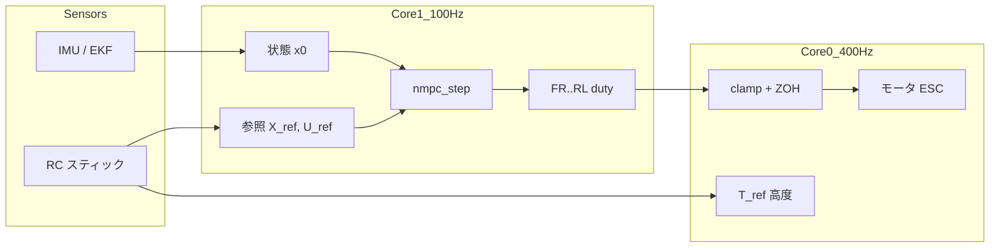

# Benzen_NMPC 実装解説レポート

Raspberry Pi Pico 2 W 上で動作する Hexa-X ヘキサコプタ向け **非線形モデル予測制御 (Nonlinear Model Predictive Control, NMPC)** の実装について、数学的定式化・アルゴリズム・実機統合・パラメータ設計を体系的に解説する。

---

## 1. 概要

### 1.1 目的

本プロジェクトは、既存 PID ベースの姿勢制御を **NMPC** に置き換えることを目的とする。高度制御（スロットル `T_ref`）は従来の PID / スティック入力のまま維持し、**ロール・ピッチ・ヨー（姿勢）制御のみ** を NMPC が担当する。

### 1.2 制御対象機体

| 項目 | 内容 |
|------|------|
| マイコン | Raspberry Pi Pico 2 W (RP2350) |
| 機体 | Hexa-X（6 モータ） |
| 制御周期 | 100 Hz（`angle_control` / core1） |
| モータ出力 | 400 Hz ZOH（`rate_control` / core0） |
| 参照実装 | `nmpc_simulation.py`（Hexa-X 6 発、シミュレーション実証済み） |

### 1.3 設計方針

- **絶対モード**: 最適化変数 `U` は各モータの **絶対 duty**（0〜1）。加算合成（PKG-C）方式は未採用。
- **`U_ref` = ホバー baseline**: スロットルから算出した `u_hover` を全ホライズンにタイルし、入力コストで baseline 付近へ引く。`B_c · 1 = 0` より共通モードは baseline を維持し、姿勢補正は差分的に作用する。
- **RTI + 準ニュートン更新**: 毎周期フル SQP は行わず、Real-Time Iteration (RTI) と TR1/SR2 による Hessian / 予測行列の差分更新で計算量を削減。
- **Box 制約 ADMM**: モータ duty の `[0, 1]` 制約を ADMM で処理（RTI では 1 反復）。

---

## 2. システムアーキテクチャ

### 2.1 マルチコア構成

```
┌─────────────────────────────────────────────────────────────┐
│  core0 (main)                    core1 (angle_control)    │
│  ─────────────────               ────────────────────────   │
│  ・400Hz rate_control            ・100Hz Kalman + NMPC      │
│  ・FR_duty..RL_duty を ZOH 出力   ・nmpc_step() 実行        │
│  ・セーフティ (Disable/OverG)     ・グローバル duty 更新    │
│  ・10Hz ベンチログ出力                                      │
└─────────────────────────────────────────────────────────────┘
         ↑ 100Hz で更新された duty を 400Hz で読み出し
```

| タスク | 周期 | コア | 役割 |
|--------|------|------|------|
| `angle_control` | 100 Hz | core1 | EKF 姿勢推定、参照生成、`nmpc_step`、duty 書込 |
| `rate_control` | 400 Hz | core0 | duty clamp、フェイルセーフ、`set_duty_*` 出力 |
| `debug_print_nmpc_bench` | 10 Hz | core0 | USB シリアルへベンチ CSV 出力 |

### 2.2 ソースファイル構成

| ファイル | 役割 |
|----------|------|
| `nmpc_params.hpp` | 物理定数、ホライズン、コスト重み、RTI/ADMM パラメータ |
| `nmpc_model.hpp/cpp` | プラントモデル（連続時間ダイナミクス、ヤコビアン、離散化） |
| `nmpc.hpp/cpp` | NMPC コア（凝縮形、TR1/SR2、Cholesky、ADMM） |
| `control.cpp` | フライトコントローラ統合（`#ifdef USE_NMPC`） |
| `tools/plot_nmpc_log.py` | ベンチログ可視化 |

### 2.3 コンパイルスイッチ

| マクロ | 効果 |
|--------|------|
| `USE_NMPC` | PID 姿勢制御を NMPC に置換（`control.cpp` L8） |
| `NMPC_BENCH_LOG` | 10 Hz ベンチ CSV、机上検証用参照固定 |
| `NMPC_TR1_VERIFY` | 定期フル再構築を無効化（SR2 失敗時のみ reset） |
| `EIGEN_NO_MALLOC` | Eigen の動的メモリ確保を禁止（組込み向け） |

---

## 3. 状態・入力・プラントモデル

### 3.1 状態ベクトル

5 次元の姿勢ダイナミクス:

\[
\mathbf{x} = [\phi,\ \theta,\ p,\ q,\ r]^T \in \mathbb{R}^5
\]

| 要素 | 意味 |
|------|------|
| \(\phi\) | ロール角 [rad] |
| \(\theta\) | ピッチ角 [rad] |
| \(p\) | ロール角速度 [rad/s] |
| \(q\) | ピッチ角速度 [rad/s] |
| \(r\) | ヨー角速度 [rad/s] |

実機では EKF 推定値からバイアスを差し引いた値を使用:

```cpp
x0(0) = Phi - Phi_bias;
x0(1) = Theta - Theta_bias;
x0(2) = Wp - Pbias;
x0(3) = Wq - Qbias;
x0(4) = Wr - Rbias;
```

### 3.2 入力ベクトル

6 次元（各モータ正規化推力 duty、範囲 \([0, 1]\)）:

\[
\mathbf{u} = [u_{fr}, u_{fl}, u_{mr}, u_{ml}, u_{rr}, u_{rl}]^T \in \mathbb{R}^6
\]

実機モータ順序 `[FR, FL, MR, ML, RR, RL]` に対応し、`U_opt(0..5)` をそのまま `FR_duty..RL_duty` に割り当てる。

### 3.3 連続時間ダイナミクス

\[
\dot{\mathbf{x}} = f(\mathbf{x}, \mathbf{u})
\]

**運動学（オイラー角）:**

\[
\begin{aligned}
\dot{\phi} &= p + q\sin\phi\tan\theta + r\cos\phi\tan\theta \\
\dot{\theta} &= q\cos\phi - r\sin\phi
\end{aligned}
\]

**动力学（剛体 + 空力ダンピング + モータトルク）:**

\[
\begin{aligned}
\dot{p} &= (B_c \mathbf{u})_p + \frac{-(I_z - I_y)qr - C_p p|p|}{I_x} \\
\dot{q} &= (B_c \mathbf{u})_q + \frac{-(I_x - I_z)rp - C_q q|q|}{I_y} \\
\dot{r} &= (B_c \mathbf{u})_r + \frac{-(I_y - I_x)pq - C_r r|r|}{I_z}
\end{aligned}
\]

角速度の絶対値 \(|p|\) 等は数値安定のため **平滑化**:

\[
|v| \approx \sqrt{v^2 + \varepsilon^2}, \quad \varepsilon = \texttt{damping\_eps} = 10^{-3}
\]

### 3.4 入力行列 \(B_c\)

\(B_c\) は状態に依存せず、Hexa-X 幾何から定数として構築（`model_B_const`）:

\[
\begin{aligned}
B_c(2, k) &= -y_k \cdot l \cdot T_{max} / I_x \quad \text{(roll)} \\
B_c(3, k) &= +x_k \cdot l \cdot T_{max} / I_y \quad \text{(pitch)} \\
B_c(4, k) &= s_k \cdot C_{QT} \cdot T_{max} / I_z \quad \text{(yaw)}
\end{aligned}
\]

モータ配置（\(l =\) `arm_length`、単位は \(l\) 倍）:

| idx | モータ | \(x_k\) | \(y_k\) | \(s_k\) (ヨー符号) |
|-----|--------|---------|---------|-------------------|
| 0 | FR | +0.866 | +0.5 | -1 |
| 1 | FL | +0.866 | -0.5 | +1 |
| 2 | MR | 0.0 | +1.0 | +1 |
| 3 | ML | 0.0 | -1.0 | -1 |
| 4 | RR | -0.866 | +0.5 | -1 |
| 5 | RL | -0.866 | -0.5 | +1 |

**サニティチェック**（起動時 `model_sanity()`）:

1. \(B_c \mathbf{1} = \mathbf{0}\)（全 6 発均等推力で姿勢トルク 0）
2. \(B_c\) の姿勢行（2〜4 行）のランク = 3

### 3.5 離散化

オイラー法（サンプリング \(dt = 0.01\) s）:

\[
A_d = I + dt \cdot A_c, \quad B_d = dt \cdot B_c
\]

非線形 1 ステップシミュレーション:

\[
\mathbf{x}_{k+1} = \mathbf{x}_k + dt \cdot f(\mathbf{x}_k, \mathbf{u}_k)
\]

---

## 4. NMPC 問題の定式化

### 4.1 予測ホライズン

| 記号 | 値 | 意味 |
|------|-----|------|
| \(N\) | 20 | 予測ステップ数 |
| \(dt\) | 0.01 s | サンプリング周期 |
| \(NX\) | 5 | 状態次元 |
| \(NU\) | 6 | 入力次元 |
| \(NX_{total}\) | 100 | \(NX \times N\) |
| \(NU_{total}\) | 120 | \(NU \times N\) |

予測時間幅: \(T_p = N \cdot dt = 0.2\) s

### 4.2 コスト関数

スタック化した状態 \(\mathbf{X} \in \mathbb{R}^{NX_{total}}\)、入力 \(\mathbf{U} \in \mathbb{R}^{NU_{total}}\) に対し:

\[
J(\mathbf{U}) = \frac{1}{2}(\mathbf{X} - \mathbf{X}_{ref})^T \bar{Q} (\mathbf{X} - \mathbf{X}_{ref})
           + \frac{1}{2}(\mathbf{U} - \mathbf{U}_{ref})^T \bar{R} (\mathbf{U} - \mathbf{U}_{ref})
\]

- \(\bar{Q}\), \(\bar{R}\): 対角行列（ステージコスト + 終端コスト倍率 `terminal_scale`）
- 終端ステップ \(k = N-1\) のみ \(Q\) を `terminal_scale` 倍

**現在の重み**（`nmpc_params.hpp`）:

| パラメータ | 値 | 備考 |
|-----------|-----|------|
| \(Q_\phi, Q_\theta\) | 1.0 | シミュ値 100 から暫定低減 |
| \(Q_p, Q_q\) | 0.1 | |
| \(Q_r\) | 0.05 | |
| \(R_u\) | 20.0 | 入力を baseline へ引く |
| `terminal_scale` | 10.0 | |

### 4.3 凝縮形（Condensed Form）

線形化予測モデル:

\[
\mathbf{X} = S_x \mathbf{x}_0 + S_u \mathbf{U}
\]

ここで \(S_x \in \mathbb{R}^{NX_{total} \times NX}\)、\(S_u \in \mathbb{R}^{NX_{total} \times NU_{total}}\) は各ステップの \(A_d, B_d\) を連鎖して構築。

コストを \(\mathbf{U}\) のみに関する二次関数に凝縮:

\[
J(\mathbf{U}) = \frac{1}{2}\mathbf{U}^T H \mathbf{U} + \mathbf{g}^T \mathbf{U} + \text{const}
\]

\[
H = S_u^T \bar{Q} S_u + \bar{R}
\]

勾配（毎周期再計算）:

\[
\mathbf{g} = S_u^T \bar{Q}(S_x \mathbf{x}_0 - \mathbf{X}_{ref}) - \bar{R} \mathbf{U}_{ref}
\]

### 4.4 入力制約

各モータ duty:

\[
0 \le u_i \le 1
\]

---

## 5. ソルバーアルゴリズム

### 5.1 全体フロー（`nmpc_step`）

```
warm_start_shift (U, z, λ を 1 ステップシフト)
        │
        ▼
┌───────────────────┐     Yes    ┌─────────────────────┐
│ フル再構築必要？   │───────────►│ full_rebuild_sx_su  │
│ (pending/period)  │            │ full_rebuild_chol   │
└───────────────────┘            └─────────────────────┘
        │ No                              │
        ▼                                 │
 nonlinear_rollout (非線形シミュレーション) │
        │                                 │
        ▼                                 │
 TR1: Sx, Su を rank-1 更新              │
        │                                 │
        ▼                                 │
 SR2: Cholesky を rank-2 更新             │
        │ (失敗時 → フル再構築)            │
        └────────────┬────────────────────┘
                     ▼
            compute_gradient (g)
                     ▼
            ADMM solve (Box 制約)
                     ▼
            U_opt = z の先頭 NU 要素
                     ▼
            スナップショット保存 (次周期 TR1 用)
```

### 5.2 Real-Time Iteration (RTI)

従来の NMPC は複数の SQP 反復を行うが、本実装は **1 周期 1 反復** の RTI スキームを採用:

1. 線形化点 \((\mathbf{x}_0, \mathbf{U}_{lin})\) で予測行列を更新
2. 二次問題（+ Box 制約）を 1 回求解
3. 解の先頭ブロック \(\mathbf{u}_0^*\) を適用（receding horizon）

**Warm-start**: 前周期の解 \(\mathbf{U}\) を 1 ステップシフトして初期値とする。

### 5.3 フル再構築（`full_rebuild_sx_su`）

線形化軌道 \(\mathbf{x}_{traj}\) 上で各ステップ \(k = 0..N-1\):

1. `model_jacobians` → \(A_c, B_c\)
2. `discretize_euler` → \(A_d, B_d\)
3. \(S_x, S_u\) を再帰的に更新
4. `simulate_step` で \(\mathbf{x}_{traj}\) を前進

**Hessian 再構築**（`full_rebuild_chol`）:

\[
M = S_u^T \bar{Q} S_u + \bar{R} + \rho I
\]

\(M\) を Cholesky 分解 \(LL^T = M\)（ADMM 用）。

**再構築トリガ**:

| 原因コード | 条件 |
|-----------|------|
| `NMPC_REBUILD_INIT` | 初期化 |
| `NMPC_REBUILD_EXTERNAL` | 非武装時 `nmpc_reset_request()` |
| `NMPC_REBUILD_PERIOD` | `cycles_since_reset >= reset_period` (100) |
| `NMPC_REBUILD_SR2_BAD_C` | SR2 係数 \(c\) が異常 |
| `NMPC_REBUILD_SR2_UNHEALTHY` | Cholesky が非正定 |

`reset_period = 100` は差分更新の数値誤差累積対策（約 1 秒に 1 回）。

### 5.4 TR1: 予測行列の準ニュートン更新

前周期との割線条件から Broyden 風 rank-1 更新:

\[
\mathbf{s}_x = \mathbf{x}_0 - \mathbf{x}_{0,prev}, \quad
\mathbf{s}_u = \mathbf{U}_{lin} - \mathbf{U}_{lin,prev}
\]

非線形 rollout 結果 \(\mathbf{X}_{nl}\) との残差:

\[
\mathbf{r} = \mathbf{X}_{nl} - \mathbf{X}_{lin,prev} - S_x \mathbf{s}_x - S_u \mathbf{s}_u
\]

\[
\mathbf{u}_{rk1} = \frac{\mathbf{r}}{\|\mathbf{s}_x\|^2 + \|\mathbf{s}_u\|^2}
\]

\[
S_x \leftarrow S_x + \mathbf{u}_{rk1} \mathbf{s}_x^T, \quad
S_u \leftarrow S_u + \mathbf{u}_{rk1} \mathbf{s}_u^T
\]

\(\|\mathbf{s}\|\) が `secant_min_norm` 未満の場合は更新スキップ。

### 5.5 SR2: Hessian の Cholesky 差分更新

TR1 更新に伴い \(H = S_u^T \bar{Q} S_u + \bar{R}\) も変化する。フル再構築を避け、Cholesky 因子 \(L\) に対し **rank-2 更新**（外積パッチ 2 回）:

\[
L \leftarrow \text{rankUpdate}(L, \mathbf{p}, +1), \quad
L \leftarrow \text{rankUpdate}(L, \mathbf{q}, -1)
\]

SR2 失敗時は `need_full_rebuild` を立て、同一周期内でフル再構築にフォールバック。

### 5.6 ADMM による Box 制約処理

等式制約付き二次問題を ADMM で解く。ADMM 用 Hessian:

\[
M = H + \rho I, \quad \rho = \texttt{admm\_rho} = 1.0
\]

**1 反復**（`admm_max_iter = 1`、RTI 向け）:

```
U  ← M^{-1} (-g + ρ(z - λ))     // Cholesky solve
z  ← clip(U + λ, U_min, U_max)   // Box 射影
λ  ← λ + U - z                   // 双対更新
```

出力は射影後の \(\mathbf{z}\) の先頭 \(NU\) 要素。

---

## 6. フライトコントローラ統合

### 6.1 参照信号の生成

`angle_control`（100 Hz）内:

| 信号 | ソース |
|------|--------|
| \(\phi_{ref}\) | スティック CH4 + `Phi_trim` |
| \(\theta_{ref}\) | スティック CH2 + `Theta_trim` |
| \(r_{ref}\) (`Psi_ref`) | スティック CH1（ヨー **角速度** 目標） |
| \(p_{ref}, q_{ref}\) | 0（角速度は安定化） |
| \(u_{hover}\) | `T_ref * T_ref_coe`（0〜0.95 に clip） |

\(\mathbf{X}_{ref}\), \(\mathbf{U}_{ref}\) は全ホライズンに同一値をタイル。

### 6.2 高度制御との分離

- **NMPC**: 6 モータ duty を直接出力（姿勢）
- **PID / スロットル**: `T_ref` により総推力（高度）を制御
- `U_ref = u_hover` により、NMPC は baseline 付近で姿勢のみ補正

### 6.3 非武装・フェイルセーフ

| 条件 | 動作 |
|------|------|
| `T_ref/BATT < Flight_duty` | `nmpc_reset_request()`、バイアス更新、duty = `Disable_duty` |
| NaN duty | `rate_control` で `Disable_duty` に置換 |
| OverG | `motor_stop()` |
| 低スロットル着地 | warm-start 破棄、次回フル再構築 |

### 6.4 400 Hz 出力経路

NMPC モードでは `rate_control` 内の PID ミキサをバイパスし、100 Hz で更新された `FR_duty..RL_duty` を 400 Hz で clamp + 出力（Zero-Order Hold）。

---

## 7. 物理パラメータ

`nmpc_params.hpp` の `physical::` 名前空間:

| パラメータ | 値 | 単位 |
|-----------|-----|------|
| \(I_x\) | 6.10×10⁻³ | kg·m² |
| \(I_y\) | 6.53×10⁻³ | kg·m² |
| \(I_z\) | 1.16×10⁻² | kg·m² |
| \(C_p, C_q, C_r\) | 0.01, 0.025, 0.005 | 空力ダンピング |
| `arm_length` | 0.050 | m |
| `mass` | 0.200 | kg |
| `T_max` | 2.725 | N（duty=1 時 1 モータ推力、暫定値） |
| `C_QT` | \(C_Q / C_t\) ≈ 0.036 | 反トルク/推力比 |

---

## 8. メモリ・計算量

### 8.1 メモリ配置

`NmpcContext`（約 200 KB）は **BSS 上の static 確保**。core1 スタックは 4 KB に制限されるため、大きな一時配列は `NmpcScratch` に集約。

| 行列 | サイズ | 概算 |
|------|--------|------|
| \(S_u\) | 100×120 | 48 KB |
| \(M(H)\) | 120×120 | 57.6 KB |
| Cholesky \(L\) | 120×120 | 57.6 KB |

`EIGEN_NO_MALLOC` により実行時ヒープ確保を禁止。

### 8.2 計算量

| 処理 | 次数 | 頻度 |
|------|------|------|
| フル Cholesky | O(120³) | 約 100 周期に 1 回 |
| SR2 rank-2 更新 | O(120²) | 通常周期 |
| ADMM 1 反復 | O(120²) | 毎周期 |

### 8.3 実測性能（ログ `nmpc_12.log` より）

| 指標 | 典型値 |
|------|--------|
| `iter_us`（`nmpc_step` 所要時間） | 8.7〜9.4 ms |
| `loop_us`（`angle_control` 1 周期） | 10.5〜11.4 ms |
| 100 Hz 周期 | 10 ms |

**注意**: 現状 `iter_us` が 10 ms 周期をわずかに超過しており、100 Hz 厳守には最適化または \(N\) 縮小（15 等）の検討余地がある。目標は `< 10 ms`（plan.md Phase 4）。

---

## 9. 初期化シーケンス

```
control_init()
  ├─ nmpc_init(g_nmpc_ctx)       // フラグ・ゼロ初期化
  ├─ nmpc_warmup(g_nmpc_ctx)     // core0 で初回フル再構築（core1 初回ピーク回避）
  └─ model_sanity()              // B_c 検証 → PASS/FAIL 表示
```

`nmpc_warmup` は Cholesky の初回計算を core0 で先行実行し、core1 起動後のスタックオーバーフローを防ぐ。

---

## 10. デバッグ・検証

### 10.1 ベンチログ（`NMPC_BENCH_LOG`）

core0 が 10 Hz で USB シリアルに CSV 出力。主要列:

| 列 | 内容 |
|----|------|
| `phi, theta, p, q, r` | 状態 |
| `phi_ref, theta_ref, psi_ref` | スティック入力に応じた姿勢目標（机上検証の NMPC 参照上書き前の値） |
| `T_ref` | スロットル目標 [V]（`u_base = T_ref * T_ref_coe`） |
| `u_fr..u_rl` | NMPC 出力 duty |
| `iter_us, loop_us` | 演算時間 |
| `reset_cause, path, tr1` | ソルバー内部状態 |
| `cost` | 評価値 \(J(U^*)\) |

可視化: `python tools/plot_nmpc_log.py log/nmpc_12.log`

### 10.2 机上検証モード

`Arm_flag == 2` 時:

- NMPC 参照を \(\phi=\theta=r=0\) に固定（テレメの `phi_ref` 等はスティック由来のまま記録）
- スロットル `T_ref = 0.2 * BATTERY_VOLTAGE * (CH3 正規化)`（`Arm_flag==2` でも CH3 に追従）
- リモコン無しでも NMPC 動作確認可能

---

## 11. PID 制御との比較

| 項目 | PID（従来） | NMPC（本実装） |
|------|------------|----------------|
| 制御構造 | カスケード（角度→角速度→ミキサ） | 6 入力直接最適化 |
| 予測 | なし | 0.2 s 先まで |
| 制約 | 事後 sat | 予測中に Box 制約考慮 |
| 計算 | 軽量 | 8〜10 ms/周期 |
| 切替 | `#ifndef USE_NMPC` | `#ifdef USE_NMPC` |

従来ミキサ（PID モード）:

```
FR = T*coe + (-1.7655 P + 3.0562 Q - 1.7655 R)
...
```

NMPC モードではこのミキサは使用せず、最適化結果が直接 duty になる。

---

## 12. 今後の拡張（plan.md より）

1. **実機パラメータ同定**: `T_max`、`T_ref_coe` のホバー duty からの逆算
2. **コスト重みチューニング**: シミュ値（\(Q_\phi=Q_\theta=100\) 等）への復帰
3. **\(N\) の最適化**: メモリ/時間トレードオフ（20 vs 15）
4. **FDI + B 列更新**: モータ故障時の `set_eta` 相当（Phase 6）
5. **ヨー符号**: 実機通電テストでの最終確認

---

## 13. 参考文献・関連ファイル

- 実装計画: [`plan.md`](../plan.md)
- シミュレーション参照: `NMPC_simulation/nmpc_simulation.py`（Hexa-X）
- 主要 API:
  - `nmpc::nmpc_step()` — 1 周期 RTI
  - `nmpc::nmpc_mark_external_rebuild()` — warm-start 破棄
  - `nmpc::model_f()` / `model_jacobians()` — プラントモデル

---

## 付録 A: 数学記号一覧

| 記号 | 意味 |
|------|------|
| \(N\) | 予測ホライズン長 |
| \(S_x, S_u\) | 凝縮形予測行列 |
| \(H\) | Hessian \(S_u^T \bar{Q} S_u + \bar{R}\) |
| \(M\) | ADMM 用 \(H + \rho I\) |
| \(\rho\) | ADMM ペナルティ |
| RTI | Real-Time Iteration |
| TR1 | 予測行列 rank-1 更新 |
| SR2 | Cholesky rank-2 更新 |

## 付録 B: データフロー図



---

*本レポートは Benzen_NMPC リポジトリのソースコード（2025年6月時点）に基づく。*
