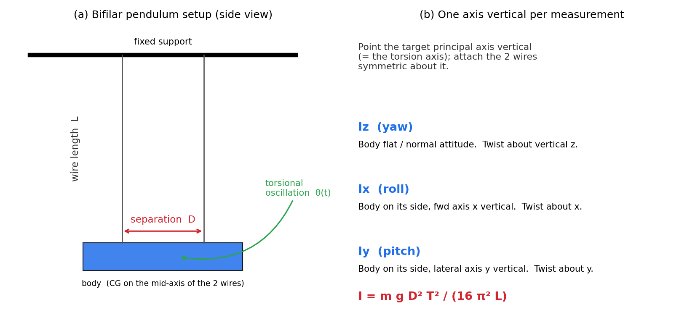

# 二線式（2点吊り）振り子による慣性モーメント測定 — 調査

対象: Hexa-X 機体の主軸慣性モーメント $I_x, I_y, I_z$ の実験同定
用途: `nmpc_params.hpp` の `Ix, Iy, Iz` を実測値で確定（現状は推定値）
換算/設計ツール: `docs/bifilar_inertia.py`、図: `docs/sysid_figs/bifilar_setup.png`

---

## 1. 原理

機体を**平行な2本の糸（ワイヤ）**で吊り、鉛直軸まわりに微小角ねじって放すと**ねじり振動**する。
2本吊りなので **bifilar（二線式）振り子**と呼ぶ。糸の張力が復元トルクを生み、振動周期が
その軸まわりの慣性モーメントに一意に対応するため、**周期を測れば $I$ が求まる**。

### 復元トルクと運動方程式
- ワイヤ長 $L$、2線の間隔 $D$（軸から各線まで $b=D/2$）、機体質量 $m$（張力は各線 $mg/2$）。
- 台を微小角 $\theta$ ねじると各線が $\varphi=b\theta/L$ だけ振れ、水平復元力 $\approx (mg/2)\,\varphi$。
- 復元トルク $= -\dfrac{mg\,b^2}{L}\theta$。運動方程式 $I\ddot\theta = -\dfrac{mg b^2}{L}\theta$（単振動）。

### 周期と慣性モーメント
$$
T = 2\pi\sqrt{\frac{I\,L}{m g\, b^2}}
\quad\Longleftrightarrow\quad
\boxed{\,I = \frac{m g\, D^2\, T^2}{16\pi^2 L}\,}\qquad(b=D/2)
$$

$m$=質量, $g$=9.81, $D$=2線間隔, $L$=ワイヤ長, $T$=1周期。
この式は小振幅（線形）近似。UAV での標準手法で、Jardin & Mueller (2009) 等で確立している。

---

## 2. $I_x, I_y, I_z$ の取り方（3姿勢）

**測りたい主軸を鉛直（＝ねじり軸）**に向け、その軸に対称に2線を取り付ける（図b）。

| 軸 | 機体姿勢 | ねじり軸 |
|---|---|---|
| $I_z$（ヨー） | 水平（通常飛行姿勢） | 鉛直 z |
| $I_x$（ロール） | 横倒し（前後軸 x を鉛直に） | x |
| $I_y$（ピッチ） | 横倒し（左右軸 y を鉛直に） | y |

$I_x, I_y$ は機体を90°倒して吊る必要があるため、**姿勢を保持する軽量ジグ**があると安定する。

---

## 3. この機体での期待周期（設計目安）

現行推定 $I_x{=}6.10, I_y{=}6.53, I_z{=}11.6\ (\times10^{-3})$、$m{=}0.356$ kg で計算した周期 $T$［s］:

| $L$ | $D$ | $I_x$ | $I_y$ | $I_z$ |
|---|---|---|---|---|
| 1.0 m | 0.15 m | 3.50 | 3.62 | 4.83 |
| 1.0 m | 0.20 m | 2.63 | 2.72 | 3.62 |
| 1.0 m | 0.25 m | 2.10 | 2.17 | 2.90 |

→ **$L\approx1$ m, $D\approx0.2$ m** なら周期 2.6〜3.6 秒で計測しやすい。
（`bifilar_inertia.py` で $L,D$ を変えて再計算可。換算・逆算の両方に対応。）

---

## 4. 測定手順

1. **質量 $m$** を精密秤で測る（バッテリ込みの飛行構成）。
2. 細く伸びにくい糸（釣り糸/細ワイヤ）**2本を平行・等長**に張り、**機体の重心が2線の中点直上**かつ
   測定軸が鉛直になるよう取り付ける。
3. **ワイヤ長 $L$ と間隔 $D$** を正確に測る（$I\propto D^2,\ 1/L$ なので誤差が効く）。
4. **微小角（〜5–10°以内）**でねじって放す。大振幅は周期が伸び、線形近似が崩れる／糸が緩む。
5. **周期 $T$** を計測。**10〜20 周期分を計時して割る**と時間誤差が縮む。
   IMU（機体のジャイロ $r$ ログ）やスマホのスロー動画、フォトゲートが使える。
6. 数回繰り返して平均。$I = m g D^2 T^2/(16\pi^2 L)$ で算出。
7. 各軸（$I_z, I_x, I_y$）で 2〜6 を繰り返す。CAD 値ともクロスチェック。

> 便利: 機体の**ジャイロ（$p,q,r$）ログ**をそのまま使えば、ねじり振動の角速度から周期を高精度に取れる
> （既存のログ機構を流用でき、専用センサ不要）。

---

## 5. 誤差要因と対策

相対誤差の伝播: $\dfrac{\Delta I}{I} = \dfrac{\Delta m}{m} + 2\dfrac{\Delta D}{D} + 2\dfrac{\Delta T}{T} - \dfrac{\Delta L}{L}$

- **$D$ と $T$ が2乗で効く** → 間隔 $D$ は正確に、$T$ は多周期計時で誤差低減。
- **小振幅を厳守**（大角度で周期が伸びる／糸のたるみ）。
- **純ねじり振動**にする。前後の**振り子的スイング**が混ざると誤差。混ざったら減衰させてからねじり成分を計測。
- **重心を軸上**に。非対称だとスイングと連成し誤差。
- 糸は軽量・非伸長・等長・鉛直。糸の質量は機体に比べ無視できること。
- $I_x, I_y$ は倒立姿勢の**ジグ質量**を含めない（含めるなら別途差し引く）。

---

## 6. 代替法（比較）

- **三線式（trifilar）振り子**: 3本の糸で吊った**台**に機体を載せ、台のみの周期と機体込みの周期を測って
  **差し引く**。重心合わせが容易で全軸に使いやすい。式は $I=\dfrac{m g R^2 T^2}{4\pi^2 L}$（$R$=取付円半径）。
- **単振り子（compound pendulum）**: 1点で吊って揺らし、その軸まわりの $I$ を測り**平行軸の定理**で重心まわりへ換算。$I_x, I_y$ 向き。
- **CAD / 質量分布モデル**: 独立の概算としてクロスチェックに使う。

本用途（小型ヘキサ、既存ジャイロログ活用）では **二線式が簡便で精度も十分**。

---

## 7. 論文への接続

`paper.typ` の「システム同定」小節に、$I_x,I_y,I_z$ の測定手順（二線式）・測定値・CAD照合を記載できる。
$T_{max}/C_t$（推力同定, `thrust_sysid_K1.md`）と合わせ、モデルパラメータを実測で裏付ける材料になる。

---

### 参考文献
- M. R. Jardin, E. R. Mueller, "Optimized Measurements of UAV Mass Moment of Inertia with a Bifilar Pendulum," *Journal of Aircraft*, 46(3), 2009. （UAV での二線式振り子の代表的文献）
- 二線式振り子の一般式: $I = m g D^2 T^2/(16\pi^2 L)$
