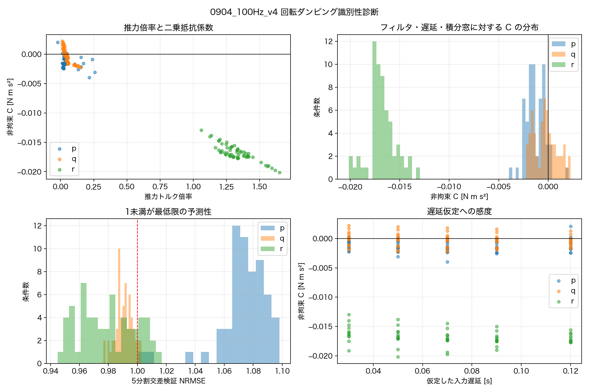

# 飛行ログによる回転ダンピング `Cp/Cq/Cr` の回帰同定

- **対象ログ**:
  - `tools/0904_v12.csv`
  - `tools/0904_v11.csv`
  - `tools/0904_100Hz_v4.csv`
- **解析日**: 2026-09-05
- **再現スクリプト**: `tools/estimate_rotational_damping.py`
- **数値結果**: `docs/rotational_damping_sysid_results.json`
- **診断図**: `docs/rotational_damping_sysid_diagnostics.png`



## 0. 結論

今回の3ログから、物理的に妥当な `Cp/Cq/Cr` の点推定値は得られなかった。

- `0904_v12.csv` はヘッダだけで、データ行が0。
- `0904_v11.csv` は10 Hzテレメであり、既知の50 Hz dutyチャタリングが折り返して混入する。角加速度と実入力トルクを再構成できないため係数回帰から除外した。
- `0904_100Hz_v4.csv` は唯一使用可能なログだが、記録されているのはモータの**指令duty**であり、実回転数・実推力ではない。加えて指令変動の91%が50 Hz反転成分で、モータ遅れも実測されていない。
- フィルタ、入力遅延、積分窓を変えた60条件/軸の回帰で、非拘束解の `C` は大半が負になった。非負制約を課すと85–98%の条件で `C=0`境界へ張り付いた。
- したがって、現ログは「ダンピングを独立に識別する励起」を持たない。負値や0は機体に負の/ゼロの空力抵抗があるという意味ではなく、入力トルク、モータ遅れ、閉ループ応答、ダンピングを回帰が分離できていないことを示す。

**方針**: `nmpc_params.hpp` の `Cp=0.025, Cq=0.025, Cr=0.005`は今回の結果では更新しない。ただし、これらを「同定済み」とも扱わない。relaxed-hover探索では不確かな仮値として感度解析し、単一点の解を実飛行根拠にしない。

## 1. 使用可否

| ログ | 行数 | 周波数 | 使用判断 | 理由 |
|---|---:|---:|---|---|
| `0904_v12.csv` | 0 | — | 除外 | データ行なし |
| `0904_v11.csv` | 626 | 約10 Hz | 除外 | 角加速度不足、50 Hz dutyチャタリングのエイリアシング |
| `0904_100Hz_v4.csv` | 1946 | 100 Hz | 識別性診断に使用 | 角速度と6発指令dutyを同時記録 |

`0904_100Hz_v4.csv` の範囲:

- 時間: 19.45 s
- duty: 0.174–0.950
- 最大角速度: `|p|=1.081`, `|q|=0.942`, `|r|=0.431 rad/s`
- FTCなし、フェイルセーフなし

## 2. 回帰式

実装モデルは

```text
Ix pdot = tau_x - (Iz-Iy) q r - Cp p|p|
Iy qdot = tau_y - (Ix-Iz) r p - Cq q|q|
Iz rdot = tau_z - (Iy-Ix) p q - Cr r|r|
```

である。角加速度の直接差分はノイズを増幅するため、時間窓 `[t0,t1]` で積分した。

Roll:

```text
Ix (p1-p0) + integral((Iz-Iy)qr dt)
  = gain_x integral(tau_x dt)
    - Cp integral(p|p| dt)
    - bp integral(p dt)
    + bias_x (t1-t0)
```

Pitch、Yawも同形である。追加した項の意味:

- `gain`: 指令dutyから計算したトルクと実トルクの倍率。推力曲線・モータ遅れ・個体差の不一致を吸収する診断量。
- `b`: 線形粘性項。
- `bias`: 重心ずれ、モータ差、定常外乱を吸収するバイアストルク。
- `C`: 求めたい二乗空力ダンピング。

入力トルクは次で再構成した。

```text
T(u) = -0.2265 u^2 + 1.0525 u + 0.0452 [N]
tau_x = -sum(y_i T_i)
tau_y =  sum(x_i T_i)
tau_z = C_QT sum(s_i T_i)
```

使用値:

- `Ix/Iy/Iz = 1.8e-3 / 1.9e-3 / 3.0e-3 kg m^2`
- `C_QT = 5.8e-9 / 5.21e-7 = 0.01113 m`
- モータ順序 `[FR,FL,MR,ML,RR,RL]`

## 3. 感度条件

1つのフィルタ・遅延を正解と決め打ちせず、以下の全組合せを評価した。

- ゼロ位相4次low-pass: 2 / 3 / 5 / 8 Hz
- 指令→機体応答の仮定遅延: 30 / 50 / 70 / 90 / 120 ms
- 積分窓: 100 / 200 / 500 ms

合計 `4×5×3=60条件/軸`。

各条件で

1. 符号制約なし最小二乗
2. `gain>=0, C>=0, b>=0`の物理制約付き最小二乗
3. 時系列を5分割したblock交差検証

を実行した。

識別可能の暫定基準:

- 非拘束 `C` の80%以上が正
- 物理制約付き解で `C=0`境界が20%以下
- block交差検証NRMSE中央値が1未満

## 4. 結果

| 軸 | 非拘束C中央値 | Cの範囲 | C>0の割合 | 制約解C=0率 | 推力倍率中央値 | CV NRMSE | 判断 |
|---|---:|---:|---:|---:|---:|---:|---|
| Roll `Cp` | -0.00152 | -0.00398–+0.00206 | 6.7% | 85.0% | 0.032 | 1.07 | 識別不能 |
| Pitch `Cq` | -0.000274 | -0.00223–+0.00225 | 36.7% | 95.0% | 0.043 | 0.99 | 識別不能 |
| Yaw `Cr` | -0.0169 | -0.0202–-0.0130 | 0.0% | 98.3% | 1.306 | 0.98 | 識別不能 |

単位は `C: N m s^2`。

### 数値を採用できない理由

1. **符号が物理に反する。** 空力抵抗なら `C>=0`でなければならないが、Rollの93%、Pitchの63%、Yawの100%で負になった。
2. **非負制約で0へ張り付く。** これは「真値が0」ではなく、残差を説明する方向として二乗抵抗項が選ばれていないことを示す。
3. **Roll/Pitchの推力倍率が不合理。** 実測推力曲線が正しければ1付近を期待するが、中央値0.032/0.043である。入力トルクと機体応答の対応付けが成立していない。
4. **交差検証性能が低い。** NRMSE≈1は、別区間を平均値より明確に良く予測できていない。
5. **閉ループ共線性。** NMPCは角速度を打ち消す方向へ入力するため、制御トルクと`omega|omega|`が同方向に変化し、推力倍率とダンピングを分離しにくい。

Yawの推力倍率だけは1.306と同程度だが、`Cr`が全条件で負なので採用不可。`C_QT`の誤差を`Cr`へ押し込んだ結果と考えられる。

## 5. 50 Hz dutyチャタリングの影響

同じ100 Hzログの過去解析で、指令duty変動の91%が毎サンプル反転し、その約94%が姿勢に効かない方向と確認されている。

実モータはこの成分を減衰させるが、ログにあるのは減衰前の指令値である。したがって

```text
logged duty -> T(u) -> torque
```

で作った入力は実機が受けたトルクではない。low-passと遅延を振っても、未知のモータダイナミクスと各モータ差を一意に復元できない。

10 Hzの`v11`では50 Hz成分を観測できず、同じ位相を拾ってDC偏りに見える可能性がある。そのため、100 Hzログの補完には使えない。

## 6. 現在の方針

### ファームウェア

- `Cp/Cq/Cr`は変更しない。
- 現在値を実測値とは表記しない。
- 今回の回帰で得た負値や境界0を設定しない。

### relaxed-hoverオフライン探索

- nominalとして現行値を使う場合も「仮定」と明記する。
- 工学的なストレステスト範囲として、少なくとも
  - `Cp: 0–0.05`
  - `Cq: 0–0.05`
  - `Cr: 0–0.01`
  を走査する。この範囲は信頼区間ではなく、現行値の0–2倍を使う仮の不確かさ範囲。
- 1点でのみ成立する平衡は採用しない。
- 推力上限、`C_QT`、質量、慣性も同時に感度解析する。
- 特に`Cr`が大きい場合だけ成立する5発平衡は、実機根拠なしとしてNo-Goとする。

### 研究上の記述

今回の結果から主張できるのは

> 既存飛行ログへ積分形回帰を適用したが、指令dutyと実トルクの不一致および閉ループ共線性により、回転ダンピング係数は識別不能だった。

までである。`Cp/Cq/Cr`を同定した、または0に近いと結論してはいけない。

## 7. 治具なしで次回改善する最小ログ

追加飛行が可能なら、新しい治具を作らず次を行うと識別性を改善できる。

1. 50 Hzチャタリングを解消する。
2. 100 Hz以上で、できれば400 Hzの生gyroを保存する。
3. モータ指令に加えて、一次遅れ後の推定dutyまたはRPMを保存する。
4. 水平付近で小振幅の正負rateステップまたはPRBSを軸ごとに実施する。
5. スティック操作ではなく再現可能な自動シーケンスを使う。
6. 学習用と検証用で異なる入力系列を取る。

治具なしの自由飛行なので、振幅は既存フェイルセーフから十分離し、1軸ずつ短時間で実施する。

## 8. 再現方法

`Benzen_NMPC`直下で:

```bash
python3 tools/estimate_rotational_damping.py \
  tools/0904_v12.csv \
  tools/0904_v11.csv \
  tools/0904_100Hz_v4.csv
```

出力:

- `docs/rotational_damping_sysid_results.json`: 全180回帰条件と要約
- `docs/rotational_damping_sysid_diagnostics.png`: 符号、分布、交差検証、遅延感度

## 9. 今回行ったこと

- 3ログのデータ有無、周波数、列を検査。
- 角加速度の直接差分を避ける積分形剛体運動回帰を実装。
- 実測`T(u)`、モータ位置、`C_QT`から3軸入力トルクを再構成。
- フィルタ4条件、遅延5条件、積分窓3条件を全走査。
- 非拘束回帰、物理制約付き回帰、5分割block交差検証を実施。
- 物理符号、境界解率、推力倍率、交差検証から識別不能と判定。
- 再現スクリプト、全数値結果、診断図を保存。

