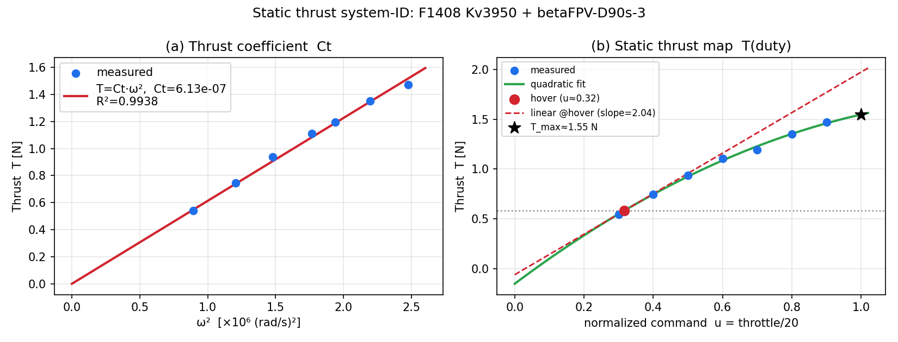

# 静推力データによるシステム同定（K=1 規約）— Ct・T_max・T(duty)

> ⚠ **2026-08-28: この文書は `F1408 Kv3950` を同定したものであり、実機のモータ（`f1404 Kv2900`）ではない。**
> 実機構成での再同定は [`thrust_sysid_f1404.md`](thrust_sysid_f1404.md) を見ること。
> 本文書は F1408 構成の記録として残す。

入力: `重量-推力計算.xlsx`（シート「ヒコロボ」）の静推力試験
対象構成: **F1408 Kv3950 + betaFPV-D90s-3**（実機構成と推定）
規約: **K=1**（正規化推力 u∈[0,1]、推力ゲイン T_max は $B_c$ が担う）
再現: `python docs/sysid_thrust.py` / 図: `docs/sysid_figs/thrust_sysid.png`



---

## 1. 結果サマリ

| 量 | 同定値 | 備考 |
|---|---|---|
| 推力係数 **Ct** | **6.13×10⁻⁷ N·s²/rad²** | $T=C_t\,\omega^2$、R²=0.994（図a） |
| **T_max**（duty=1 の1モータ推力） | **≈1.55 N**（実測最大 1.47 N @duty0.90） | 2次外挿。$B_c$ の推力ゲイン |
| ホバー動作点 | duty ≈ **0.27**, ω ≈ 895 rad/s（≈8540 rpm）, T=0.490 N | **機体0.300kg・6発**（実機実測）|
| **ホバー近傍の実効ゲイン** dT/du | **≈2.12 N/unit-duty** | 線形 $B_c$ 用（後述、重要） |
| 推力マージン T_max/T_hover | ≈3.16 | 耐故障に十分 |

### ホバー点の計算根拠
1モータあたりホバー推力 $T_{hover}=M g/6$（$M$=機体質量, 6発）。duty は 2.2節の $T(u)$ を $T_{hover}$ について解いて得る。
$M$ は**実機実測 0.300 kg** を採用（旧版は params の 0.356 kg を使用していたため duty≈0.32/マージン2.66 だった）。

**耐故障時の推力収支**（300g、残存モータで均等分担する目安）:

| ケース | 各モータ推力 | duty | 判定（上限0.95）|
|---|---|---|---|
| 健全（6発） | 0.490 N | 0.27 | 余裕大 |
| 1発故障（5発） | 0.589 N | 0.32 | 余裕大 |
| 2発故障（4発） | 0.736 N | 0.39 | まだ余裕 |

※ヘキサはトルク均衡の制約で実際は単純な均等分担にならない。あくまで推力収支の上限目安。

> 現コード値との差: `Ct=8.3e-7`（別プロペラ想定）→ **6.13e-7 に更新**。
> `T_max=2.725`（仮値）→ 下記の考え方で **1.55 か 2.04** を選択。

---

## 2. 同定の中身

### 2.1 Ct（推力係数） — 換算不要で確定
$T = C_t\,\omega^2$ を原点通過で最小二乗フィット（図a）。R²=0.994 で非常に良好。
これは**プロペラ固有**の物理量でスロットル目盛りの解釈に依存しないため、最も信頼できる出力。
（f1404 でも同一プロペラなら同じ Ct になることを確認済み＝妥当性の裏付け。）

### 2.2 T(duty)（静推力マップ） — 図b
`duty = throttle/20` の仮定で 2次フィット:
$$
T(u) \approx -0.911\,u^2 + 2.612\,u - 0.152 \quad[\mathrm{N}]
$$
高 duty 側で凹（RPM が上限に飽和して推力の伸びが鈍る）。duty=1 外挿で T_max≈1.55 N。

### 2.3 ★ K=1 の線形 $B_c$ に入れる値（重要）
現在の $B_c[2,k]=-y_k\,T_{max}/I_x$ は「推力が duty に**線形**」を仮定する。
しかし実推力は duty に対し非線形（図b）。NMPC は**ホバー近傍で微小な差動推力**を出すので、
$B_c$ に入れるべきは duty=1 の推力ではなく、**ホバー点での接線勾配**:
$$
\left.\frac{dT}{du}\right|_{u=u_{hover}} \approx 2.12\ \mathrm{N/unit\text{-}duty}\quad(M=0.30\,\mathrm{kg})
$$
→ **姿勢制御の実効 T_max として 2.12 を推奨**（duty=1 値 1.55 ではなく）。
図bの赤破線がこの線形近似。ホバー近傍で実測とよく一致する。

---

## 3. 実装の2案（K=1）

**案A: 線形 $B_c$ のまま（推奨・最小変更）**
- `physical::T_max = 2.04f`（ホバー接線勾配）、`Ct = 6.13e-7f`。
- ホバー近傍で正確。大舵角では誤差が出るが、姿勢制御用途では実用十分。

**案B: アクチュエータ線形化（より厳密）**
- ファームで指令 u（=正規化推力）→ 実 duty を静マップの逆関数 $\text{duty}=T^{-1}(u\,T_{max})$ で変換。
- これで「推力が u に線形」が**定常で厳密成立**し、`T_max=1.55f`（duty=1 値）を使える。
- このデータ（図b）が逆マップの元になる。全 duty 域で整合するが実装がひと手間。

---

## 4. 注意・要確認

1. **スロットル目盛り→duty 対応**: 本解析は `throttle/20` を仮定。ホバー duty≈0.32 が
   `cost::schedule::u_low=0.30` と、目盛り18→0.90 が `U_duty_max≈0.95` と整合するため妥当と推定。
   実際の servo tester / PWM 対応が分かれば `FULL_SCALE` を直して再フィット可（数値は変わりうる）。
2. **機体質量**: 本版は実機実測 **0.300 kg** を採用（params は 0.356、Sheet1 は ~0.40）。
   ホバー duty は質量に敏感（300g→0.27, 356g→0.32, 400g→0.35）。最終質量で確定を。
3. **反トルク比 C_QT（ヨー）**: このデータにトルク計測が無いため同定不可。現状値/推定を維持。
4. **動特性（時定数 τ）は不可**: 本データは定常点のみ。τ は別途ステップ/チャープの過渡応答
   （≥200–500 Hz 記録）が必要（`motor_lag_sysid_analysis.md` 参照）。
5. **電圧依存**: 同一目盛りでも電圧で RPM・推力が変わる。飛行時バッテリ電圧付近の行で同定を。

---

## 5. `nmpc_params.hpp` 反映案（案A採用時）

```cpp
constexpr float Ct    = 6.13e-7f;   // [N*s^2/rad^2]  D90s-3 実測 (旧 8.3e-7)
constexpr float T_max = 2.12f;      // [N] ホバー接線勾配 dT/du|hover (K=1 線形Bc用, M=0.30kg)
// 参考: duty=1 実推力 ≈1.55N, ホバー duty≈0.27, 推力マージン≈3.16
// C_QT は本データからは同定不可 → 現状維持
```
