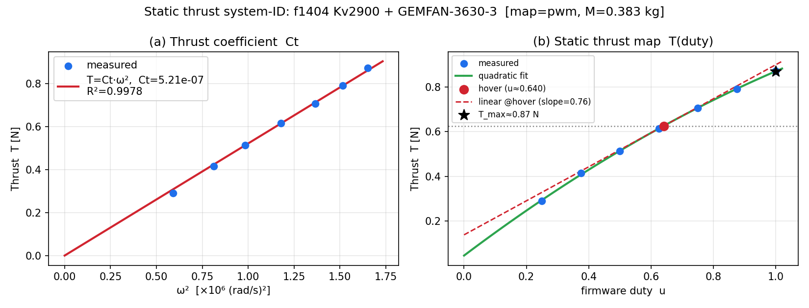

# 静推力の再同定（実機モータ f1404 Kv2900）— Ct・T_max・T(duty)

- **日付**: 2026-08-28
- **入力**: `重量-推力計算.xlsx` シート「ヒコロボ」
- **再現**: `../../../../NMPC_simulation/.venv/bin/python sysid_thrust.py --prop "GEMFAN-3630-3"`
- **旧版**: [`thrust_sysid_K1.md`](thrust_sysid_K1.md)（**対象モータが F1408 Kv3950 で実機と別物**）



---

## 0. 結論

| 量 | 旧版（F1408） | **今回（f1404 実機）** |
|---|---|---|
| 対象モータ | F1408 Kv3950 | **f1404 Kv2900** |
| プロペラ | betaFPV-D90s-3（推定） | **GEMFAN-3630-3**（6発実験と一致・§2） |
| **Ct** | 6.13×10⁻⁷ | **5.21×10⁻⁷** N·s²/rad²（R²=0.998） |
| T_max（duty=1） | 1.55 N | **0.87 N** |
| ホバー duty（M=0.356) | — | **0.583** |
| **dT/du @hover（線形 B_c 用）** | 2.12 | **0.79 N/unit-duty** |
| 推力マージン | 3.16 | **1.50** |

> **`nmpc_params.hpp` の `T_max = 2.04f` は実機の約 2.6 倍。**
> `B_c ∝ T_max` なので、NMPC は**自分の操作権限を 2.6 倍に過大評価**している。
> → 必要な Δu の 1/2.6 しか出さない。**応答が鈍る側**である（発振側ではない）。
>
> ⚠ [`docs/20260828_benzen_nmpc_review.md`](../../../../../docs/20260828_benzen_nmpc_review.md) §C1 では
> 「T_max を過小に見積もると出しすぎる」と書いたが、**実際の誤差は逆向き（過大）**だった。訂正する。

---

## 1. スクリプトの修正点

`sysid_thrust.py` は**そのままでは実行できなかった**。修正内容:

| # | 旧 | 新 |
|---|---|---|
| 1 | 入出力が別セッションの絶対パス `/sessions/dreamy-cool-sagan/mnt/...` | `__file__` からのリポジトリ相対パス |
| 2 | 対象が `F1408 Kv3950`（**実機と別モータ**） | 既定を `f1404 Kv2900` に。`--motor` / `--prop` で切替 |
| 3 | `duty = 目盛り/20` 決め打ち | サーボテスタのパルス幅経由に一般化（`--map pwm`）。旧仮定は `--map ratio` で再現可 |
| 4 | 質量が定数 | `--mass`。`--list` でデータのある組を列挙 |

### 回帰確認（移植で数値が変わっていないこと）

旧版と同じ条件で実行し、`thrust_sysid_K1.md` の記載値を**再現**した。

```
$ python sysid_thrust.py --motor "F1408 Kv3950" --prop betaFPV-D90s-3 --map ratio --mass 0.300
Ct = 6.127e-07 (旧記載 6.13e-7)   T_max = 1.548 N (旧 1.55)
ホバー duty = 0.272 (旧 0.27)     dT/du = 2.116 (旧 2.12)
```

**計算部分は書き換えていない。**変えたのは入力の選び方と duty 換算だけである。

---

## 2. プロペラの特定 — 6 発実験との突き合わせ

シート「ヒコロボ」の右側に **「メインミッション（510）」の 6 発実験**があり、
総推力 **532 g**（t=30 s、以後バッテリ電圧低下で 470 g まで低下）が記録されている。

各構成の「1 発最大 × 6」と突き合わせた:

| 構成 | 1 発最大 [N] | 6 発合計 [g] | 532 g との差 |
|---|---|---|---|
| f1404 + betaFPV-D90s-3 | 0.662 | 405.0 | −127.0 |
| **f1404 + GEMFAN-3630-3** | **0.873** | **534.0** | **+2.0** |
| f1404 + Hqprop-T3.5×3.5×3GR | 0.639 | 390.6 | −141.4 |
| f1404 + BETAFPV-HQ-3520-3 | 0.699 | 427.8 | −104.2 |
| F1408 + betaFPV-D90s-3 | 1.472 | 900.0 | +368.0 |

**GEMFAN-3630-3 が誤差 0.4 % で一致する。** 旧版が仮定していた betaFPV-D90s-3 では 127 g 足りない。

> ⚠ シートの `F1408 Kv3950 + BETAFPV-HQ-3520-3` は 1 発 13.78 N（6 発 8.4 kg）となっており、
> **入力ミスと思われる**。使わないこと。

---

## 3. 結果（f1404 Kv2900 + GEMFAN-3630-3）

### 3-1. Ct — 換算に依存しないので最も信頼できる

$$T = C_t\,\omega^2,\quad C_t = 5.209\times10^{-7}\ \mathrm{N\,s^2/rad^2},\quad R^2=0.9978$$

同じプロペラなら F1408 でも同じ Ct になるはずで、実際
`betaFPV-D90s-3` は f1404 で 6.113e-7、F1408 で 6.127e-7（差 0.2 %）。**データの整合性は良い。**

**現行 `nmpc_params.hpp` の `Ct = 6.13e-7` は betaFPV-D90s-3 の値**であり、
プロペラが GEMFAN-3630-3 なら **5.21e-7 に更新すべき**。

### 3-2. T(duty) と実効ゲイン

`--map pwm`（目盛り 6..18 → 1300..1900 µs → ファーム duty 0.25..1.00）:

$$T(u) \approx -0.2265\,u^2 + 1.0525\,u + 0.0452\ \mathrm{[N]}$$

| 機体質量 | ホバー duty | dT/du @hover | 推力マージン |
|---|---|---|---|
| 0.300 kg | 0.471 | **0.839** | 1.78 |
| **0.356 kg**（params） | **0.583** | **0.788** | **1.50** |
| 0.390 kg（Sheet1 の機体重量） | 0.655 | 0.756 | 1.37 |

`--map ratio`（旧仮定）だと dT/du は 0.95–1.05 になる。**換算の仮定で 25 % 変わる。**

### 3-3. ファームのスロットルとの対応

`T_ref = 0.5·V·r`、`T_ref_coe = 0.6` → `common_duty = 2.22·r`（r はスティック比）。

| | duty | スティック比 r |
|---|---|---|
| ホバー（M=0.356） | 0.583 | **0.263** |
| ホバー（M=0.300） | 0.471 | 0.212 |
| duty 上限 0.95 | 0.950 | 0.428 |

**ホバーがスティック 26 %、飽和が 43 %。** 姿勢制御に使える上側の余裕は約 1.6 倍しかない。
推力マージン 1.50 と整合する。

---

## 4. `nmpc_params.hpp` 反映案

```cpp
constexpr float Ct    = 5.21e-7f;   // GEMFAN-3630-3 実測 (旧 6.13e-7 = betaFPV-D90s-3)
constexpr float T_max = 0.79f;      // dT/du|hover, f1404+GEMFAN-3630-3, M=0.356kg, map=pwm
// 参考: duty=1 実推力 0.87 N / ホバー duty 0.583 / 推力マージン 1.50
```

⚠ **`C_QT = CQ / Ct` も動く。** `CQ = 3.0e-8` は未測定の仮値なので、
Ct を 6.13e-7 → 5.21e-7 にすると `C_QT` は 0.0361 → **0.0576**（+60 %）になる。
ヨー軸の権限見積もりが変わるので、**CQ を測るか、C_QT を据え置くかを明示的に決めること。**

---

## 5. 残る不確かさ（優先順）

| # | 項目 | 影響 | 解消方法 |
|---|---|---|---|
| **U1** | **スロットル目盛り → パルス幅の対応が未確認** | `T_max` が ±25 % | ベンチのサーボテスタの出力をオシロで測る。または実機のホバー duty を測って接線を取り直す |
| **U2** | **機体質量が 3 通り書かれている**（params 0.356 / 旧同定 0.300 / Sheet1 0.390） | ホバー duty が 0.47–0.66 | 実測 1 回 |
| **U3** | プロペラの確定 | Ct が ±18 % | 実機のプロペラ型番を確認（6 発実験からは GEMFAN-3630-3） |
| **U4** | 反トルク係数 CQ | ヨー権限 | このデータにトルク計測が無く同定不可 |
| **U5** | 電圧依存 | 同一目盛りでも推力が変わる | 飛行時電圧付近の行で同定する（本データは 7.4 V 2S） |

**U1 と U2 は「係留してホバー直前まで上げ、`T_ref × T_ref_coe` を読む」1 回の実験で同時に解ける。**
そのとき `T_max = (M·g/6) / hover_duty` ではなく、**接線勾配 `dT/du`** を使うこと（§3-2）。

---

## 6. 波及

`program/sil/host/plant.py` も `T_max = 2.04` を使っている。
**SIL の姿勢応答は実機より 2.6 倍機敏に出ていた**ことになる。
SIL で得た数値（バンク角不足 47 %、Ti スイープ、自動機動の軌跡）は
**この係数を直してから読み直す必要がある。**

---

## 7. CQ（反トルク係数）は推定できるか — できる

**2026-09-04 追記。** このデータにトルク計は無いが、**電流**と**推力**から 2 つの独立な経路で推定でき、
両者はよく一致する。

### 7-1. 経路A — 電気入力から

$$C_Q = \frac{\eta\,V I}{\omega^3}\quad(\eta = \text{モータ+ESC 効率})$$

| 目盛り | I [A] | P_elec [W] | ω [rad/s] | η=0.50 | η=0.65 | η=0.80 |
|---|---|---|---|---|---|---|
| 6 | 0.82 | 6.07 | 769 | 6.68e-9 | 8.68e-9 | 1.07e-8 |
| 12 | 1.69 | 12.51 | 1086 | 4.89e-9 | 6.36e-9 | 7.82e-9 |
| 18 | 2.52 | 18.65 | 1285 | 4.40e-9 | 5.72e-9 | 7.03e-9 |

高回転ほど値が下がるのは、**モータ効率が負荷とともに上がる**ため（η を定数にした近似の限界）。

### 7-2. 経路B — 運動量理論から（電気系の効率に依存しない）

$$P_{ideal}=\frac{T^{1.5}}{\sqrt{2\rho A}},\quad P_{mech}=\frac{P_{ideal}}{FM},\quad C_Q=\frac{P_{mech}}{\omega^3}$$

GEMFAN-3630-3（直径 3.6 in = 0.0914 m、ディスク面積 6.56e-3 m²）:

| FM | CQ | C_QT = CQ/Ct |
|---|---|---|
| 0.40 | 7.31e-9 | 0.0140 |
| **0.55** | **5.32e-9** | **0.0102** |
| 0.70 | 4.18e-9 | 0.0080 |

### 7-3. 両経路の整合

$$\frac{P_{ideal}}{P_{elec}} = \eta \times FM = 0.20\ (\text{目盛り}6) \to 0.35\ (\text{目盛り}18)$$

小型モータの η≈0.6–0.7、小径プロペラの FM≈0.45–0.55 なら η×FM≈0.27–0.39。
**実測の 0.20–0.35 はこの範囲に収まっており、データは自己整合している。**

### 7-4. 飛行時の動作点での推定

ホバー 1 発推力 0.626 N（機体 383 g）→ ω = 1096 rad/s（10470 rpm）。目盛り 12–14 に相当。

| 経路 | CQ |
|---|---|
| A（η=0.65） | 6.2e-9 |
| B（FM=0.55） | 5.4e-9 |

$$\boxed{C_Q \approx 5.8\times10^{-9},\quad C_{QT}=C_Q/C_t \approx 0.011\ \mathrm{m}}$$

### 7-5. 現行値との差

| | CQ | Ct | C_QT |
|---|---|---|---|
| 現行 `nmpc_params.hpp` | 3.0e-8（**未測定の仮値**） | 5.21e-7 | **0.0576** |
| 推定 | **5.8e-9** | 5.21e-7 | **0.0111** |

**`C_QT` を 5.2 倍 過大に見積もっている。**

`nmpc_model.cpp` の `B_c(4,k) = kS[k]·C_QT·T_max/Iz` はヨーの操作権限そのもの。
1 発・duty 1 あたりのヨー角加速度は

| | ヨートルク | 角加速度 |
|---|---|---|
| 現行 C_QT=0.0576 | 0.0599 N·m | 1144 deg/s² |
| 推定 C_QT=0.0111 | 0.0116 N·m | 221 deg/s² |

⚠ **`C_QT` を下げると、同じヨー誤差に対して制御器はより多くの duty を要求するようになる。**
0904_v1 では既にヨーが Δu の 84.7 % を消費していたので、
**先に `Psi_ref` のスケールを下げて（済）、飽和が減ったことを確認してから `CQ` を直すこと。**

### 7-6. 残る不確かさ

- η（モータ+ESC 効率）と FM（プロペラのフィギュア・オブ・メリット）は**どちらも仮定値**。
  両経路が一致するのは整合性の証拠だが、**絶対値の保証にはならない**
- **確実なのは反力トルクを直接測ること。** ベンチにトルクセンサ、または
  機体を吊るしてヨー軸の応答（既知の duty 差動 → 実測角加速度）から `C_QT·T_max/Iz` を同定する。
  **後者なら追加のハードは不要で、`Iz` の誤差も同時に吸収できる**（二線振り子の `Iz` も推定値のため）
